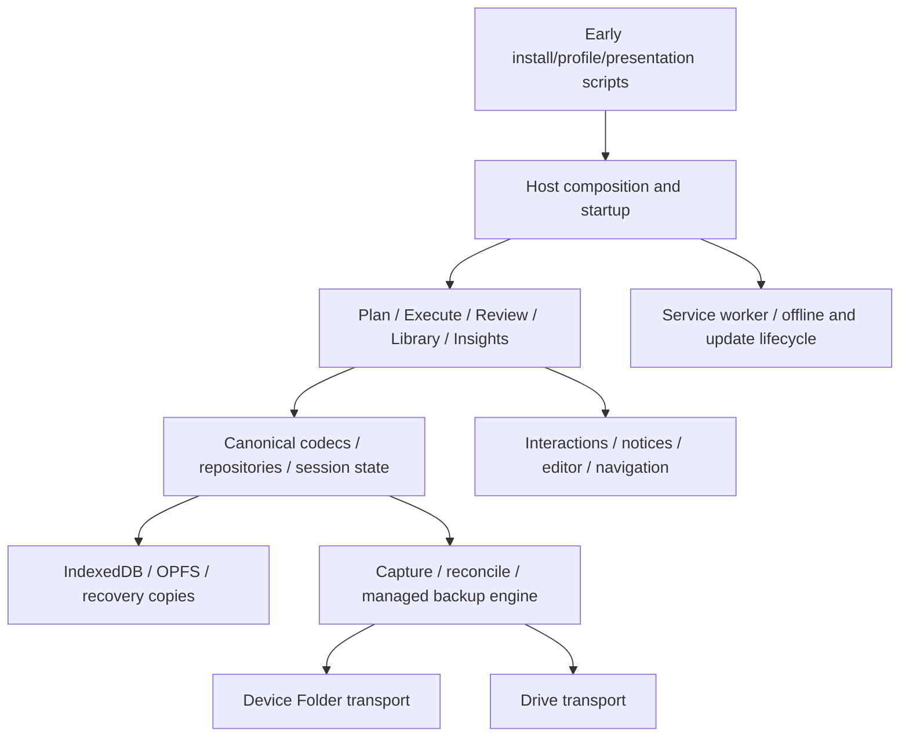

# Study Director — current architecture

This is the current source/runtime map for `TS-Conversion`. [Product purpose](PRODUCT.md), [data contracts](DATA-CONTRACTS.md) and [conversion status](../TS-CONVERSION-EXECUTION.md) are separate. The documentation review used source checkpoint `4136ba5`; it is not a fresh whole-app correctness or device audit.

## Composition and source ownership

The host in `source/host/main.js`, composed into the `source/app.html` shell, constructs private registry modules through explicit capability ports. Modules do not freely resolve one another. `build/module-manifest.mjs` defines source paths, registration order and dependency edges; `contracts/` defines durable identities and limits. Runtime identity/version/shape checks remain necessary even where TypeScript checks callers.

| Layer | Source owners | Boundary |
| --- | --- | --- |
| Bootstrap/composition | `source/app.html`, `source/host/`, `source/core/internal.js`, `startup.js`, `profiles.js` | Early scope/presentation before storage or hydration; explicit feature/service wiring |
| Core data | `domain.ts`, `record-codecs.ts`, `persistence.ts`, `app-meta.ts`, `repositories.ts`, `repositories-notes.ts` in `source/core/` | Unknown stored input → validated canonical records; strict transactions and stable identities |
| Session/execution | `ownership.ts`, `mutation-coordinator.ts`, `session-lifecycle.ts`, `timer-state.ts`, `timer-engine.ts`, `pomodoro.ts`, `practice-pacer.ts`, plus host adapters | One writable owner; portable session evidence and local execution state |
| Features | `plan.js`, `review.js`, `library.js`, `note-links.js`, `note-export.js`, host UI | User actions and presentation; durable writes through domain services |
| Editor/files | Authored `rich-text/`, `attachments.ts`, `asset-storage.ts`, `attachment-ingest.ts`, `asset-maintenance.ts`, `portable/` | Rich-text serialization, references, verified bytes, scoped worker/file lifetimes |
| Backup/recovery | `backup-capture.ts`, `backup-codec.ts`, `managed-repository.ts`, `backup-provider.ts`, `backup.ts`, recovery/journal/reconciliation modules | Verified captures, publication, current-format restore and rollback |
| Background/presentation | `operation-lifecycle.ts`, `repository-background.ts`, diagnostics, `notice-coordinator.js`, `interactions.js`, `backup-presentation.js`, `audio-engine.js` | Explicit job outcomes, priority/settlement and one notification policy |
| External authored features | `source/external/{drive,insights-model,insights,guide,glass,aurora}.js` | Transport, analytics, help and presentation contracts |
| Platform/build | `source/platform/sw.js`, `pwa-lifecycle.js`, `native-capabilities.js`, `build/` | Offline/update protocols, capability checks, deterministic output/CSP |

File extensions reflect the current mixed-source boundary. [TypeScript tooling](TYPESCRIPT.md) explains admitted implementations; [Phase 5](typescript/PHASE-5.md) owns remaining runtime conversion. Generated `source/external/{wordgard,rich-text,search-worker,image-worker,attachment-worker,export-worker}.js` are built from reviewed authored/vendor inputs; do not edit them by hand.

## Startup and active lifecycle

The five authored scripts in `source/host/` are inserted inline by `build/host-source.mjs` at their manifest-marked positions in `source/app.html`. They capture install events, establish profile scope, initialize the presentation kernel, synchronize presentation metadata, and compose the main application. Their order and synchronous first-paint behavior matter. Hydration follows storage availability/unsupported-data checks and ownership setup; feature controllers consume the resulting state. Build-time composition preserves their original scope and positions without additional requests. Later restructuring must preserve events, public capabilities, CSP and cache identity; the Phase 5 register assigns their owners.

An Active Session names the installation running it. That installation may rehydrate the timer; another device displays the shared session until an explicit handoff/Continue Here. A Plan draft equal to the applied schedule remains live; a different draft remains editing state. Host adapters coordinate notes, timer controls, restore and visibility changes. [Backup/sync](BACKUP-ENGINE.md) owns the cross-device rules.

## Persistence and destructive operations

[DATA-CONTRACTS.md](DATA-CONTRACTS.md) owns the current topology, profile scoping, canonical/recovery/derived distinctions, unknown-input handling and immutable safety rules. Every destructive path must inspect those contracts and adjacent consumers. Temporary UI or cache state never becomes authority to delete durable data.

Library clear captures a durable rollback image before mutation. Restore uses validated provenance, safety publication where required, a revision fence and journals; local verification must finish before retiring recovery state. Unknown verification retains the journal and blocks unsafe continuation. Notes use the shared save lane, with storage-specific rescue paths; see [NOTES.md](NOTES.md).

## Repository and background boundaries

Device Folder and Drive share one repository format, retention engine, recovery orchestration and scheduling policy. Their adapters remain distinct because filesystem permissions and remote authorization/consistency differ. Repository state is scoped to actual destination identity; stale caches or pending intent cannot silently carry into a recreated destination.

Foreground work preempts background work and waits for real settlement. A timeout ends the caller's wait, not the executor's ownership. Cooperative budgets bound opportunities at safe boundaries; native operations may remain uninterruptible. [BACKGROUND-OPERATIONS.md](BACKGROUND-OPERATIONS.md) owns these lifecycle and diagnostic details; [BACKUP-ENGINE.md](BACKUP-ENGINE.md) owns publication, history, sync and retention.

## Presentation and editor boundaries

The Library contains Notes, Days and Data. Feature controllers own user operations, focus and local view state. Notifications are coordinated centrally; dismissing feedback does not cancel an operation. [NOTIFICATIONS.md](NOTIFICATIONS.md) owns the producer/delivery contract.

Theme selects semantic color roles; presentation selects their appearance, typography, shape and motion. Director, Glass and Aurora use explicit presentation identities; early preference restoration avoids first-paint inconsistency. Appearance changes use a synchronous transition boundary; asynchronous feature loading remains outside it. Reduced motion, keyboard access, contrast and responsive behavior require targeted verification, not an assertion of universal compliance.

Authored editor code consumes Wordgard through the existing adapter/facades and documented build rewrites. Upstream `vendor/wordgard/**` stays immutable for this program. The generated editor and Wordgard modules have separate identities; the minified build may combine them through its established pipeline. [Adapter notes](../rich-text/wordgard-patches/README.md) own that boundary.

## PWA, workers and diagnostics

The service worker owns shell caching, update/client coordination and notification-click routing; it is not a database authority or guaranteed closed-app job runner. Update activation coordinates client settlement and pending backup work before reload/cache retirement. Worker requests/replies and progress are validated at message boundaries; late responses cannot revive cancelled operations. `portable/` contracts remain DOM-free where shared outside the browser main thread.

Developer diagnostics summarize operational state, outcomes and verification coverage without study payloads, private filenames or unrestricted error text. Historical verification timestamps describe prior events, not current health. Review's study report remains distinct from developer diagnostics.

## Evidence and historical context

Use [verification](VERIFICATION.md) for executable checks and the [execution record](../TS-CONVERSION-EXECUTION.md) for results actually run. [Product history](history/PRODUCT-DEVELOPMENT.md) preserves earlier detailed explanations, measurements, changes and superseded policies. It must not be read as an active migration plan or current certification. No module rewrite or product redesign is implied by this documentation reorganization.
