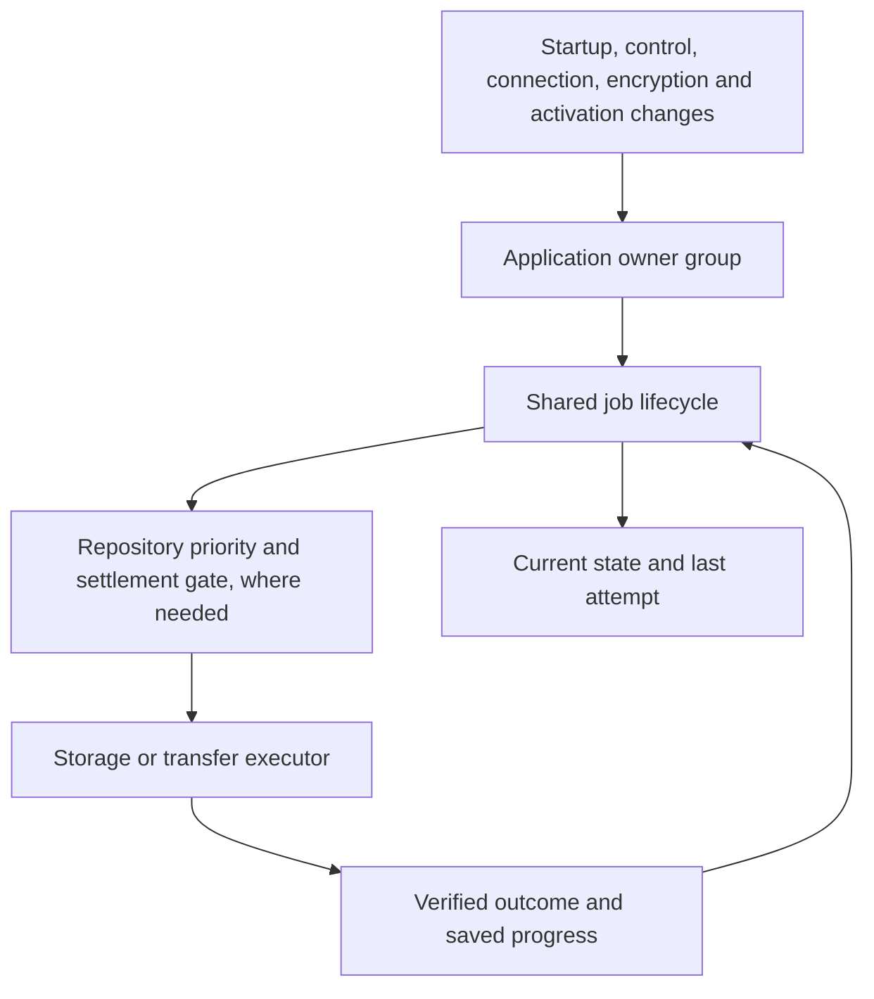
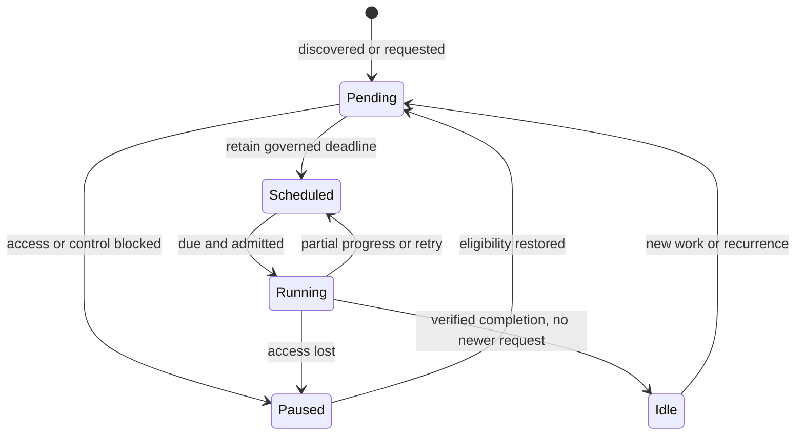

# Background coordination

Background work belongs to the open application. It is not an operating-system service that is guaranteed to run after the app closes. Pending durable work is rediscovered when the app opens and its required access is available.

## Ownership

`operation-lifecycle.createJob` owns pending opportunities, a coalesced deadline, eligibility, one executor promise and its explicit outcome. `createGroup` reconnects the application owners after eligibility changes, isolating a failed owner's wake-up from other owners and foreground completion. `repository-background` adds priority, reservation, preemption and real settlement for each repository. Transport and storage modules own the actual proof of safety, durable progress and provider-specific retry cadence.

There is one timer owner per job. Provider registration and hook configuration establish all available provider jobs; connection notifications wake cleanup, integrity and pending publication together. Foreground release wakes the repository owner. It does not require a history or backup caller to remember a second completion handoff.

A future recurrence counts as a pending opportunity. Current execution and the previous attempt are separate: a job can be scheduled while its last outcome is unavailable. An unavailable metadata read never establishes that work is absent. Named permission/control/key blockers sleep until an eligibility event; an unknown availability failure retains a bounded retry.

## Jobs and policies

| Job / owner | Pending work and progress | Execution and recovery |
| --- | --- | --- |
| Canonical data maintenance / host | Strict pending/completion metadata; canonical notes, session, fallback and deletion recovery | Cooperative 20-second opportunity; 24-hour successful cadence; failure retry; foreground checks between phases |
| Attachment cleanup / asset maintenance | Durable pending/success markers; in-memory reference and directory continuation under a stable source proof | Five seconds / 128 units; strict references, write tokens, journals and leases; reader release, control return and daily discovery reconnect work |
| Attachment verification / host | Strict saved findings and inventory-bound scan cursor | Five seconds / 128 units; warnings survive unavailable reads and partial scans; 24-hour full-scan cadence |
| Scratch collection / file store | Durable journal/hash references, reader/producer/download pins; in-memory directory continuation | Startup orphan discovery; five seconds / 128 entries; fresh retained-reference read under each candidate lock; failed reads retry without deletion |
| Device Folder automatic backup / controller | Source revisions, original quiet/urgent deadline and verified completion metadata | Quiet window (30 minutes in production), three-second urgent trigger; permission/control/key blockers; progressive writes remain interruptible; capped infrequent retry continues after repeated temporary failures |
| Drive convergence / provider runtime | Strict pending requests with compare-before-clear completion | Noninteractive access only; no total housekeeping deadline; existing request/worker progress watchdogs and cancellation remain; failure backoff caps at 30 minutes |
| Device / Drive retention and object GC / repository coordinator | Strict identity-bound cleanup intent, reason, eligibility and request fencing | Short bounded cleanup passes, shared classification for grace, contention, failure and uncertainty; reconnection wakes cleanup independently of publication |
| Device / Drive integrity / repository coordinator | Identity-bound quarantine, inventory/cursors and resumable stored/plain hash checkpoints | 120-second opportunity with object/byte/segment limits; 14-day full-scan cadence; unavailable and corruption remain distinct; foreground preemption preserves completed progress |
| Search, attachment, file and Insights workers / their clients | Request identity and caller lifetime; obsolete requests are deliberately cancelled | Existing worker watchdogs, cancellation, retired-worker fencing and fallback remain. These transient requests are not durable periodic jobs |

Housekeeping can stop between bounded units and continue later. A healthy upload is allowed to finish while remaining cancellable; a 30-second total timeout no longer repeatedly destroys the progress of a 45-second upload. Native browser calls still have cooperative cancellation boundaries: a settlement timeout does not pretend a native operation or its lock has finished.

Device Folder and Drive share the coordination contract, not transport assumptions. Device Folder requires a persisted directory handle and browser permission. Drive requires a valid authorized repository connection and uses its existing bounded network/progress controls. Attachment cleanup proves local reachability before reclaiming data. Repository identity, immutable objects/commits, deletion reconciliation, recovery journals and verified rollback remain storage responsibilities.

## Invariants and evidence

| Expected rule | Authoritative targeted verification |
| --- | --- |
| Unknown reads cannot authorize deletion or erase warnings | `storage/background-gc-reliability`, `storage/attachment-reference-recovery`, `exports/scratch-gc`, `library/library-clear`, `backup/capture-safety` |
| Every pending job has a deadline or an identified blocker and wake-up | `unit/app/operation-lifecycle`, `unit/backup/repository-background`, production-runtime `backup/pending-provider-recovery` |
| Healthy finite work eventually finishes once required access is available | Lifecycle combinations of workload, failures and blockers; Device Folder recovery after repeated failures; real binary-pipeline 45-second Drive publication in `backup/repository-checkpoint` |
| Foreground work safely takes priority without releasing unsettled storage | Repository coordinator settlement tests; Device Folder safety/recovery tests; assembled Drive cancellation and retry; worker-client lifetime tests |
| Completion cannot clear a newer request | Common lifecycle late-request tests, maintenance request fencing, durable provider compare-before-clear tests, Device source-revision tests |
| Diagnostics reflect execution, retained work and unavailable data | `unit/backup/backup-operation-diagnostics` and `integration/ui/background-diagnostics`; typed safe fields and privacy assertions |
| Exact dependency composition remains functional | Assembled BackupModule with live integrity hooks, successful history, actual integrity execution and verified publication; generated source build/syntax checks |

Developer diagnostics belong to Library → Data & Backup → Copy diagnostics. Review → Copy report remains study-only. No background implementation details have been added to that user report.

These tests establish the listed contracts under deterministic access, I/O, cancellation and failure schedules. They do not establish real-browser timing or behavior on a particular device. Browser acceptance and full regression are intentionally separate from this targeted coordination pass.
