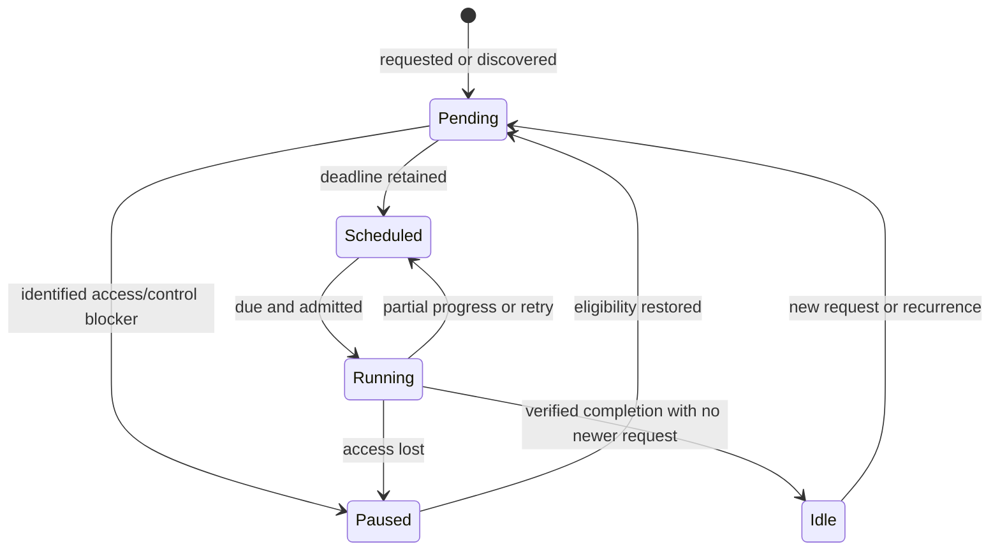

# Background operations and settlement

Background work belongs to the open application, not a guaranteed operating-system service after it closes. Pending durable work is rediscovered when the app runs with the required access. [Architecture](ARCHITECTURE.md) maps owners; [data contracts](DATA-CONTRACTS.md) defines safety; [backup](BACKUP-ENGINE.md) owns retention/publication policy.

## Common lifecycle

`operation-lifecycle.ts` owns pending opportunities, coalesced deadlines, eligibility, an executor promise and explicit outcomes. Groups wake owners after eligibility changes without letting one failure suppress others. `repository-background.ts` adds priority, reservation, preemption and actual settlement for each repository. Storage/transports own their safety proof, progress and access requirements.

There is one timer owner per job. A future recurrence is pending work, not current execution. Unknown metadata is unavailable, not proof that nothing is pending. Current state (`running`, `paused`, `scheduled`, `pending`, `idle`) and last attempt outcome (`completed`, `yielded`, `deferred`, `unavailable`, `failed`, `cancelled`) answer different questions. Partial integrity work is not a complete scan.

## Job owners

| Job | Owner and durable/in-memory progress | Targeted evidence locations |
| --- | --- | --- |
| Canonical maintenance/recovery | Host + `repositories.ts`; strict request/completion metadata, source-fenced phase continuation and current rescue/deletion replay | `tests/integration/storage/data-maintenance.mjs`, `deletion-recovery.mjs` |
| Attachment cleanup | `asset-maintenance.ts`; complete reference proof, source-fenced in-memory continuation and fresh opportunities after lifecycle changes | `tests/integration/storage/background-gc-reliability.mjs`, `attachment-reference-recovery.mjs` |
| Attachment integrity | Host/storage; persisted findings and inventory-bound scan progress, preserving warnings on partial/unavailable reads | `tests/integration/storage/attachment-integrity-audit.mjs` |
| Scratch collection | Authored portable file store/client; active pins/leases/journal references, startup discovery and bounded traversal | `tests/integration/exports/scratch-gc.mjs` |
| Automatic backup/convergence | Provider engine; change-time rule, retained request identity, connection/key/ownership blockers and capped retry policy | `tests/integration/backup/automatic-provider-backup.mjs`, `pending-provider-recovery.mjs` |
| Repository retention/object reclamation | Shared repository engine/coordinator; identity-bound cleanup intent, complete history/reachability and renewable protection | `tests/integration/backup/repository-checkpoint.mjs` |
| Repository integrity | Shared coordinator + integrity continuation; inventory/cursors/hash checkpoints and quarantine bound to repository identity | `tests/integration/storage/integrity-continuation.mjs`, `repository-integrity-state.mjs` |
| Transient search/image/attachment/export/Insights work | Worker clients; request identity, cancellation and generation fencing | Worker/export/search/Insights unit, integration and browser suites |

Paths identify relevant existing checks, not a statement that they were executed during a documentation pass. Exact commands/results belong in the [execution record](../TS-CONVERSION-EXECUTION.md).

## Admission, priority and bounded work

The host's shared background gate checks startup and writable ownership; jobs add only their own capability/key/connection conditions. Housekeeping also observes unresolved browser-data clearing and held unsupported data. Current canonical recovery may run where destructive housekeeping must wait. Profile collection has its own no-live-owner rule.

Foreground backup/file/recovery operations suspend or preempt affected background work. Preemption waits for real settlement before handing over storage/worker ownership. A waiting caller's timeout must not unlock a still-running executor. Every retained named blocker needs an eligibility wake-up; unknown transient failure needs a bounded retry. Completion cannot clear a newer request, another provider's intent or work belonging to a different repository generation.

Work allowances are cooperative at safe units. They are separate from foreground cancellation, I/O inactivity watchdogs and coordination lease expiry. Slow successful proof of the first useful unit must not cause endless budget restarts; after useful saved progress, the next boundary may yield. Native browser calls may be uninterruptible, so budgets are not hard wall-clock guarantees.

Drive metadata calls have finite response deadlines. Observable binary-transfer progress uses byte-inactivity watchdogs rather than discarding productive long uploads; fallback capabilities can have finite total deadlines. Bounded range reads revalidate immutable version/digest/size. Exact constants belong to source policies/transports and their tests, not another independent documentation timer table.

## Recovery and cleanup proof

Interactive reads may provide rescue values on storage failure; destructive cleanup, Library rollback and complete backup capture require strict canonical evidence. A value accompanied by a read failure is not a complete reference inventory. Retire recovery data only after rereading and preserving newer/unrelated copies. A successful user save remains acknowledged if subsequent housekeeping fails.

Notes recovery checks the live model revision and save chain across awaits. Reference scans include notes/trash, sessions, days and recovery/journal use. Scratch collection respects active readers/producers/downloads. Repository cleanup verifies history and protection before deleting artifacts; unreadable and unknown states follow distinct conservative rules. [Backup retention](BACKUP-ENGINE.md#retention--one-policy-for-both-locations) selects history; it does not bypass those deletion proofs.

Durable request identities and expected-entry transactions fence retirement. A failure before the first durable write may retain only an in-memory retry until the next discovery; do not claim that state survives app closure. Current metadata schemas are validated without the retired migration adapters.

## Diagnostics and update coordination

Diagnostics separate present state, prior attempts, retained intent, partial coverage and actual completion. They must exclude private study content, arbitrary provider messages and filenames. Diagnostic failure cannot change the outcome of a successful operation. A saved verification date is historical evidence, not a current health certificate.

PWA update coordination settles clients and gives pending external work its governed opportunity before activation/reload; it is a separate protocol, not another generic cleanup job. Offline/client/cache tests must cover changes at that boundary. The app cannot promise that an OS-closing event gives every background operation time to finish.

Historical measurements and investigations are retained in [product history](history/PRODUCT-DEVELOPMENT.md). Whole-program QA and device evidence remain governed by [verification](VERIFICATION.md).
