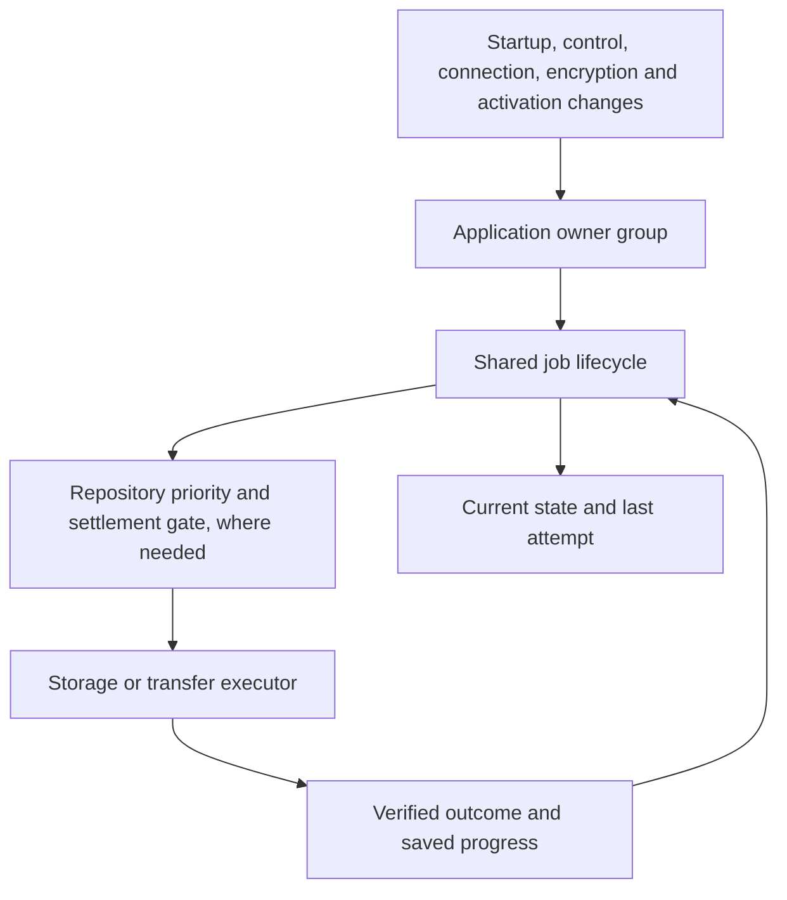
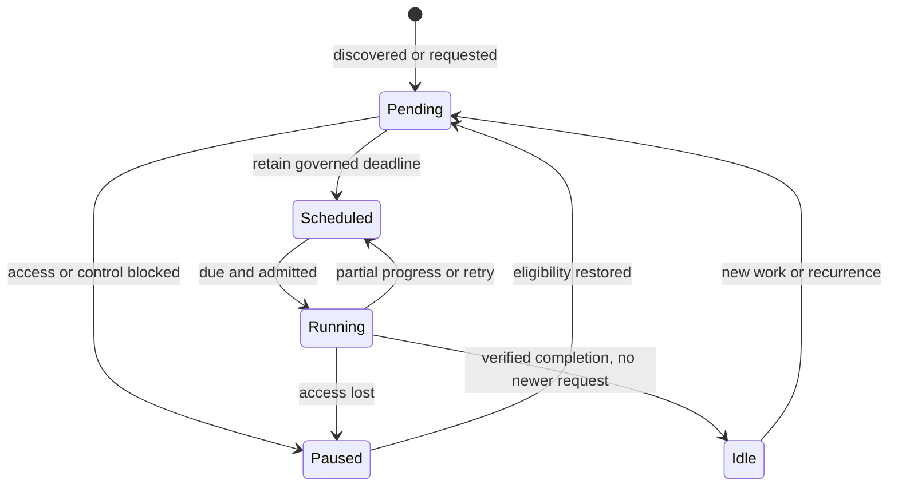

# Background coordination

Background work belongs to the open application. It is not an operating-system service that is guaranteed to run after the app closes. Pending durable work is rediscovered when the app opens and its required access is available.

## Ownership

`operation-lifecycle.createJob` owns pending opportunities, a coalesced deadline, eligibility, one executor promise and its explicit outcome. `createGroup` reconnects the application owners after eligibility changes, isolating a failed owner's wake-up from other owners and foreground completion. `repository-background` adds priority, reservation, preemption and real settlement for each repository. Transport and storage modules own the actual proof of safety, durable progress and provider-specific retry cadence. Shared repository cleanup owns the order: complete history, protected object inventory, bounded deletion, and an explicit complete or pending outcome. Incomplete artifacts use that same safety and work allowance, rather than separate adapter-owned deletion loops.

There is one timer owner per job. Provider registration and hook configuration establish all available provider jobs; connection notifications wake cleanup, integrity and pending publication together. Foreground release wakes the repository owner. It does not require a history or backup caller to remember a second completion handoff.

Discovery is part of job ownership: an unknown settings read retains a retry, and a restored connection compares the current source revision with the last verified backup before declaring itself idle. A known-clean job does not repeatedly rediscover itself.

A future recurrence counts as a pending opportunity. Current execution and the previous attempt are separate: a job can be scheduled while its last outcome is unavailable. An unavailable metadata read never establishes that work is absent. Local recovery discovery distinguishes verified empty, verified non-empty and unavailable data; an unavailable result preserves its retry and does not settle the observed source revision. Named permission/control/key blockers sleep until an eligibility event; an unknown availability failure retains a bounded retry.

## Jobs and policies

| Job / owner | Pending work and progress | Execution and recovery |
| --- | --- | --- |
| Canonical data maintenance / host | Strict pending/completion metadata; canonical notes, session, fallback and deletion recovery | Cooperative 20-second opportunity; 24-hour successful cadence; failure retry; foreground checks between phases |
| Attachment cleanup / asset maintenance | Durable pending/success markers; in-memory reference and directory continuation under a stable source proof | Five seconds / 128 units; strict references, write tokens, journals and leases; reader release, control return and daily discovery reconnect work |
| Attachment verification / host | Strict saved findings and inventory-bound scan cursor | Five seconds / 128 units; warnings survive unavailable reads and partial scans; 24-hour full-scan cadence |
| Scratch collection / file store | Durable journal/hash references, reader/producer/download pins; in-memory directory continuation | Startup orphan discovery; five seconds / 128 entries; fresh retained-reference read under each candidate lock; failed reads retry without deletion |
| Device Folder automatic backup / controller | Strict startup settings recovery; discovery of actual source revisions, original quiet/urgent deadline and verified completion metadata | Quiet window (30 minutes in production), three-second urgent trigger; permission/control/key blockers; progressive writes remain interruptible; capped infrequent retry continues after repeated temporary failures |
| Drive convergence / provider runtime | Strict pending requests with compare-before-clear completion | Noninteractive access only; no total housekeeping deadline; existing request/worker progress watchdogs and cancellation remain; failure backoff caps at 30 minutes |
| Device / Drive retention and object GC / repository coordinator | Strict identity-bound cleanup intent, reason, eligibility and request fencing | Device Folder first completes a cancellable inventory under a renewable exclusion marker, with a ten-second timeout on each read. Deletion then has a twenty-second / bounded-entry allowance. Drive inventories history and objects under renewable immutable maintenance markers, with network watchdogs and cancellation; its thirty-second deletion allowance starts after inventory. Shared cleanup blocks all artifact and retention deletion when history is incomplete and governs grace, contention, failure and uncertainty; reconnection wakes cleanup independently of publication |
| Device / Drive integrity / repository coordinator | Identity-bound quarantine, inventory/cursors and resumable stored/plain hash checkpoints | 120-second opportunity with object/byte/segment limits; 14-day full-scan cadence; unavailable and corruption remain distinct; foreground preemption preserves completed progress |
| Search, attachment, file and Insights workers / their clients | Request identity and caller lifetime; obsolete requests are deliberately cancelled | Existing worker watchdogs, cancellation, retired-worker fencing and fallback remain. These transient requests are not durable periodic jobs |

Housekeeping can stop between bounded units and continue later. A healthy upload is allowed to finish while remaining cancellable; a 30-second total timeout no longer repeatedly destroys the progress of a 45-second upload. Native browser calls still have cooperative cancellation boundaries: a settlement timeout does not pretend a native operation or its lock has finished.

Device Folder and Drive share the coordination contract, not transport assumptions. Device Folder requires a persisted directory handle and browser permission. Drive requires a valid authorized repository connection and uses its existing bounded network/progress controls. Attachment cleanup proves local reachability before reclaiming data. Repository identity, immutable objects/commits, deletion reconciliation, recovery journals and verified rollback remain storage responsibilities.

## Invariants and evidence

| Expected rule | Authoritative targeted verification |
| --- | --- |
| Unknown reads cannot authorize deletion or erase warnings | `storage/background-gc-reliability`, `storage/attachment-reference-recovery`, `exports/scratch-gc`, `library/library-clear`, `backup/capture-safety` |
| Every pending job has a deadline or an identified blocker and wake-up | `unit/app/operation-lifecycle`, `unit/backup/repository-background`, production-runtime `backup/pending-provider-recovery` |
| Healthy finite work eventually finishes once required access is available | Lifecycle combinations of workload, failures and blockers; Device Folder recovery after repeated failures; real binary-pipeline 45-second Drive publication in `backup/repository-checkpoint` |
| Foreground work safely takes priority without releasing unsettled storage | Repository coordinator settlement tests; Device Folder safety/recovery and slow-inventory cancellation tests; assembled Drive cancellation and retry; worker-client lifetime tests |
| Completion cannot clear a newer request | Common lifecycle late-request tests, maintenance request fencing, durable provider compare-before-clear tests, Device source-revision tests |
| Diagnostics reflect execution, retained work and unavailable data | `unit/backup/backup-operation-diagnostics` and `integration/ui/background-diagnostics`; typed safe fields and privacy assertions |
| Exact dependency composition remains functional | Assembled BackupModule with live integrity hooks, successful history, actual integrity execution and verified publication; generated source build/syntax checks |

Developer diagnostics belong to Library → Data & Backup → Copy diagnostics. Review → Copy report remains study-only. No background implementation details have been added to that user report.

These tests establish the listed contracts under deterministic access, I/O, cancellation and failure schedules. Full regression uses the GitHub Promotion QA workflow, including all browser journeys and built-runtime coverage. Native-device acceptance remains separate; the existing pull request links the current workflow result.

## Why the follow-up found defects

The shared scheduler originally owned execution after a request was queued, while callers still owned discovering whether a request existed. A failed startup settings read and edits during a permission block could therefore leave an idle scheduler with undiscovered work. The Device Folder job now owns both discovery and execution. Permission, control and startup recovery reconnect that same lifecycle.

The former twenty-second total allowance also treated a complete filesystem inventory like an independently repeatable cleanup unit. Restarting a healthy forty-second scan could never reach deletion. Inventory now completes under renewed exclusion, yields regularly and remains cancellable; each individual read is bounded. Destructive work retains its short allowance and never proceeds from an incomplete inventory.

Assembled browser checks exposed gaps that identity-only repository mocks and stale fixtures could not reveal. Current-schema tests now use the real canonical codec and cover sorted and windowed reads, preventing a second projection from discarding valid Saved Days. Reflection checks cover persistence through the active session and Saved Days. Browser fixtures exercise current backup choices, actual worker cancellation, trusted input and completed navigation; they do not add a separate draft-reflection store or change product interactions.

The same checks found a presentation wait that could block hidden-window startup and an update wake-up that could supersede the editing idle deadline. Both waits are now governed explicitly. The note-status tooltip keeps its toolbar anchor and belongs to the editor dialog. Touch image controls retain tap-to-select behavior.

Read-only ownership probes also used to change the authority revision even when no access changed. That could invalidate an update preparation between its checks. Failed availability probes now preserve the secondary state; actual acquisition, hydration and release still invalidate write tokens. Tests cover repeated unavailable Web Lock and BroadcastChannel probes followed by real takeover and release.

The PWA and Device Folder browser checks use the shared browser harness, including process settlement and temporary-profile cleanup. PWA checks observe completed navigation, actual foreground/hidden tabs and terminal check/installation state, and reinstall their security-policy listener before every document. Automatic update counts measure explicit registration update calls; browser-initiated registration checks are not mistaken for duplicate application work. Offline serving, damaged-worker rejection and required-asset verification still exercise real service workers and caches.

Populated Insights reads no longer fetch the summary inventory twice or repeatedly create locale formatters for English weekday labels. The same saved records, derived results and progressive rendering remain in use. Its 590-day performance, worker/fallback parity and worker-failure retry checks retain their original limits. Browser attachment checks use a valid PCM WAV and actual media readiness; click automation preserves already-visible targets so it does not manufacture page scrolling.

## Current audit limitation

The three findings from the 3 October baseline audit are corrected: uncertain history no longer authorizes counterpart deletion, slow responsive Drive inventory can complete under renewable protection, and unavailable local data retains Device Folder discovery. The follow-up audit confirmed a remaining capacity/recovery gap: Drive lists at most 64 checkpoint manifests or commits. A valid backlog of 65 versions causes overflow; cleanup repeatedly defers and a new backup stops for review. Data remains preserved, but automatic recovery does not finish. See [the current audit and evidence](BACKGROUND-AUDIT.md). The finite-work completion claim above is therefore not established for that backlog. Bounded history processing needs a further focused refactor before the programme can be closed.
