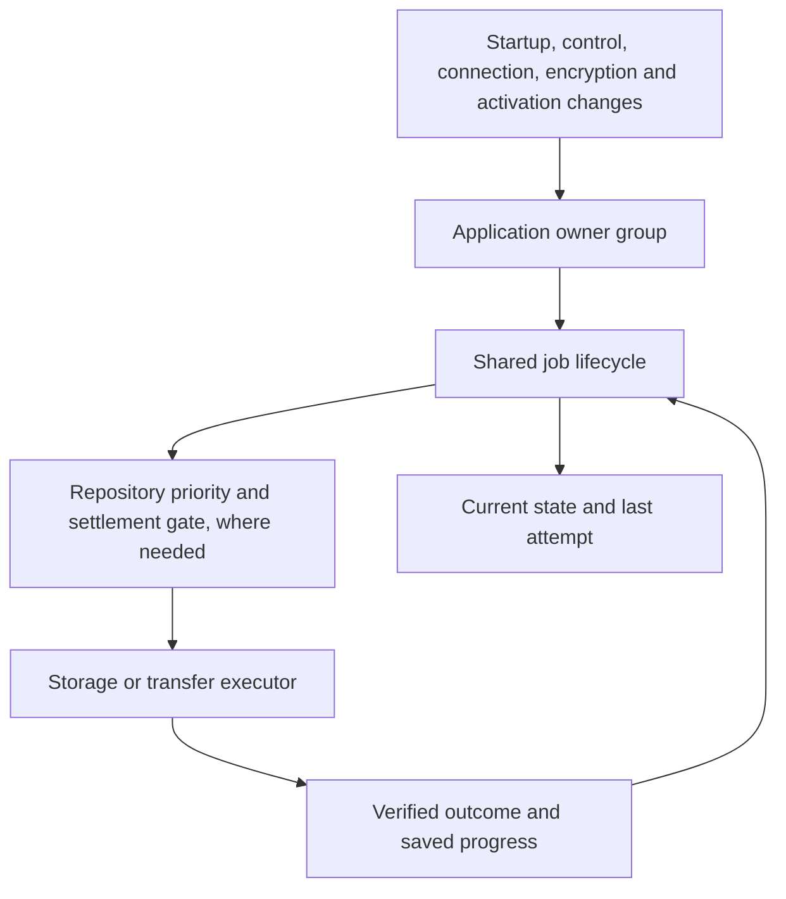
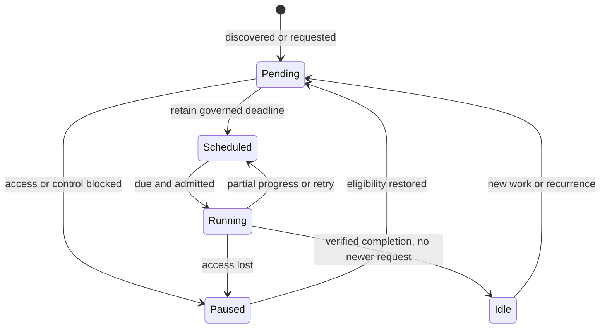

# Background coordination

Background work belongs to the open application. It is not an operating-system service that is guaranteed to run after the app closes. Pending durable work is rediscovered when the app opens and its required access is available.

## Ownership

`operation-lifecycle.createJob` owns pending opportunities, a coalesced deadline, eligibility, one executor promise and its explicit outcome. `createGroup` reconnects the application owners after eligibility changes, isolating a failed owner's wake-up from other owners and foreground completion. `repository-background` adds priority, reservation, preemption and real settlement for each repository. Transport and storage modules own the actual proof of safety, durable progress and provider-specific retry cadence. Shared repository cleanup owns the order: complete history, protected object inventory, bounded deletion, and an explicit complete or pending outcome. Incomplete artifacts use that same safety and work allowance, rather than separate adapter-owned deletion loops.

There is one timer owner per job. Provider registration and hook configuration establish all available provider jobs; connection notifications wake cleanup, integrity and pending publication together. Foreground release wakes the repository owner. It does not require a history or backup caller to remember a second completion handoff.

Discovery is part of job ownership: an unknown settings read retains a retry, and a restored connection compares the current source revision with the last verified backup before declaring itself idle. A known-clean job does not repeatedly rediscover itself.

A future recurrence counts as a pending opportunity. Current execution and the previous attempt are separate: a job can be scheduled while its last outcome is unavailable. An unavailable metadata read never establishes that work is absent. Local recovery discovery distinguishes verified empty, verified non-empty and unavailable data; an unavailable result preserves its retry and does not settle the observed source revision. Named permission/control/key blockers sleep until an eligibility event; an unknown availability failure retains a bounded retry.

## Jobs and policies

Every job first asks one shared gate, `backgroundBlocker()` in `app.html`: start-up has finished and this tab owns writes. Housekeeping (attachment cleanup and verification, scratch files, Device Folder preparation, backups and their upkeep) also waits while a browser-data clear is unresolved, and every job is woken when the clear is settled. Canonical data maintenance is recovery, so it keeps running through a clear. Each job adds only its own condition, such as storage support or an unlocked encryption key. The one exception is deleting removed profiles' data at start (`Profiles.collect`): it runs in whichever tab opens, and only for profiles no tab holds. While this device holds data from a newer version, local upkeep also waits (`unsupported-data`) and Drive takes no upload, since both would read that data's absence as a deletion (`ARCHITECTURE.md` section 2).

Local upkeep (canonical maintenance, attachment cleanup and verification, scratch files) asks `upkeepBlocker()`, which adds "is the person busy?" to that gate. While they are, a job waits under the named reason `foreground-busy` with no timer; one shared watcher checks back every 15 seconds and wakes every job with `foreground-released` when the work ends. Notice changes, backup status changes and the end of an app update check at once. A file backup or file import the person starts holds every location's background backup work (`suspendBackground('file-backup')`) until it ends, so it never queues behind an integrity hash in the shared file worker; automatic backups never set those flags, so they cannot hold themselves.

| Job / owner | Pending work and progress | Execution and recovery |
| --- | --- | --- |
| Canonical data maintenance / host | Strict pending/completion metadata; canonical notes, session, fallback and deletion recovery; on each completed day, notes past 30 days in Recently deleted are removed and attachment cleanup is started | Shared cooperative 20-second allowance; retained phase cursor fenced by strict canonical epoch, local rescue values, live Notes revision and ownership; safe revalidation after changes/reload; recovery retires only exact serviced requests and checkpoints prefixes between transactions; 24-hour successful cadence and governed retry |
| Attachment cleanup / asset maintenance | No record of its own: requested after each daily upkeep and soon after a file falls out of use; a request lost to a reload is caught by the next daily sweep. In-memory reference and directory continuation under a stable source proof | Five seconds / 128 units; strict references, write tokens, journals and leases; reader release, control return and the daily upkeep reconnect work |
| Attachment verification / host | Strict saved findings and inventory-bound scan cursor | Five seconds / 128 units; warnings survive unavailable reads and partial scans; earliest-wins scheduling preserves newer short-delay requests against later recurrence or retries; 24-hour full-scan cadence |
| Scratch collection / file store | Durable journal/hash references, reader/producer/download pins; in-memory directory continuation | Startup orphan discovery; five seconds / 128 entries; fresh retained-reference read under each candidate lock; failed reads retry without deletion |
| Automatic backup and convergence, every location / backup engine | Strict pending requests with compare-before-clear completion; automatic need is the change-time rule (newest change later than the change the location's last backup from this device captured), so nothing is written per change; each location's due time is kept in memory and any earlier wake-up keeps it | One job per location. Device Folder publishes independently from canonical local state from when it is chosen. Drive, whenever signed in, syncs first: its newest version is checked on sign-in, start, a return to the app (at most once a minute), going to the background with changes waiting, and every 20 minutes, and is taken in by a quiet Combine before any upload. An upload refused because Drive moved on retries after catch-up; one waiting for another device's publication retries through the bounded convergence backoff. A newest version this build cannot read is not retried: sync waits for an app update, or for the person to remove that version, and uploads nothing over it. Drive and Device Folder never wait for, download, backfill or copy checkpoints from one another. 20-minute quiet window from the first waiting change, three seconds after a key moment, five minutes before a sign-in ends; changes found on start or reconnect go at once, but only while local data is present; permission, control and encryption-lock blockers; failure backoff caps at 30 minutes |
| Device / Drive retention and object GC / repository coordinator | Strict identity-bound cleanup intent, reason, eligibility and request fencing | Both locations read and verify history, choose retention and inventory objects before taking a destructive maintenance marker. After acquiring the marker (a Device Folder marker file or immutable Drive file), they revalidate checkpoint/commit metadata and abandon deletion if the repository changed. The cooperative thirty-second deletion allowance starts only after that protected revalidation. The shared cleanup engine permits one protected productive unit, then checks the allowance before another; foreground cancellation remains effective within units. Shared cleanup blocks all artifact and retention deletion when history is incomplete and governs grace, contention, failure and uncertainty; reconnection wakes cleanup independently of publication |
| Device / Drive integrity / repository coordinator | Identity-bound quarantine, inventory/cursors and resumable stored/plain hash checkpoints | Shared cooperative 120-second allowance after durable useful progress, with object/byte/segment limits; 14-day full-scan cadence; unavailable and corruption remain distinct; foreground preemption preserves completed progress |
| Search, attachment, file and Insights workers / their clients | Request identity and caller lifetime; obsolete requests are deliberately cancelled | Existing worker watchdogs, cancellation, retired-worker fencing and fallback remain. These transient requests are not durable periodic jobs |

The shared `createWorkBudget` separates a housekeeping allowance from foreground cancellation and IO stall watchdogs. An elapsed allowance cannot cancel the successful safety reads needed for the first useful unit. Progress never renews the allowance; it makes yielding eligible at the next saved boundary. Canonical maintenance retains a phase cursor, repository cleanup advances through confirmed physical deletions, and integrity retains committed hash offsets. Housekeeping can stop between these bounded units and continue later. A healthy upload is allowed to finish while remaining cancellable; a 30-second total timeout no longer repeatedly destroys the progress of a 45-second upload. Native browser calls still have cooperative cancellation boundaries: a settlement timeout does not pretend a native operation or its lock has finished.

Device Folder and Drive are two locations of one backup engine: they share every job, rule and state machine, and differ only in their storage adapters. The Device Folder adapter needs a persisted directory handle and browser permission; Drive needs a valid authorized repository connection and uses its existing bounded network/progress controls. Attachment cleanup proves local reachability before reclaiming data. Repository identity, immutable objects/commits, deletion reconciliation, recovery journals and verified rollback remain storage responsibilities.

Local recovery readers check storage failure immediately, before another successful operation can clear the adapter's error. Unknown rescue or deletion-ledger contents cannot authorize cleanup or collection replacement. Rescue retirement rereads the current collection and preserves unrelated or newer copies; passive reconciliation cannot overwrite newer canonical data. A committed save remains acknowledged if housekeeping fails, with a pending diagnostic and retained copies for maintenance to reconcile. Successful Notes recovery replaces the failed startup load result so repeated maintenance phases can converge.

Notes recovery also fences adoption against the live model revision and save chain. A mutation during an awaited read preserves the live model, dirty work and autosave timer; canonical maintenance yields with `notes-changed` and its existing 15-second wake-up retries. A recovery snapshot cannot acknowledge an intervening edit merely because its storage reads succeeded.

Drive's deletion work allowance and coordination lease have separate purposes. Deletion retains its cooperative 30-second allowance. Version 2 maintenance markers last five minutes, renew after one quarter of that lifetime, and retain a 75-second assertion margin for the existing 45-second metadata request limit plus release grace. The shared safety reader uses the adapter's verified expiry. Immutable overlap, missing/expired/unreadable protection checks and foreground cancellation remain mandatory. Cancellation releases coordination markers using the operation's verified folder receipt; repository identity changes invalidate that receipt. Version 1 markers retain their original 60-second expiry. Older clients classify version 2 as uncertain and defer while it exists, rather than removing an active marker using their shorter expiry; an abandoned version 2 marker is retired by a current client after expiry.

## Invariants and evidence

| Expected rule | Authoritative targeted verification |
| --- | --- |
| Unknown reads cannot authorize deletion or erase warnings | `storage/background-gc-reliability`, `storage/attachment-reference-recovery`, `exports/scratch-gc`, `library/library-clear`, `backup/capture-safety` |
| Recovery conserves acknowledged copies and pending deletion intent | `storage/deletion-recovery`: production LocalStorage adapter, failure at every local read, committed-save diagnostics, stale replay, concurrent arrivals and healthy retry |
| Recovery cannot regress accepted live Notes work | `storage/data-maintenance`: production host and AppData, mutations at canonical-read/result/autosave boundaries, equal timestamps, exact live/canonical/restart equality and automatic retry |
| Every pending job has a deadline or an identified blocker and wake-up | `unit/app/operation-lifecycle`, `unit/backup/repository-background`, production-runtime `backup/pending-provider-recovery` |
| Healthy finite work eventually finishes once required access is available | Lifecycle workload/blocker/failure matrices; work-allowance latency matrices; actual canonical host/storage phase continuation; assembled Drive cleanup with slow protection reads and foreground interruption; real binary-pipeline 45-second Drive publication in `backup/repository-checkpoint` |
| Foreground work safely takes priority without releasing unsettled storage | Repository coordinator settlement tests; Device Folder safety/recovery and slow-inventory cancellation tests; assembled Drive cancellation and retry; worker-client lifetime tests |
| Completion cannot clear a newer request | Common lifecycle late-request tests, maintenance request fencing, durable provider compare-before-clear tests, Device source-revision tests |
| Diagnostics reflect execution, retained work and unavailable data | `unit/backup/backup-operation-diagnostics` and `integration/ui/background-diagnostics`; typed safe fields and privacy assertions |
| Exact dependency composition remains functional | Assembled BackupModule with live integrity hooks, successful history, actual integrity execution and verified publication; generated source build/syntax checks |

Developer diagnostics belong to Library → Data → Copy diagnostics. Review → Copy report remains study-only. No background implementation details have been added to that user report.

These tests establish the listed contracts under deterministic access, I/O, cancellation and failure schedules. Full regression uses the GitHub Promotion QA workflow, including all browser journeys and built-runtime coverage. Native-device acceptance remains separate; check CI results by exact commit SHA. GitHub Actions does not prove real device-folder permissions, OS background suspension or mobile storage eviction.

## Retention and backlog recovery

Device Folder and Drive share the same retention policy (`selectRepositoryRetention`): 15 ordinary recovery points, up to 10 Hourly versions from the last 24 hours, plus, for each device, its newest unexpired protected safety point (kept for 7 days). Safety points are extra temporary copies, as confirmed by the user; they do not displace an ordinary slot.

| Tier | Slots | Selection |
| --- | ---: | --- |
| Latest | 1 | Newest ordinary committed checkpoint |
| Daily | 6 | Newest checkpoint of each of the six most recent earlier days that have one |
| Weekly | 4 | Newest checkpoint of each of the four most recent Monday-based weeks that have one, counting only weeks wholly older than the oldest Daily's week |
| Monthly | 4 | Newest checkpoint of each of the four most recent calendar months that have one, counting only months wholly older than the oldest Weekly's month |
| Saved | the rest | Slots the tiers cannot use go to the newest checkpoint of the remaining days, widest gap in time first, newer on a tie |
| Hourly | up to 10 extra | Walking back over the 24 hours before Latest, the newest checkpoint of each earlier local hour (by the UTC offset captured with it) whose notes differ from the version kept after it. Versions that changed no note are not kept, so Version History is not crowded. Checkpoints without a notes fingerprint (written before it existed) count as changed |
| Protected safety | 1 extra per device | Each device's newest unexpired Before restore / combine / clear-library checkpoint, by the device that made it |

No Weekly shares a week with a Daily and no Monthly a month with a Weekly, so with a backup every day the Weeklies fall one to five weeks back, a week apart, and the Monthlies about a month apart beyond them, reaching four to five months back. Periods without a checkpoint are skipped rather than counted, so gaps of any length (inside a week, between weeks or months, or a break of several months) never empty a tier: after a break the history from before it stays, and graduates from Daily to Weekly to Monthly as new checkpoints arrive. Retention keeps one checkpoint per day, the newest, and keeps every day it can up to 15, so a new checkpoint replaces at most one version and the history is never lost wholesale. The latest day can be any weekday. Periods use the local calendar recorded at capture, so changing the evaluator's timezone does not reinterpret history.

A single note can be restored from the open note's ⋯ menu (Earlier versions…). It reads the connected backup locations (the Device Folder first; Drive skips versions it already read) and runs the same verified Combine limited to that note: the two texts are always shown side by side, nothing else changes, the restored text is saved as a new edit, and the version does not become the shared base for later combines. A version without the note, with the same text, or a review that keeps the current text changes nothing and makes no safety backup. It reads only the backup objects that hold that note and the images its text uses, each verified against the version's verified manifest, so a Drive restore downloads a few small files rather than the whole version; such a read can never be used to combine or replace everything. Because it never touches today's session, it is available during an active study session: the timer display pauses only while the change is saved, and that time counts as study time rather than an inactive gap.

Retention selects recovery points; it cannot enforce an instantaneous physical file limit. Publication first commits and verifies a new immutable version, then maintenance safely removes obsolete versions. A blocked, interrupted or failed cleanup can therefore leave more than 15 ordinary manifest/commit pairs temporarily. Each version has a manifest and a commit marker; shared objects are separate files and are not counted as versions. Version History projects retained points while physical cleanup catches up.

Drive history inventory now reads all pages, independently of the retention slot count. Pages remain bounded to 1,000 descriptors and history verification to eight concurrent reads. Each verified obsolete manifest is reduced to a compact retention/provenance proof; full object references are loaded only for the selected points. The existing full-body cache remains limited to 64 entries. Compact proofs are scoped to the current repository and exact listed immutable file identity/version/digest. They are reused on ordinary retry, discarded on changed identity or repository, and pruned when physical history changes or cleanup completes. They are in-memory acceleration; durable pending intent still owns wake-up after reload.

The same attempt validates every manifest/commit pair before authorizing deletion. Unknown history, an explicitly incomplete Drive search, repeated pagination tokens, or lost exclusion cannot produce a clean result or authorize reclamation. A version whose content this build cannot read is known rather than unknown: retention still runs around it, object GC waits until it is removed (Version History offers Remove), and no timed retry is scheduled for it. The verified retention evaluation time stays fixed through loading the selected manifests and deletion planning. Foreground preemption preserves its actual cancellation reason and waits for all active readers to settle; a later history observation may legitimately renew the pending request. Deletion still uses its existing short allowance and bounded entry count. Large finite backlogs and object GC continue through governed passes until verified completion.

See [the 4 October 2026 record](BACKGROUND-AUDIT.md) for the verification results and acceptance limits of that pass; later audits are listed in `HANDOFF.md`.

## Publication failure and convergence retry safety (2026-10-30 corrective pass)

Publication error handling cannot use a successfully returned upload receipt as evidence that the attempt **created** an immutable file. Device Folder may reuse an identical file and Google Drive may recover an upload whose response was lost. A manifest, commit or object may even have become visible before verification failed. Therefore the publication failure path **does not delete** manifest, commit or object identities. Pending/uncommitted artifacts are candidates for later inventory-verified, reference-aware retention/garbage collection under the existing repository maintenance contract; an orphan manifest alone never counts as a committed recovery point. This also protects previously committed checkpoints from mistaken retry cleanup.

Device Folder deletion now checks an explicitly supplied SHA-256 digest against the current bytes as well as a supplied remoteVersion. The same no-guessing deletion rule already applies to Google Drive metadata. Uncertain versions refuse deletion rather than relaxing repository safety.

Convergence's failed attempt captures the canonical revision it began with. Same-revision failure or turn backoff replaces its own deadline; a genuinely different current revision retains any earlier urgent deadline. Pending-retry diagnostics retain the actual cause rather than labelling all failures as managed recovery. Managed recovery records independent durable pending intents for the source and every configured automatic peer (including temporarily disconnected destinations); each is cleared after its own verified publication. Unconfigured or explicitly forgotten destinations do not retain an obligation. Coverage rediscovery remains a second line of defence after restart.

Automatic Drive catch-up uses suspension-aware admission. Its own managed-recovery suspension retains precisely that initiating sync controller, so it can finish local reconciliation; a separate PWA update, file-backup or storage-reset suspension still aborts it and waits for real settlement. Automatic sync also declares its shared import controller as background-preemptible, preventing the standalone file-work observer from acquiring a self-cancelling `file-backup` hold; manual file imports and exports still suspend provider background work. The portable-file Cancel control is not shown during a quiet provider catch-up. The startup canonical mutation-clock reconciliation now fails closed on an unavailable authoritative read, and a failed promise is not cached as a successful prerequisite. No new scheduler, storage family or backup topology was introduced.

Read-only maintenance planning remains potentially expensive on cold/paginated Drive inventories. Measure it with real transports before implementing a resumable planning cursor; the 30-second limit still applies to destructive work rather than inventory discovery. Duplicate local checkpoint captures are a measured-only optimization, not a prerequisite to correctness.

Certification distinguishes emulator/browser evidence from physical-device evidence. Required native acceptance remains: Android and desktop browser suspend/resume; permission revocation/regrant for real Device Folders; iOS/iPadOS unsupported-folder fallback; quota pressure and origin eviction with disposable data; real Drive paginated inventory, long transfer cancellation/restart and slow maintenance; and battery/CPU behavior over sustained idle time. Do not use irreplaceable data. Native acceptance cannot be inferred from a passing GitHub Actions run.
