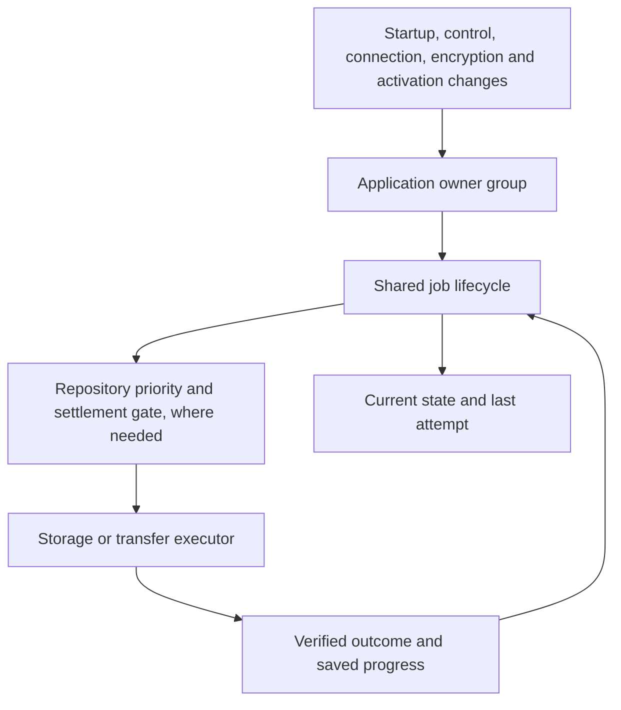
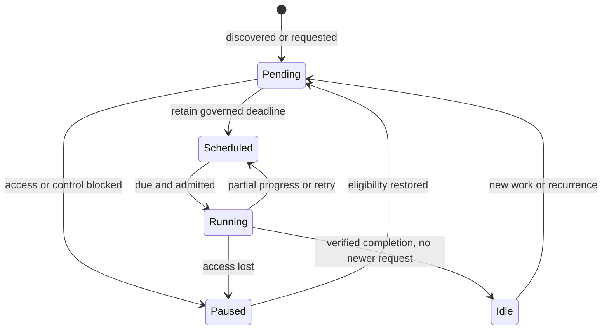

# Background jobs

Everything that runs without the person asking: automatic backups and sync, upkeep, cleanup, integrity checks, workers and diagnostics. What each backup operation does is in [backup-and-sync.md](backup-and-sync.md).

Background work belongs to the open application. It is not an operating-system service that is guaranteed to run after the app closes. Pending durable work is rediscovered when the app opens and its required access is available.

## The standard every job meets

1. Bounded work per run, with a work budget or progress watchdog.
2. Gives way at once to foreground work, resuming from a durable checkpoint.
3. Intent persisted when it must survive a reload; idempotent when repeated.
4. One retry policy: backoff with a cap, and a user notice only when a person can act.
5. Runs only while this tab owns writes; pauses during restores, updates and browser-data clears.
6. Visible in one diagnostics view (Library → Data → Copy diagnostics) with state, next run and last outcome.
7. Tested on a fake clock, plus a browser test for the real lifecycle.

## Ownership

`operation-lifecycle.createJob` owns pending opportunities, a coalesced deadline, eligibility, one executor promise and its explicit outcome. `createGroup` reconnects the application owners after eligibility changes, isolating a failed owner's wake-up from other owners and foreground completion. `repository-background` adds priority, reservation, preemption and real settlement for each repository. Transport and storage modules own the actual proof of safety, durable progress and provider-specific retry cadence. Shared repository cleanup owns the order: complete history, protected object inventory, bounded deletion, and an explicit complete or pending outcome. Incomplete artifacts use that same safety and work allowance, rather than separate adapter-owned deletion loops.

There is one timer owner per job. Provider registration and hook configuration establish all available provider jobs; connection notifications wake cleanup, integrity and pending publication together. Foreground release wakes the repository owner. It does not require a history or backup caller to remember a second completion handoff.

Discovery is part of job ownership: an unknown settings read retains a retry, and a restored connection compares the current source revision with the last verified backup before declaring itself idle. A known-clean job does not repeatedly rediscover itself.

A future recurrence counts as a pending opportunity. Current execution and the previous attempt are separate: a job can be scheduled while its last outcome is unavailable. An unavailable metadata read never establishes that work is absent. Local recovery discovery distinguishes verified empty, verified non-empty and unavailable data; an unavailable result preserves its retry and does not settle the observed source revision. Named permission/control/key blockers sleep until an eligibility event; an unknown availability failure retains a bounded retry.

## Jobs and policies

Every job first asks one shared gate, `backgroundBlocker()` in `app.html`: start-up has finished and this tab owns writes. Housekeeping (attachment cleanup and verification, scratch files, Device Folder preparation, backups and their upkeep) also waits while a browser-data clear is unresolved, and every job is woken when the clear is settled. Canonical data maintenance is recovery, so it keeps running through a clear. Each job adds only its own condition, such as storage support or an unlocked encryption key. The one exception is deleting removed profiles' data at start (`Profiles.collect`): it runs in whichever tab opens, and only for profiles no tab holds. While this device holds data from a newer version, local upkeep also waits (`unsupported-data`) and Drive takes no upload, since both would read that data's absence as a deletion ([data-and-storage.md](data-and-storage.md#data-this-version-cannot-read)).

Local upkeep (canonical maintenance, attachment cleanup and verification, scratch files) asks `upkeepBlocker()`, which adds "is the person busy?" to that gate. While they are, a job waits under the named reason `foreground-busy` with no timer; one shared watcher checks back every 15 seconds and wakes every job with `foreground-released` when the work ends. Notice changes, backup status changes and the end of an app update check at once. A file backup or file import the person starts holds every location's background backup work (`suspendBackground('file-backup')`) until it ends, so it never queues behind an integrity hash in the shared file worker; automatic backups never set those flags, so they cannot hold themselves.

| Job / owner | Pending work and progress | Execution and recovery |
| --- | --- | --- |
| Canonical data maintenance / host | Strict pending/completion metadata; canonical notes, session, fallback and deletion recovery; on each completed day, notes past 30 days in Recently deleted are removed and attachment cleanup is started | Shared cooperative 20-second allowance; retained phase cursor fenced by strict canonical epoch, local rescue values, live Notes revision and ownership; safe revalidation after changes/reload; recovery retires only exact serviced requests and checkpoints prefixes between transactions; 24-hour successful cadence and governed retry |
| Attachment cleanup / asset maintenance | No record of its own: requested after each daily upkeep and soon after a file falls out of use; a request lost to a reload is caught by the next daily sweep. In-memory reference and directory continuation under a stable source proof | Five seconds / 128 units; strict references, write tokens, journals and leases; reader release, control return and the daily upkeep reconnect work |
| Attachment verification / host | Strict saved findings and inventory-bound scan cursor | Five seconds / 128 units; warnings survive unavailable reads and partial scans; earliest-wins scheduling preserves newer short-delay requests against later recurrence or retries; 24-hour full-scan cadence |
| Scratch collection / file store | Durable journal/hash references, reader/producer/download pins; in-memory directory continuation | Startup orphan discovery; five seconds / 128 entries; fresh retained-reference read under each candidate lock; failed reads retry without deletion |
| Automatic backup and convergence, every location / backup engine | Strict pending requests with compare-before-clear completion; automatic need is the change-time rule (newest change later than the change the location's last backup from this device captured), so nothing is written per change; each location's due time is kept in memory and any earlier wake-up keeps it | One job per location. Device Folder publishes independently from canonical local state from when it is chosen. Drive, whenever signed in, syncs first: its newest version is checked on sign-in, start, a return to the app (at most once a minute), going to the background with changes waiting, and every 20 minutes, and is taken in by a quiet Combine before any upload. An upload refused because Drive moved on retries after catch-up; one waiting for another device's publication retries through the bounded convergence backoff. A newest version this build cannot read is not retried: sync waits for an app update, or for the person to remove that version, and uploads nothing over it. Drive and Device Folder never wait for, download, backfill or copy checkpoints from one another. 20-minute quiet window from the first waiting change, three seconds after a key moment, five minutes before a sign-in ends; changes found on start or reconnect go at once, but only while local data is present; permission, control and encryption-lock blockers; failure backoff caps at 30 minutes |
| Device / Drive retention and object GC / repository coordinator | Strict identity-bound cleanup intent, reason, eligibility and request fencing | Both locations read and verify history, choose retention and inventory objects before taking a destructive maintenance marker. After acquiring the marker (a Device Folder marker file or immutable Drive file), they revalidate checkpoint/commit metadata and abandon deletion if the repository changed. The cooperative thirty-second deletion allowance starts only after that protected revalidation. The shared cleanup engine permits one protected productive unit, then checks the allowance before another; foreground cancellation remains effective within units. Shared cleanup blocks all artifact and retention deletion when history is incomplete and governs grace, contention, failure and uncertainty; reconnection wakes cleanup independently of publication |
| Device / Drive integrity / repository coordinator | Identity-bound quarantine, inventory/cursors and resumable stored/plain hash checkpoints | Shared cooperative 120-second allowance after durable useful progress, with object/byte/segment limits; 14-day full-scan cadence; unavailable and corruption remain distinct; foreground preemption preserves completed progress |
| Search, attachment, file and Insights workers / their clients | Request identity and caller lifetime; obsolete requests are deliberately cancelled | Existing worker watchdogs, cancellation, retired-worker fencing and fallback remain. These transient requests are not durable periodic jobs |
| Insights idle pre-computation / Insights plugin | None: read-only and in memory. The host loads the Insights file four seconds after start-up is ready, at idle; the plugin then reads the saved history and builds its model in the worker at idle, and again when the page becomes visible | Runs only with a worker, saved (not sample) data, a trusted dataset revision, a visible page and the tab closed. Opening the tab waits for a running pre-computation and reuses its model only when source, study date, revision and window still match. Records go to the worker in parts of at most 150 and are kept there per revision; a hidden tab keeps its idle worker for two minutes. Writes nothing |

The shared `createWorkBudget` separates a housekeeping allowance from foreground cancellation and IO stall watchdogs. An elapsed allowance cannot cancel the successful safety reads needed for the first useful unit. Progress never renews the allowance; it makes yielding eligible at the next saved boundary. Canonical maintenance retains a phase cursor, repository cleanup advances through confirmed physical deletions, and integrity retains committed hash offsets. Housekeeping can stop between these bounded units and continue later. A healthy upload is allowed to finish while remaining cancellable, with no total timeout that could discard a long upload's progress. Native browser calls still have cooperative cancellation boundaries: a settlement timeout does not pretend a native operation or its lock has finished.

Device Folder and Drive are two locations of one backup engine: they share every job, rule and state machine, and differ only in their storage adapters. The Device Folder adapter needs a persisted directory handle and browser permission; Drive needs a valid authorized repository connection and uses its existing bounded network/progress controls. Attachment cleanup proves local reachability before reclaiming data. Repository identity, immutable objects/commits, deletion reconciliation, recovery journals and verified rollback remain storage responsibilities.

Local recovery readers check storage failure immediately, before another successful operation can clear the adapter's error. Unknown rescue or deletion-ledger contents cannot authorize cleanup or collection replacement. Rescue retirement rereads the current collection and preserves unrelated or newer copies; passive reconciliation cannot overwrite newer canonical data. A committed save remains acknowledged if housekeeping fails, with a pending diagnostic and retained copies for maintenance to reconcile. Successful Notes recovery replaces the failed startup load result so repeated maintenance phases can converge.

Notes recovery also fences adoption against the live model revision and save chain. A mutation during an awaited read preserves the live model, dirty work and autosave timer; canonical maintenance yields with `notes-changed` and its existing 15-second wake-up retries. A recovery snapshot cannot acknowledge an intervening edit merely because its storage reads succeeded.

Drive's deletion work allowance and coordination lease have separate purposes. Deletion retains its cooperative 30-second allowance. Version 2 maintenance markers last five minutes, renew after one quarter of that lifetime, and retain a 75-second assertion margin for the existing 45-second metadata request limit plus release grace. The shared safety reader uses the adapter's verified expiry. Immutable overlap, missing/expired/unreadable protection checks and foreground cancellation remain mandatory. Cancellation releases coordination markers using the operation's verified folder receipt; repository identity changes invalidate that receipt. Version 1 markers retain their original 60-second expiry. Older clients classify version 2 as uncertain and defer while it exists, rather than removing an active marker using their shorter expiry; an abandoned version 2 marker is retired by a current client after expiry.

Other owners that meet the same standard:

| Owner | How |
|---|---|
| App update checks and the safe update | Own timer with capped backoff, writing tab only; an update waits for backups (up to a minute) and for the applied plan to end ([app-updates.md](app-updates.md)) |
| Service worker caches | A fixed file list and at most three release caches; nothing cached at runtime |
| Workers | Search and attachment workers are let go after two quiet minutes; export stops after each job; image and Insights workers are one per use |
| Deletion records | Bounded, trimmed by canonical maintenance |
| Storage health and quota | Persistent storage requested at launch; warnings at 80% and 92%; the estimate is refreshed on returning to the app, at most hourly |
| Removed profiles' data (`Profiles.collect`) | Runs in any tab, only for profiles no tab holds; waits while the profile list comes from a newer version |
| Device Folder preparation and the one-time move (`prepareInBackground`) | Behind the shared gate, in the writing tab only, under one lock across tabs |

**Considered and left out.**
- *Run upkeep only while the page is visible.* A desktop tab left in the background all day would never run it. Upkeep already runs at background priority (`scheduler.postTask`) and yields to anything the person does.
- *Move the app-update timer under the shared job.* It already meets the standard; moving it would touch the update-safety flow for no visible gain.
- *One reservation for local upkeep and backups.* See "One way to wait": the backup busy signals cover automatic backups too.
- *New or merged services.* None is missing, and none duplicates another: the Device Folder and Drive already share every job.

## Limits and policies

- **Open-app work only.** Background work runs while an app page is open and eligible (storage, permissions and control allow it). Closing or suspending every page gives no recurring background execution; work with durable intent is found again on the next open. That is a recovery contract, not a promised backup frequency while closed.
- **Clocks.** Repository timers recheck absolute deadlines before running, so a clock moving backward never runs work early, and a wake after a forward jump makes overdue work eligible.
- **Priority release.** A maintenance or integrity job that was ready but refused the repository slot retries one second after the higher-priority job releases it, rather than waiting an unrelated contention retry. A verification check stopped by other work does the same, rather than waiting ten minutes. The release listener is detached when a job unregisters.
- **Protected verification start.** Verification has the lowest priority, so every automatic upload of a study session used to stop it before it had checked anything (a full Drive check takes about a minute, mostly listing). A check that has just started now keeps the slot for 60 seconds against automatic sync and cleanup, which retry meanwhile (sync every 15 seconds); after that it yields as before. Anything a person starts and every suspension stop it at once, and a clock moving backwards never extends the protection.
- **Attachment checks.** The background presence check asks only for the trusted union of attachment ids from complete Notes, Saved Days and Active Session reads; the cleanup walker tracks unreferenced keys in a Set. An untrusted live editor always invalidates a partly cached reference scan. The shallow audit still rereads and hashes the full fresh attachment catalogue each pass; the OPFS sweep keeps a bounded iterator with a fresh retained-file set and lock per batch; scratch collection rereads journal and scrub pins for every deletion candidate.
- **Start-up.** The six background owners wake after the mutation-clock reconciliation; OPFS scratch orphans are found separately. Read-only provider maintenance planning stays outside the remote deletion lease; the destructive phase checks fresh digests and history under the lease.

## Reliability

`operation-lifecycle.createJob` owns pending work, one timer, eligibility blockers, execution and attempt outcomes. Application startup registers an owner group that reconnects all jobs after control, activation, date changes and encryption unlock; provider connection events wake the complete provider owner. Repository coordinators retain admission priority, cancellation and actual settlement. Storage executors retain proofs, transactional markers and resumable progress. Automatic transfers have no total housekeeping deadline; Device Folder uses capped infrequent retries, while Drive retains its capped convergence backoff. Foreground callers release their reservation; they do not individually reassemble integrity, cleanup and convergence wake-ups.

Attachment ingestion uses an owned worker with monotonic request IDs, a 120-second progress inactivity watchdog and a two-second cooperative cancel deadline. Cancellation wins over a late success. Timeout/error/messageerror retires the worker and settles its outstanding requests; callbacks captured from a retired worker cannot affect its replacement. Abandoned staging requests verified GC rather than unsafe immediate deletion. Quota estimation has a five-second read-only opportunity and signal cancellation. Search uses a fixed thirty-second build/query deadline followed by its existing content fallback, with the same worker/ID fences and timer cleanup. Export keeps its existing scoped processing/watchdogs and now fences retired callbacks. Existing image and Insights request-scoped lifetimes remain.

Local GC keeps separate operational records: a v2 last-success day and a v1 durable pending intent. The earlier v1 scheduled-attempt day is classified legacy residue and cannot certify success. Pending survives failure, foreground deferral and reopen, even after another successful sweep that day. Actual completion persists the success day and clears pending; a failed marker write or a newer request retains retry. Ownership return and reader release provide opportunities; reader contention also has a fallback retry. Unsupported capabilities remain dormant.

A local opportunity is cooperatively bounded to five seconds and 128 reference/removal/directory units per batch. The reference scan resumes only under the same canonical mutation epoch, reference revision, live values and key inventory; source change restarts proof. Notes/session/Saved Days reads must be trustworthy, and Saved Days GC uses the strict canonical reader rather than its interactive rescue fallback. No orphan metadata is removed before the reference proof finishes. Physical traversal releases locks between batches, resumes its iterator/candidate and reloads retained metadata on each opportunity. Existing reader/editor locks, pinned library items, journals, write tokens and source guards remain mandatory.

Scratch token release unlocks promptly and requests coalesced collection instead of scanning the entire directory. Scratch GC serializes cooperative five-second/128-entry opportunities, permits one candidate after slow strict retained-reference reads, resumes traversal, fails closed on unknown retained metadata and preserves producer/shared-reader/download/journal leases. Errors retry after thirty minutes; external reader contention retains a five-minute retry across batches. Foreground file scopes suspend collection and resume pending work after release. Synchronous native picker activation is preserved; scratch-dependent processing awaits collection separately.

Repository foreground/suspension waiters, local attachment settlement and scratch processing settlement have ten-second deadlines. Timeout fails the waiting action while the actual executor/locks remain active until release. Higher-priority background work cannot overlap an unsettled job. Device preflight failure releases its foreground reservation, and a failed automatic suspension releases its token. Local reconciliation waits for real cleanup settlement. Canonical housekeeping checks foreground/ownership/budget boundaries between operations and writes completion only after a successful metadata read and completed phases.

Work limits are cooperative at native-call/unit boundaries; full-list APIs still materialize their arrays and an individual native call cannot be forcibly cancelled. A permanently stuck browser call may require browser recovery. Local reference/traversal continuation is in memory and restarts after reopening; the pending record schedules re-proof. Scratch orphan discovery also runs at startup. Jobs remain page-owned and are not closed-app background-sync services. Search content fallback and very large individual records retain their existing main-thread cost.

Local attachment integrity remains a presence/size/metadata audit, rather than a full periodic content hash. Its metadata reads and clean-result writes fail closed: storage unavailability preserves prior findings and schedules retry. Version-2 attachment audit state retains a metadata/reference inventory fingerprint and cursor across cooperative five-second, 128-record opportunities; version-1 records remain readable. Partial/deferred scans preserve previous findings until full completion commits. Changed inventories restart safely and foreground preemption retains completed units when write authority is still held. A healthy quiet attempt permits at least one row after slow inventory preparation, then yields at its retained cursor. Normal GC, retention rules and canonical user data remain independently owned.

## Lifecycle contracts and diagnostics

Foreground work at any backup location pre-empts background work, which resumes afterwards with its original deadline: a location's waiting changes keep the due time set by the first of them, and any earlier wake-up re-arms that deadline instead of backing up early. Publication retains its success and encryption safeguards; failures retry on a capped schedule with one dismissible notice. Viewing Versions preserves the deadline. A healthy location converges after repeated temporary failures without another edit.

Managed provider pending-backup reads reject when metadata is unavailable. A successful empty read alone establishes that there is no pending request. Read/publication failures use the existing capped convergence backoff while authorized; failure handlers do not reread the failed marker. Registration, hook configuration, connection notifications and foreground release (including reconnect) supply one coalesced discovery opportunity for retained intent. Authorization loss leaves intent durable and stops polling. Foreground scopes and suspension retain the scheduled opportunity through the repository coordinator.

The attachment reference coordinator requires strict Saved Days reads and rejects failed Active Session results, including rescue values accompanied by a canonical-read error. Integrity verification and reference removal therefore cannot mistake an incomplete inventory for absence. Interactive Saved Days rescue behaviour remains available through its ordinary reader. Source failure follows the existing unavailable audit path: earlier findings, completion date and cursor remain intact, developer status explains the wait, and a thirty-minute retry replaces daily-success scheduling.

The host composes the private `operation-lifecycle` v1 capability into repository background scheduling, attachment maintenance, file processing and operation diagnostics. These modules do not resolve one another. It supplies the common settlement waiter, outcome interpretation and current-state snapshot; transport-specific worker/watchdog and PWA activation protocols keep their own lifetimes.

Settlement has one cancellation/timeout cleanup contract. The default ten-second deadline bounds the caller's wait, never releases the executor, lock or reservation on its behalf. Waiting on an already-aborted signal fails even when there are no active jobs. Repository preemption deliberately ignores retired executor errors after actual settlement; file processing waits for actual collection settlement; failed collection retains an unavailable outcome, diagnostic and retry without rejecting an otherwise successful file operation. Native pickers still start synchronously through file scopes. A pre-cancelled background request cannot acquire a coordinator job.

Job snapshots separate current state from the last attempt. `state` is `running`, `paused`, `scheduled`, `pending` or `idle`. `busy` means an actual operation remains active; `pending` means retained or queued work/opportunity, including a future recurrence; `scheduled` means an armed opportunity; paused jobs retain their deadline and pending work while foreground ownership or an eligibility blocker disarms execution. `nextEligibleAt` retains the real due time. `lastOutcome` is `completed`, `yielded`, `deferred`, `unavailable`, `failed` or `cancelled`; old/reloaded diagnostic records can also be `superseded` or `interrupted`. A completed partial integrity batch (`complete:false`) is `yielded`. The repository aggregate preserves its existing scheduled/active job arrays; individual job/scheduler snapshots use the common boolean fields.

Device and Drive use one maintenance diagnostic projection and one integrity projection. Counts, uncertainty, retry eligibility and partial completion survive in the trace. Unavailable verification stays distinct from confirmed corruption, and copied integrity reasons use safe categories rather than raw transport messages. Storage health labels repository findings as Backup verification; attachment warnings describe verification needing attention without declaring corruption when data could not be read.

The session diagnostic recorder holds at most twenty live traces plus the configured recent completed history (twenty in production). Starting unrelated work never closes a live trace. Closing moves a trace into completion order, so a long operation survives ordinary history pressure. Each trace retains its start and latest phases within a 512-phase bound, including its terminal phase. Details allow at most twenty-four typed fields: controlled categories, codes, phases, counts, booleans and normalized dates. Arbitrary text, provider scope IDs and object names are excluded before persistence and on legacy reload. Explicit IDs are authoritative; legacy implicit phases route only to a unique provider/target trace and do not guess when ambiguous. Same-clock reloads cannot reuse an existing trace ID. Session-storage failure leaves usable in-memory diagnostics and reports its availability; saturation declines only recording, never the actual work.

Copied diagnostics include storage-health warnings and save observations, note-save failure, write ownership, foreground backup/export activity, connection and encryption state, Device dirty/retry status, canonical maintenance, attachment cleanup, scratch collection, attachment/file processors, Device/Drive work, updater phase and PWA cache outcome/reason. This projection excludes study content, payloads, folder names and arbitrary status/error messages. Copied verification status also includes identity-bound durable progress, last full scan, failure and attempt dates, coverage, and up to eight daily target summaries. The UI distinguishes incomplete, unavailable, awaiting connection, recheck requested and encryption/foreground blockers, and explicitly labels shallow attachment coverage and repository exclusions. Clipboard success/failure keeps the existing quiet presentation contract.

## Maintenance requests

Repository maintenance uses the device-local `repositoryMaintenancePending` record with a version-4 payload. Versions 1–3 are converted once by the compatibility host. New requests receive a durable UUID, including requests made in the same clock tick with identical reasons. Conditional completion and retry writes compare the serviced identity, repository scope and eligibility fields inside one strict IndexedDB transaction. Another provider and a newer request remain untouched. External cleanup captures its serviced intent before work begins; an unfenced adopted result conservatively retains pending work. Requests arriving during execution or after a commit retain their deadline and follow-up timer. A local request generation supplements the durable comparison when scheduling results after awaited mutations.

Canonical data maintenance uses a version-6 completion marker, accepting the prior version-5 record for migration while requiring a new successful strict pass. Note loading verifies canonical availability and flushes strictly without replacing dirty cached edits. Fallback migration, active-session read/reconciliation, recovery retirement and deletion recovery must each succeed before the daily completion commit. A strict pending marker is committed before phases start, retaining the prior completion date. A failed phase or interruption retains this durable intent and feature recovery; it cannot consume the daily gate, including after a recent successful pass or a restart. Interactive callers retain their existing fallback behavior. Foreground checks and ownership validation remain between phases.

A failed initial repository-cleanup request is kept in a single in-memory slot per scheduler. A five-minute retry re-reads metadata and uses an atomic expected-entry comparison with a fresh identity. Newer durable requests win; an unknown original baseline preserves an existing deadline and renews its identity. The slot is tied to the Device directory handle or known provider repository generation, discarded on a destination change, preserved across foreground suspension, and exposed as `intentPending`. A failure before any durable write cannot survive closing the app; subsequent repository observation re-discovers cleanup opportunity when the repository becomes available. Cleanup still uses fresh reachability and grace rules.

On-demand diagnostics read six owner-managed metadata summaries in parallel with a three-second settlement deadline. They include pending canonical maintenance/deletions/local recovery, restore and Library-clear journal headers, durable cleanup intents and their eligibility, external publication intent and historical verified-copy records. They do not read journal payloads, run scans, authorize providers, hash data, open pickers, or mutate data. An individual read failure is unavailable; a hung read is unavailable with a diagnostic deadline. Late reads do not rewrite the copied report. Library clear and startup rollback have guarded traces: diagnostic failure never changes their outcome. Up to forty-eight live rows are copied, with any truncation count explicit. Observed save dates and historical verification are evidence of past events, not a current health certificate. Device retry exhaustion means unscheduled dirty work after its finite budget; Drive reports capped retry backoff and continues its bounded attempts.

## Data safety boundaries

Interactive reads may offer rescue data when browser storage fails. Destructive cleanup, attachment reference surgery, Library safety capture and rollback verification explicitly request strict Saved-Day and Active-Session reads. Valid absence is different from an unavailable source; a mixed session result containing both rescue data and an error is not a complete reference inventory. Strict reads include the local recovery/deletion inputs as well as IndexedDB.

Library clear captures the entire affected scope in a durable journal before changing it. Recovery uses that journal and verifies the restored canonical state before journal retirement. If verification cannot read the data, recovery remains pending rather than reporting success.

Backup preparation accepts deletion reconciliation only when its boolean result is explicitly true. Both full and incremental preparation enforce that rule, including full captures whose other writers were already settled. Failed settlement can support a clearly labelled rescue export but cannot authorize a complete managed checkpoint or local restore preflight. A read-only export cannot settle deletions; it requires a canonical fast fence to claim complete state, otherwise deletion coverage remains uncertain.

Acceptance invariants for destructive background work:

1. Attachment removal requires a complete, current reference inventory. An unavailable source, even with usable older rescue data, authorizes no removal and retains retry intent.
2. Library mutation requires a complete durable rollback image before deletion. Its recovery journal retires only after strict read-back verifies restoration. Unknown state must preserve the journal and block further destructive work.
3. A canonical backup requires successful deletion reconciliation and readable canonical ledgers. False, missing and thrown settlement results forbid canonical publication. A deliberate rescue export must report uncertain deletion state. Earlier settlement is not a substitute for proof at capture time.
4. Known-empty data remains valid. After a transient failure clears, cleanup, rollback and backup capture must succeed with exact intended data and no lost pending intent.

## Invariants and evidence

| Expected rule | Authoritative targeted verification |
| --- | --- |
| Unknown reads cannot authorize deletion or erase warnings | `storage/background-gc-reliability`, `storage/attachment-reference-recovery`, `exports/scratch-gc`, `library/library-clear`, `backup/capture-safety` |
| Recovery conserves acknowledged copies and pending deletion intent | `storage/deletion-recovery`: production LocalStorage adapter, failure at every local read, committed-save diagnostics, stale replay, concurrent arrivals and healthy retry |
| Recovery cannot regress accepted live Notes work | `storage/data-maintenance`: production host and AppData, mutations at canonical-read/result/autosave boundaries, equal timestamps, exact live/canonical/restart equality and automatic retry |
| Every pending job has a deadline or an identified blocker and wake-up | `unit/app/operation-lifecycle`, `unit/backup/repository-background`, production-runtime `backup/pending-provider-recovery` |
| Healthy finite work eventually finishes once required access is available | Lifecycle workload/blocker/failure matrices; work-allowance latency matrices; actual canonical host/storage phase continuation; assembled Drive cleanup with slow protection reads and foreground interruption; real binary-pipeline 45-second Drive publication in `backup/repository-checkpoint` |
| Foreground work safely takes priority without releasing unsettled storage | Repository coordinator settlement tests; Device Folder safety/recovery and slow-inventory cancellation tests; assembled Drive cancellation and retry; worker-client lifetime tests |
| Completion cannot clear a newer request | Common lifecycle late-request tests, maintenance request fencing, durable provider compare-before-clear tests, Device source-revision tests |
| Diagnostics reflect execution, retained work and unavailable data | `unit/backup/backup-operation-diagnostics` and `integration/ui/background-diagnostics`; typed safe fields and privacy assertions |
| Exact dependency composition remains functional | Assembled BackupModule with live integrity hooks, successful history, actual integrity execution and verified publication; generated source build/syntax checks |

Developer diagnostics belong to Library → Data → Copy diagnostics. Review → Copy report remains study-only. No background implementation details have been added to that user report.

These tests establish the listed contracts under deterministic access, I/O, cancellation and failure schedules. Full regression uses the GitHub Promotion QA workflow, including all browser journeys and built-runtime coverage. Native-device acceptance remains separate; check CI results by exact commit SHA. GitHub Actions does not prove real device-folder permissions, OS background suspension or mobile storage eviction.
