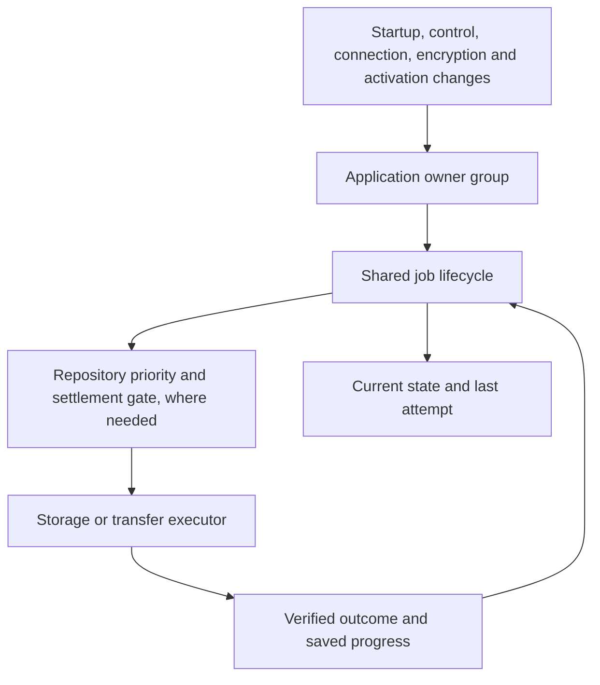
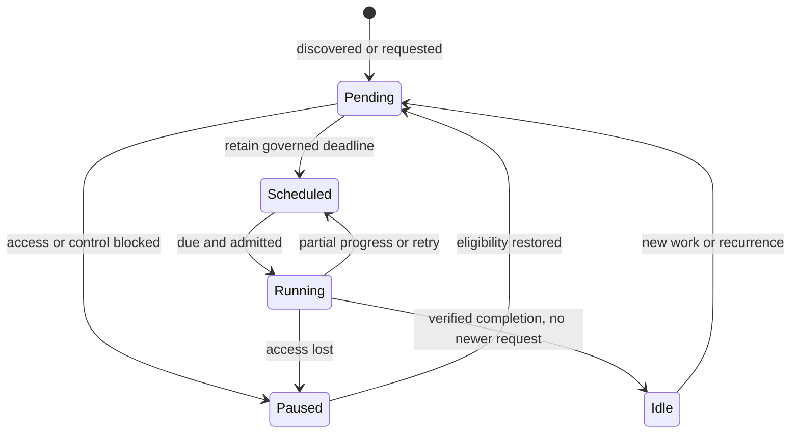

# Product development and earlier engineering records

Consolidated 2026-10-30 from commit `4136ba513479f0e0e0c01e0cef2495bcf61e0a2e`. Each original document below is preserved byte-for-byte between markers. This archive contains **historical observations, plans, measurements, decisions and status claims**, including superseded migrations and incomplete acceptance statements. It is not the current implementation plan, current data contract or a fresh QA certificate. Original relative links remain historical; use the source links in the inventory to inspect the original tree.

Current entry points: [documentation map](../README.md), [product guide](../PRODUCT.md), [architecture](../ARCHITECTURE.md), [data contracts](../DATA-CONTRACTS.md), [conversion control record](../../TS-CONVERSION-EXECUTION.md). Explicit owner decisions/current source supersede old prose; never resurrect migration code from this archive. TypeScript preparation/Phases 1–4 have their [own preserved record](../typescript/HISTORY-PREPARATION-PHASE-4.md).

## Original document inventory

- [docs/HANDOFF.md](https://github.com/oneshubhamt/study-director/blob/4136ba513479f0e0e0c01e0cef2495bcf61e0a2e/docs/HANDOFF.md)
- [docs/NOTES.md](https://github.com/oneshubhamt/study-director/blob/4136ba513479f0e0e0c01e0cef2495bcf61e0a2e/docs/NOTES.md)
- [docs/AUDIT-DATA-AND-BACKUP.md](https://github.com/oneshubhamt/study-director/blob/4136ba513479f0e0e0c01e0cef2495bcf61e0a2e/docs/AUDIT-DATA-AND-BACKUP.md)
- [docs/AUDIT-BACKUP-AFTER-SYNC.md](https://github.com/oneshubhamt/study-director/blob/4136ba513479f0e0e0c01e0cef2495bcf61e0a2e/docs/AUDIT-BACKUP-AFTER-SYNC.md)
- [docs/AUDIT-BACKUP-AFTER-CLEANUP.md](https://github.com/oneshubhamt/study-director/blob/4136ba513479f0e0e0c01e0cef2495bcf61e0a2e/docs/AUDIT-BACKUP-AFTER-CLEANUP.md)
- [docs/AUDIT-BACKGROUND-SERVICES.md](https://github.com/oneshubhamt/study-director/blob/4136ba513479f0e0e0c01e0cef2495bcf61e0a2e/docs/AUDIT-BACKGROUND-SERVICES.md)
- [docs/BACKGROUND-AUDIT.md](https://github.com/oneshubhamt/study-director/blob/4136ba513479f0e0e0c01e0cef2495bcf61e0a2e/docs/BACKGROUND-AUDIT.md)
- [docs/ARCHITECTURE.md](https://github.com/oneshubhamt/study-director/blob/4136ba513479f0e0e0c01e0cef2495bcf61e0a2e/docs/ARCHITECTURE.md)
- [docs/BACKUP-ENGINE.md](https://github.com/oneshubhamt/study-director/blob/4136ba513479f0e0e0c01e0cef2495bcf61e0a2e/docs/BACKUP-ENGINE.md)
- [docs/BACKGROUND-OPERATIONS.md](https://github.com/oneshubhamt/study-director/blob/4136ba513479f0e0e0c01e0cef2495bcf61e0a2e/docs/BACKGROUND-OPERATIONS.md)
- [docs/NOTIFICATIONS.md](https://github.com/oneshubhamt/study-director/blob/4136ba513479f0e0e0c01e0cef2495bcf61e0a2e/docs/NOTIFICATIONS.md)
- [docs/VERIFICATION.md](https://github.com/oneshubhamt/study-director/blob/4136ba513479f0e0e0c01e0cef2495bcf61e0a2e/docs/VERIFICATION.md)

## Archived source: docs/HANDOFF.md

<!-- BEGIN ORIGINAL docs/HANDOFF.md -->
# Handoff

**TS-Conversion branch:** use [the execution record](../TS-CONVERSION-EXECUTION.md) for current scope, decisions and validation. The owner assumes all supported installations completed the previous canonical upgrade. Historical converters/readers are retired; earlier migration and Release B retirement conditions below are superseded on this branch. Current recovery and integrity protections remain.

Status of the work. It was built on `refactor/background-coordination` and merged into `main` through PR #1; the original release is kept on the branch `SDVB75F10`. Read sections 1 and 5 first; sections 2 to 4 are closed summaries.

**Current state (2026-10-25):** the backup and data work is finished. The notes plan in `docs/NOTES.md` (items 1 to 16) is fully built, all five steps, including the measurement at 2,000 notes. The background services are mapped and held to one standard (section 4). Drive sync and profiles (section 5) are done: the small items (5.5), sync (5.1), merge rules (5.2), profiles and device names (5.3, 5.3a), the first-start form (5.4), the removal of what section 5 made redundant, and a fresh audit of the backup system with its fixes (5.6). Release B (removing the readers of older backup formats) waits until "Format cleanup" reads ready on every device in use (5.3a). Wordgard is now 0.6.2 and its own module (section 6, done 2026-10-25). The editor toolbar is in its new order, and the notification sounds are made in code (no sound files ship). The UI overhaul (branch `claude/wizardly-curie-qopkrx`: Dark/Light themes independent of the Director, Glass and Aurora skins, typography roles, heroes, area atmospheres, motion) is merged on top, and every screen added here is styled for it (section 7, "UI overhaul merged").

---

## 1. How we proceed (agreed 2026-10-06)

**Philosophy.** The app is clean, lean, efficient, elegant and reliable. No extravagant or unnecessary features. Everything works rock solid within the range it is meant for. Do the simple things very well; do not over-engineer.

**Order, and when the session ends.**
1. Finish refining the backup system to its best shape. **Done.**
2. Audit it and report to the user what I think. **Done.**
3. Hold a brainstorming session with the user to understand how to improve notes. Discuss first; build only after agreement. **Done.**
4. Then the background services (section 4). **Done.**
5. Then Drive sync and profiles (section 5, decided 2026-10-17). **Done.**
6. Then Wordgard as its own module (section 6). **Done** (2026-10-25).
7. The session concludes only once all four — backup, notes, background services, sync — are as good as we can reasonably make them.

**Migration (user's rule, 2026-10-10).** Older data is read once, converted into the current canonical form, verified and retired, never used again. Only the compatibility host (`compatibility-host.js`, plus repository adapters where a transaction requires it) reads old forms; the ordinary runtime reads only current forms. Every conversion is listed in `contracts/compatibility.mjs` with its retirement condition, so the whole migration machinery can be deleted later, leaving one clean canonical data structure.

**Not deployed (user, 2026-10-18).** This branch has never been released. Production still runs the old version from before this branch. Formats, identities and backups that existed only on this branch need no migration or compatibility; new changes simply replace them.

## 2. Done: backups and data (closed)

There is nothing to re-read here; the designs live in `docs/BACKUP-ENGINE.md`, `docs/BACKGROUND-OPERATIONS.md`, `docs/ARCHITECTURE.md` and `docs/AUDIT-DATA-AND-BACKUP.md`. In short:
- **One backup engine** (`backup-provider.js`) runs every operation for the Device Folder and Google Drive. The app draws all three rows (Device Folder, Drive, portable file) the same way.
- **Data is lean and canonical.**
  - Older stored data is read once by the compatibility host, converted and retired.
  - Stored names are plain: notes are `notes` everywhere (store, records, backups) and the Device Folder settings are `deviceFolder`; the old "area note" and "automatic device backup" names are converted on first start (table in `docs/ARCHITECTURE.md` §2). Backup files are version 22 and checkpoints version 7; an older build refuses them until it updates.
  - The compatibility layer is isolated, so it can be deleted in one step later (`tests/architecture/storage/compatibility-isolation.mjs`).
- **Every audit finding is closed** (status table in the audit), along with #45 and #46.
- **Retention:** 15 versions per location (latest, 6 daily, 4 weekly, 4 monthly). No tier shares a week or a month with the one before it, so the history reaches four to five months back. On top of those, up to 10 Hourly versions from the last 24 hours, only where the notes changed (2026-10-17).
- **Dropped from the backup wish list:**
  - a "backup health" summary, because each location's row already shows its last backup and any problem;
  - streaming verification during restore, because every downloaded piece is already checked against the version's manifest before anything is written.
- **Left for later on purpose:**
  - encryption, to come as end-to-end encryption with a sign-in-first experience (data in the browser is not encrypted; see 5.8);
  - measuring restore of a very large library;
  - deleting the compatibility layer once no older data can remain.

## 3. Done: notes

Every decision is in `docs/NOTES.md` (items 1 to 15), with the order of work. All five steps are built; step 5 measured the app at 2,000 notes and fixed what was slow (results in `docs/NOTES.md`).

## 4. Done: every background service, mapped and held to one standard

**History.** The background services began as a patchwork: one broke another, and they did not give way to what the person asked for. Earlier sessions rebuilt them as state machines with one job model, shared priorities and preemption (section 6, "Background operations"). This pass (2026-10-17) mapped every service against the standard below. Most already met it; the gaps are closed.

**The standard for each job:**
1. Bounded work per run, with a work budget or progress watchdog.
2. Gives way at once to foreground work, resuming from a durable checkpoint.
3. Intent persisted when it must survive a reload; idempotent when repeated.
4. One retry policy: backoff with a cap, and a user notice only when a person can act.
5. Runs only while this tab owns writes; pauses during restores, updates and browser-data clears.
6. Visible in one diagnostics view (Library → Data → Copy diagnostics) with state, next run and last outcome.
7. Tested on a fake clock, plus a browser test for the real lifecycle.

**The map.**

| Service | Meets the standard | Changed in this pass |
|---|---|---|
| Canonical data maintenance | Yes: 20 s budget, yields to foreground, durable pending record, 24 h cadence (defined once, in the repository) | Uses the shared gate. Keeps running through a browser-data clear, because it is the recovery path. Each completed day also empties notes past 30 days in Recently deleted, then starts attachment cleanup. |
| Attachment cleanup | Yes: 5 s / 128 files a pass, strict reference proof | Shared gate. Waits while a clear is unresolved and stops at once when one is detected. Images in Recently deleted notes are kept (now tested). Runs after each daily upkeep and soon after a file falls out of use; it no longer keeps its own browser-storage record (the two old keys are removed at start-up). |
| Attachment verification | Yes: 5 s / 128 files, saved progress, daily | Shared gate; waits during a clear. After giving way to the person it resumes when they finish, not 10 minutes later. |
| Backup scratch files | Yes: lock per file, pinned files kept | Shared gate: now the writing tab only, and waits during a clear. |
| Automatic backups, retention cleanup, integrity (Device Folder and Drive) | Yes: one engine, shared priorities (integrity < maintenance < automatic < convergence < foreground), leases, journals | Shared gate (it already paused for clears). A file backup or import the person starts now holds this work, so it never waits behind an integrity hash in the shared file worker. |
| App update checks and the safe update | Yes: own timer with capped backoff, writing tab only; an update waits for backups (up to a minute) and for the applied plan to end | Diagnostics now show the next check, the last check and failed attempts. |
| Service worker caches | Yes: a fixed file list and at most 3 release caches, nothing cached at runtime | None; no size budget is needed. |
| Workers | Search: let go after 2 quiet minutes. Export: stops after each job. Image and Insights: one per use. | Attachment worker: now let go after 2 quiet minutes, like search. |
| Deletion records | Yes: bounded, trimmed by canonical maintenance | None. |
| Storage health and quota | Persistent storage requested at launch; warnings at 80% and 92% | The estimate was measured only at launch; it is now refreshed on returning to the app, at most hourly, so a tab left open for days still warns. |
| Notices, editor clean-up, debounced saves | Foreground UI, not background work | None. |
| Drive sync: catch-up, turns, copies between locations (inside the automatic backup job) | Yes, since the 2026-10-25 audit | A failed or cancelled catch-up is tried again on the backoff (30 s, 2 min, 10 min, 30 min), not at the next 20-minute check, and after four failures says "Syncing with Google Drive keeps failing". Waiting for another device's turn backs off (15 s, 1 min, 5 min); this device's own leftover upload marker no longer makes it wait. A version this app cannot read makes it wait for an update: no retries, no upload over it. Copy diagnostics has a Drive sync row. |
| Drive sign-in expiry, kept across reloads (`drive.js`) | Yes | None. |
| Removed profiles' data deleted at start (`Profiles.collect`) | Yes, by design: it runs in any tab, and only for profiles no tab holds | Copy diagnostics has a Profiles row (profiles, removals waiting). Waits while the profile list comes from a newer version. |
| Device Folder preparation and the one-time move (`prepareInBackground`) | Yes, since the 2026-10-25 audit | Behind the shared gate, in the writing tab only, and under one lock across tabs, so two tabs opened together move the folder once with no error. A tab that starts writing later prepares it then. |

**The one shared gate.** `backgroundBlocker()` in `app.html` answers "may background work start?" for every job: start-up has finished, this tab owns writes, and, for housekeeping, no browser-data clear is unresolved. Each job adds only its own condition (storage support, encryption unlocked). When a clear is settled, every job is woken. The one job outside it is the deletion of removed profiles' data at start, which must run in whichever tab opens and touches only profiles no tab holds. While this device holds data from a newer version, local upkeep waits too (`unsupported-data`) and Drive takes no upload (`ARCHITECTURE.md` section 2). `tests/architecture/storage/background-work-contract.mjs` keeps it that way.

**One way to wait.** Local upkeep (canonical maintenance, attachment cleanup and checks, scratch files) asks `upkeepBlocker()`: the shared gate, plus "is the person busy?". While they are, each job waits under the named reason `foreground-busy` with no timer of its own, the same way backup jobs wait under a held reservation. One watcher checks back every 15 seconds and wakes every job the moment the work ends; notices, backup status and the end of an app update check at once. Local upkeep keeps its own gate rather than joining the backup reservation, because the backup busy signals include automatic backups, which would then block themselves. Copy diagnostics names every waiting and waking reason.

**Considered and left out.**
- *Run upkeep only while the page is visible.* A desktop tab left in the background all day would never run it. Upkeep already runs at background priority (`scheduler.postTask`) and yields to anything the person does.
- *Move the app-update timer under the shared job.* It already meets the standard; moving it would touch the update-safety flow for no visible gain.
- *One reservation for local upkeep and backups.* See "One way to wait": the backup busy signals cover automatic backups too.
- *New or merged services.* None is missing, and none duplicates another: the Device Folder and Drive already share every job.

**Audited again** (2026-10-25), after sync and profiles: `docs/AUDIT-BACKGROUND-SERVICES.md`. Nothing lost data. Found: a failed sync catch-up waited for the next 20-minute check (M1); four smaller gaps (L1–L4); docs, wording and tests. All are fixed (the report's "Status" section). The user's answers: D1, keep Remove in Version History and make the app keep working, whatever data it meets that it cannot read (`ARCHITECTURE.md` section 2, "Data this version cannot read"); D2, after a failed sync the sidebar says "Last synced <time>".

## 5. Next: Drive sync and profiles (decided 2026-10-17)

Build this next, before Wordgard (section 6). The decisions below are the user's, settled over several rounds; do not reopen them. Take it slowly and thoroughly: the user expects edge cases to be many, and robustness must not be traded for convenience.

**Goal.** Every device stays fully local and works on its own, exactly as now. Whenever a Drive connection happens to be open, the device syncs: it brings in what other devices changed, merges it with its own changes, then uploads. Drive is where a person's devices meet and holds the shared library and the shared Version History. It never overwrites an edit a device has not yet synced. Apart from Drive backup and restore becoming sync, and profiles, the app behaves exactly as it does now. The app is meant mainly for one device; two or three devices per person is the most it must handle well.

**Why.** Drive today is explicit handoff: back up the device you leave, then choose Combine or Replace on the other. If that step is skipped, the keep-15 rule (newest version per day, over all devices together) can drop one device's versions from Drive, so its edits then live only on that device (audit finding #1, 2026-10-17). Sync removes the manual step, and with it the risk.

### 5.1 Sync

**Done** (2026-10-17). Design and rules: `docs/BACKUP-ENGINE.md`, "Sync through Drive" and "One history". What was built, against the table below:
- Catch up first, then upload; an upload that finds Drive moved on stops and the device catches up; another device's recent publication marker makes it wait its turn.
- The shared base (v3) also holds one fingerprint per Saved Day and one of the Active Session, so Saved Days and the session merge three-way. Only Drive moves it.
- Sync never asks: anything that needs a choice leaves the data untouched and shows "Needs review" (sidebar and Drive row); Review opens Combine on Drive's version, after the study session if one runs. Making review marks that do not stop the rest of the sync is 5.2.
- The running session waits ("hold") while everything else merges.
- Sign-in kept across reloads for the rest of its hour.
- **Changed from the table (user, 2026-10-17):** the Device Folder and Drive keep one history. A version is made once and copied to the other location under the same id, so both show the same versions. The Device Folder is still not a sync channel.
- **Study session across devices (user, 2026-10-18).** The session names the device running it (ActiveSession v10, `runningOn`); only that device runs the timer. Another device shows "Running on another device" and edits notes and everything else freely; notes from it reach the running device without stopping its session. Suspend hands the session over (uploads at once; the other device offers Continue here). Continue Here on a device whose copy still runs elsewhere asks first; the device taken over from stops at its next sync and keeps its unsynced progress for review. "Needs review" opens during a running session and leaves the session as it is.
- Known limit: a fresh device whose plans and settings differ from Drive's keeps Drive's for review on its first sync (5.4 settles this).

| Part | Decision |
|---|---|
| When | Whenever a Drive sign-in is open. Google gives this app about an hour, renewed only by a tap; that is accepted, and sync simply happens during those windows. A sync runs on sign-in, on opening the app, on returning to it, every 20 minutes while it is open, and on going to the background |
| Upload cadence | Changes upload 20 minutes after the first one, as now. The user chose not to shorten it |
| Order | Catch up first, then upload. A device never uploads over a Drive version it has not merged |
| Upstream conflicts | Uploads take turns through the existing publication lease. If Drive moved on after this device caught up (another device uploaded in between), the upload is refused, and the device catches up again and retries, without asking anything |
| Common ancestor | Each device remembers the Drive version it last synced with (the existing reconciliation base). That is the ancestor for three-way merging, however long the device was offline |
| Two devices open together | No device lock: a Web Lock only works inside one browser, and a lock on Drive would stop the other device. Catching up on return to the app shows the other device's edits before you type |
| Three devices | Each device merges only with Drive, which already holds the others' changes, so a choice is always between two versions |
| Running session | Restore is blocked while a session runs, because it replaces or combines today's session (`hasBlockingActiveSession` in `app.html`; the blocked actions are `ACTIVE_SESSION_BLOCKED_CLICK_ACTIONS`). Sync must not be blocked. While a session runs, everything else merges as usual. Incoming changes to the running session itself (the Active Session and today's plan) wait until it ends or is suspended, then merge by the same rules. Uploads carry on and include this device's session as it is |
| Sign-in expiry | The existing dismissible "sign-in expired" toast stays exactly as it is. No other prompts to sign in |
| Sign-in across reloads | Keep the Drive sign-in for the rest of its hour across reloads; phones often close and reopen the app. Today it lives only in memory (`drive.js`) |
| Status | A small status by the name tag in the left sidebar and in the Drive row of Library → Data: "Synced 10:42", "Syncing…" or "Changes since 10:42"; after a sync that failed, "Last synced 10:42" while it keeps trying (user, 2026-10-25); "Needs app update" when Drive's newest version or data on this device comes from a newer version |
| Combine and Replace | Leave everyday Drive use. They stay for backup files and Device Folder versions. Restoring a Drive version from Version History applies to all devices, with a safety version kept first |
| Device Folder | Unchanged: a local safety copy of this device (of the active profile). After a sync it holds the shared library anyway. It is not a second sync channel; two masters would mean conflicts |
| First sync with no shared history | For example two devices that backed up separately to the same Drive. Two-way merge: anything on one side only is added, anything different on both is kept for review |

### 5.2 Merge rules

**Done** (2026-10-18). Design and rules: `docs/BACKUP-ENGINE.md`, "Kept for review". What was built, against the table below:
- A sync never stops for a choice. Smart merge joins notes changed in different paragraphs; everything else changed on both sides shows the newer and keeps the other as a `PendingReview` record (contract `PendingReview.v1`, appMeta `pendingReview:<id>`).
- Kept versions are synced data: backup v23 and manifest v8 carry them (released v20 files and v5 manifests read with none; v21, v22 and manifests 6, 7 came only from unreleased builds and are refused), every device gets them, a resolved one wins everywhere, and at most 2000 may wait (more stops the write; nothing is dropped). Their images are kept.
- Review: a quiet "Needs review" mark on the note, a count in Library → Data, and "Needs review" in the sidebar. Choices first (titles, deletions, Saved Days, plans and settings, the session), then note texts in `reconciliation-ui.js` with Smart merge from what both last shared. Each choice is an ordinary edit that syncs; nothing that changed while the person chose is overwritten. A kept session waits while a session runs here and comes back suspended.
- A takeover no longer stops the sync: the device taken over from shows the running session and keeps its own progress for review.
- "Needs review" on Drive's version itself now appears only for what a sync cannot keep (an older backup format, or more than 2000 waiting).
- Version History (5.5): each version made after a sync holds the kept versions, so they are in the history too.

The person's data is never lost. Merging is automatic wherever it is lossless; only genuine conflicts are shown, and never as a pop-up during study.

| Case | Result | Asked? |
|---|---|---|
| Changed on one side only since the last sync | That change is taken | No |
| Note changed on both, edits in different paragraphs | Smart merge, applied automatically. `mergeThreeWay` (`rich-text/reconciliation.ts`) already returns `safe: true` when no paragraph changed on both sides, and treats fuzzy matches as conflicts | No |
| Note changed on both, in the same paragraph | The newer edit shows for now; the other version is kept with the note and marked "Needs review" | Once, whenever the person chooses |
| Note title renamed on both | The newer title shows; the other is kept for review | Same |
| Note edited on one device, deleted on the other | The note stays; the review offers to delete it | Same |
| Saved Day, plans and settings, or the Active Session changed on both | The newer one shows; the other is kept; the review lets the person pick one | Same |
| Attachments | Added on either side are kept (they are content-addressed); deletions follow the deletion records | No |

- Timestamps never settle a genuine conflict. They only decide what shows until the person reviews it.
- A kept version is synced data: it can be reviewed on any device, never expires, and goes only when resolved. This needs a new "pending review" record in the library and in backups.
- The review uses the existing dialog (`reconciliation-ui.js`): Smart merge, Append additions, keep either side, or Custom. It opens from a quiet "Needs review" mark on the note and from a count in Library → Data.
- Each kept version is also in Version History (hourly versions, 5.5).
- This replaces the rule agreed earlier the same day ("the newer edit wins and the other text goes to Recently deleted").

### 5.3 Profiles

**Done** (2026-10-18), with device names. Design and rules: `docs/BACKUP-ENGINE.md`, "Profiles". What was built, against the table below:
- **Profiles** (`core/profiles.js`). The device list is one browser-storage key (`studyDirector.profiles.v1`): the active profile and, for each, its id, name, Google email and Drive folder. A profile id is `prof_<name>_<time>_<random>`. It follows the name only until the first start is finished and no Drive library knows it; after that it never changes.
- **Storage per profile.** The first profile keeps every current storage name, so nothing moved. A later one adds `~<scope>` to each name: database, browser-storage keys, attachment and scratch folders (the workers check the folder they are given), locks, channels, the Drive sign-in and the Device Folder repository. The scope is fixed when the profile is made. Device-wide: the device ID, the install notice, the update check and the profile list.
- **Profile panel.** Name, Google Drive (email; connect, change, disconnect), backup password (set, change, remove), the profiles on this device (Switch, Add profile) and this device's name. Opened from the name tag in the sidebar (desktop) and from the letter circle on phones. Library → Data keeps the password and Drive controls, and has Remove this profile (shown with two or more).
- **Switching** reloads every tab into the chosen profile. With two or more profiles, each start asks for that profile's password ("Not now" keeps sync and encrypted backups waiting). With one profile, the kept key opens it.
- **Drive library tied to its profile.** The folder carries the profile id. Once per sign-in the app is told the account email and what the folder holds and settles it: its own folder continues; a folder from before profiles is claimed; a library from another device is offered as "Continue with your library?" (only within 5 minutes of tapping Connect) and its id taken over; a library or email of another profile on this device is refused without touching it, and the sign-in is forgotten so Connect offers the choice of account again. A new folder means a first, two-way sync.
- **Password per profile** (record `BackupProtection.v3`): the key is kept as a non-extractable key with the record. A password set, changed or removed on another device: the next sync shows "Needs password" (sidebar and Drive row); entering it continues the sync and keeps that password here. A plain version built on an encrypted one removes it here.
- **Removing a profile** asks first: when it is fully synced, it says Drive keeps everything; otherwise, that its data is deleted from this device for good. Its data is deleted once no tab holds it. Deleting a profile everywhere, and the last profile on a device, came later (5.3a).
- **Device names.** As in the table: `inst_<type>_<browser>_<time>_<random>`, named from the ID alone. Older IDs are replaced once.
- **Correction:** on phones the section bar is a floating bar at the **bottom** (glass presentation; the Director presentation keeps a top bar). The letter circle sits at its start.
- Known limits: Drive flows are tested against a simulated Drive (`tests/integration/backup/drive-profile-binding.mjs`), not real Google. Two people on one Google account are refused by design. A profile removed from one device stays on others (Delete everywhere, 5.3a, removes it from all).

| Part | Decision |
|---|---|
| What a profile is | A name, an optional backup password and an optional Google account. The three belong together. Drive and the password can be added later, or changed, in the Profile panel (primary) or in Library → Data |
| Profile panel (user, 2026-10-18) | One panel is the primary home for who you are: name, backup password (set, change, remove), Google account (shown by its email; connect, change, disconnect), the profile list (switch, Add profile) and this device's name (read only). Opened from the name tag on desktop and from the letter circle on phones. In-place editing of the name tag goes away. Library → Data keeps the password and Drive controls too, as the same actions, because backups need them; the name is edited only in the panel |
| Profile ID (user, 2026-10-18) | Like the device ID: made once from the name plus a unique part (for example `prof_<name>_<time>_<random>`) and never changed when the name changes. The display name is not unique and there are no usernames: two people with the same name on one device are separate profiles, told apart in the list by their Google account email when connected. Two or three people per device is the expectation, not a limit |
| Name (user, 2026-10-18) | One name per profile, synced with the library: changing it on one device changes it everywhere |
| Several people on one device | Supported, though rare. Each profile has its own local data: database, browser settings, attachments and Device Folder |
| Existing data | Becomes the first profile under its current storage names. Nothing moves, so there is no migration. New profiles get their own names, resolved from the identities already centralised in `contracts/` |
| Device-wide | Only what belongs to the device: app updates, the service worker and the profile list itself. Decide key by key |
| Switching | In the Profile panel. One profile is active at a time; switching reloads every open tab into it and asks for that profile's password (below) |
| Phones (user, 2026-10-18) | On phones the sidebar becomes the section bar (a floating bar at the bottom in the glass presentation), and the name and sync status are hidden (`.sb-head` at 900px and below), so phones show no sync status today. A small circle at the start of that bar shows the first letter of the name in the accent colour, with a small dot only for "Needs review" or a sync problem; tapping it opens the Profile panel |
| Dialogs (user, 2026-10-18) | The Profile panel, the first-start form (5.4) and Add profile (which opens the same form) are one family: the same size, layout and style. Uniform, consistent, professional; nothing janky |
| Design quality (user, 2026-10-18) | The name tag in the sidebar, the letter circle on phones and the Profile panel are designed with care on both desktop and phone: intuitive, plainly interactive (they look clickable, with clear hover, focus and pressed states), well proportioned and in the app's own design language. Checked with screenshots at desktop and phone widths before the pass is done |
| Google account (user, 2026-10-18) | Shown by its email, read with one small Drive request when connecting |
| Drive link | The Drive library records its profile's id. Connecting a Google account whose library belongs to another profile is refused, so two people's data can never mix. Changing the account uploads the whole library to the new account and leaves the old copy alone |
| Password | With one profile on the device, its backup key is remembered on the device (a non-extractable key, never the password) and not asked again. With several, each person is asked for their own when switching in, which unlocks their sync; "Not now" keeps working locally with sync paused. It is not a privacy lock, because browser data is not encrypted (5.8). No version or backup uses a password yet, so there is no old-password handling to build (user, 2026-10-18). Removing the password is allowed, with a warning that later versions upload unencrypted. A forgotten password cannot be recovered, by design; nothing more is built for that now (5.8) |
| Removing a profile from a device | From Library → Data, only after confirming its data is synced, or with a clear warning |
| Device names (user, 2026-10-18; build in the 5.4 + 5.3 pass) | Nobody types a device name. The device ID itself says what the device is: `inst_<type>_<browser>_<first-use time>_<random>`, e.g. `inst_iphone_safari_mgk3x9p2_a8f3k2q1`. Type and browser are read from the browser when the ID is made (with a touch-screen check, since some iPads report themselves as a Mac); the random part keeps two alike devices apart. The name is read from the ID alone, so any device can name any other: "iPhone · Safari", with "(since 12 Oct)" added only when two devices would otherwise look the same. No new fields or store: versions and the session already carry the ID. Shown in "Running on … (last update …)", the Continue here question and Version History rows ("from …" or "This device"). Browsers give no model names, so it is type and browser only; a cleared or different browser is a new device. No compatibility: IDs made earlier on this branch are simply replaced |

Design sync around profile ids from the start; build the per-profile storage after sync.

### 5.3a Backup folders, one format, deleting a profile

**Done** (2026-10-24; user, 2026-10-19: "fresh backup folders named by profile and device, retire the old ones; one pure canonical format; a deletion marker for profiles; anything can be deleted"). Design: `docs/BACKUP-ENGINE.md`, "Profiles" and "One format".

| Part | What was built |
|---|---|
| Drive folder | Named "Study Director – <profile name>" and renamed to follow the name, once per sign-in. It stays the same folder: the profile id in its properties says whose it is, never the name. A new Drive folder was not made, because devices mid-sync would race to it and one could lose changes; old-format versions retire in place instead (below) |
| Device Folder | Each profile and device has its own folder inside the chosen folder: "Study Director - Ana - iPhone Safari" (plain ASCII: a name with other characters was found to land in the chosen folder itself in Chromium's browser storage), found by its marker file (`repository.sdscope` version 2: profile id, profile scope, device id). The single folder of earlier versions is copied in, every file checked (size, and contents for versions and markers), then deleted; an interrupted move continues in the same new folder and the old folder is kept until the copy is complete. A folder chosen after a browser data clear offers to continue the earlier backup folder or start a new one; another profile's folder on this device is never offered |
| One format (release A) | Once a location holds a version in the current format (manifest 8), older-format versions leave Version History and the next cleanup removes them (`selectRepositoryRetention`). Nothing old is rewritten. Copy diagnostics has a "Format cleanup" row: ready when this device's data is canonical (`verifyCanonicalInstallation`), the Device Folder's old folder is gone and every connected location keeps only current versions (per location: current and older counts) |
| Release B (later, separate) | Removes the code that reads older formats (compatibility entries `backup-repository-v1-v4` and `device-folder-single-repository`). Only when "Format cleanup" reads ready on every device in use |
| Delete a profile | Library → Data → Delete this profile…: **Remove from this device** (as before; its backups stay) or **Delete everywhere**: its Drive library goes to the Drive Trash (recoverable there for 30 days), after a deletion marker is left in Drive (a small folder "Study Director – Ana (deleted)" carrying the profile id, appProperty `studyDirectorDeletedProfile`); this device's Device Folder backup folder for it is deleted; its data here is deleted |
| Other devices | At the next Drive sign-in, before the library is used or made again, the marker is found. With nothing on the device that Drive did not have, the profile is removed there without a question; otherwise the person chooses Delete here too, or Keep on this device (the profile takes a new id, leaves the Google account and stops syncing; connecting Drive again starts a new library) |
| Last profile | Can be deleted too: a new, empty profile replaces it and starts with the first-start form |
| Single items | Already deletable, and deletions sync (deletion records for notes, Saved Days and attachments; edits for the rest): notes (Delete, Recently deleted, Delete forever), Saved Days (Delete Saved Day), reflections (Delete in Diary), attachments (Library → Data → Attachments), saved plans (Delete). Nothing new was built for these |

- Known limits: a device that never signs in to Drive again keeps a profile deleted elsewhere. Device Folder backups of a deleted profile on other devices go when those devices remove it. Deleting everywhere needs Drive signed in when the profile has a Drive library.

### 5.4 First start

**Done** (2026-10-18). Someone new (no data on this device) sees the form below; existing data becomes the first profile with no form. Skip leaves the name empty and keeps the profile. The typed password is set before Drive is used; connecting to a library from another device takes its name and settings. Add profile opens the same form, with Cancel going back to the profile it was added from. The old name prompt and its skip date are gone (`nameSetupSkippedDate` is cleaned up as an obsolete key).

One form, an upgrade of the name dialog:

```
Personalise Study Director
Name             [ Your name           ]
Backup password  [ Optional            ]   (a confirm box appears once you type)
[ Connect Google Drive ]  Keeps your devices in sync. You can connect later.
                                            [ Skip ]  [ Continue ]
```

- The password is set before the first upload, so no unencrypted copy reaches Drive. Minimum 12 characters, as now.
- Connecting to an account that already has a library offers "Continue with your library (412 notes, synced yesterday)" and downloads it. The typed password unlocks it, or is asked for again.
- The name comes from the library, not from Google (no extra Google request).
- Existing users see no form; their data and name become the first profile.
- Without Drive, Library → Data shows a quiet "Not synced · Connect Drive" line. No pop-ups.
- Add profile opens this same form, in the same dialog family as the Profile panel (5.3).

### 5.5 Small items (step 1)

| Item | Decision |
|---|---|
| Hourly versions | **Done.** Up to 10 more from the 24 hours before Latest, one per local hour, and only where the notes changed (the user's refinement: so Version History is not crowded). Same rules at Drive and the Device Folder (`selectRepositoryRetention`). Before this, only the newest version of the current day survived |
| Combine and Replace colours | **Done.** Combine is the primary (accent) choice; Replace and its confirmation are amber (`caution`). Dialog buttons marked primary had no style at all, which is why Combine looked muted; `.interaction-action.primary` and `.caution` now exist |
| Audit finding #3 | **Done.** The restore journal label is `RestoreJournalPayload.v5` |
| Audit finding #4 | **Done.** The Device Folder info popover says to use a folder only this device uses, not one synced by Dropbox, OneDrive or iCloud |

### 5.6 Order of work

1. The small items (5.5). **Done.**
2. The sync engine and merge rules (5.1, 5.2), with sync designed around profile ids. **Done.**
3. The first-start form (5.4) and profiles (5.3), in one pass, with device names (5.3) folded in. **Done.**
4. Remove what section 5 made redundant, then a cleanup pass. **Done** (2026-10-24):
   - Formats only unreleased builds of this branch wrote are refused, not read: portable backup v21 and v22, manifests 6 and 7, last-backup record version 2 and verification state version 6. Released formats (v20 and older, manifest 5 and older) still read. The compatibility entry `backups-before-pending-reviews` is gone.
   - Restore from a notice opens the one Version History whenever a backup location is connected.
   - Unused exports removed from the backup modules (capture, repository, background scheduling).
   - **Audited again** (2026-10-24): `docs/AUDIT-BACKUP-AFTER-CLEANUP.md`. The user answered D1 (no device ran a branch build against real backups) and D2 (show an unreadable version, with Remove). Every finding is fixed; its Status section says how.
5. Audit the backup system and app behaviour again (noted by the user, 2026-10-18). Drive went from a manual handoff (back up, then Combine or Replace on the other device) to automatic sync, so much has changed. Check whether everything is still in its best shape, and what can be improved, refined or corrected:
   - Device Folder and Drive backups end to end, after sync and one history.
   - Version History: one history now shared by both locations, with keep-15 plus up to 10 hourly versions. How each location keeps, copies and prunes them.
   - A note's earlier-versions list gathers Drive and Device Folder versions separately; with one history this may now be redundant.
   - Every app behaviour built for manual handoff: restore flows, Combine and Replace, wording, reminders, status and notices.
   - Report findings to the user first, as with the earlier audits.
   - **Audited** (2026-10-24): `docs/AUDIT-BACKUP-AFTER-SYNC.md`.
   - **Decided** (user, 2026-10-24): one Version History list; one safety version per device on Drive; drop the Primary and Optional labels (phones and iPads may have no Device Folder).
   - **Done** (2026-10-24): every finding fixed. See the Status section of the audit report.

For each build step: make all the changes, build, test with two simulated devices in a real browser, fix, document, commit.

### 5.7 Edge cases to settle while building

| Case | Direction |
|---|---|
| A device whose browser data was cleared | The existing guards hold: a device with an unresolved clear never uploads; it downloads again |
| A device offline for months | Merges normally; deletions older than the kept deletion records may reappear |
| Device clocks differ | Clocks only choose what shows before review; they never decide a conflict |
| A note open in the editor when a change arrives | It updates in place if nothing was typed since the last save; otherwise it is a both-changed case |
| Password added or changed on one device | Other devices ask for the new one at their next sync |
| Wrong Google account, or the account changed | Refused, or a full upload, as in 5.3 |
| Drive full or unreachable | Sync pauses, the app carries on locally, with the existing toasts |
| Restoring a Drive version | Applies to all devices; pending reviews are kept |
| Large attachments on mobile | Downloaded only when missing, as now |
| Data from a newer version, or two versions that disagree on how data is laid out | **Decided** (user, 2026-10-25): what this build cannot read is held untouched and shown read-only; nothing is converted, merged or deleted. A database another profile or version holds offers "Open <other profile>" or "Start a new profile", as now. No side copies through Needs review. |

### 5.8 Later (noted, not planned)

- **Encryption at rest.** Data stored in the browser (IndexedDB, browser storage, attachments) is not encrypted. Backups are, when a password is set: Device Folder, Drive and backup files, attachments included. Note exports are not. Profiles on one device are therefore separate, not private. Already on the list: end-to-end encryption with a sign-in-first experience (section 2). That work, which extends encryption to the whole data topology, also decides how passwords are managed: recovery, changes and the rest (user, 2026-10-18).
- **Fully silent background sync** would need a small server to hold Google refresh tokens. Not planned; sync during sign-in windows is the accepted design.
- **Better Smart merge of notes** (`mergeThreeWay`). It works decently, with a lot of room to improve. The user will come back to it later; until then, do not audit it or suggest changes (noted 2026-10-18).

---

## 6. Done: Wordgard as its own module (decided 2026-10-11, built 2026-10-25)

| What | Where |
|---|---|
| Upstream source, exact | `vendor/wordgard` is Wordgard 0.6.2, checked against `build/wordgard-metadata.mjs`. |
| Wordgard's own module | `source/external/wordgard.js`: readable (not minified), the parts of each Wordgard package the editor uses, on `globalThis.StudyDirectorWordgard`. Entry `rich-text/wordgard-module.ts`. |
| Study Director's editor | `source/external/rich-text.js` reads Wordgard from that global (`wordgardGlobalPlugin` in `build/wordgard-bundle.mjs`); it holds no Wordgard code. |
| How they ship | Development and the plain deployment load both as one script, Wordgard first (`rich-text` has two sources in `build/module-manifest.mjs`). The minified deployment (`stage:firebase:minified`) ships the lean build instead: the editor and only the Wordgard code it reaches, tree-shaken and minified together. |
| Our changes to Wordgard | Build-time rewrites (`build/wordgard-source-patches.mjs`) and runtime additions behind `rich-text/wordgard-adapter.ts`, unchanged in kind. |
| New version | Replace `vendor/wordgard`, run `npm run build:richtext`; a rewrite whose upstream text moved fails by name. Record the snapshot in `build/wordgard-metadata.mjs`. |
| Tests | Tests that load the editor read both files through `tests/helpers/rich-text-runtime.mjs`. |

**Checked with 0.6.2: still needed.**

| Workaround | Why it stays |
|---|---|
| `inert-html.ts` and the two parsing rewrites | Wordgard still creates a Trusted Types policy on every HTML parse, which the app's policy list refuses. |
| `cut.ts` | Copy and cut still read the selection without first reading the DOM, and `deleteByCut` still maps to no command. |
| `Node.slice` rewrite | Still spelled in a way esbuild rejects. |
| History menu trim | Upstream history still ships undo/redo menu buttons. |

**Changes for 0.6.**
- Position sets come from `wordgard/set`; `create` takes `[value, pos]` and `[value, from, to]`.
- Pastes arrive as `beforeinput` `insertFromPaste` (an `InputEvent` with `dataTransfer`). Browser tests send the paste the way the browser does (`pasteInPage` in `tests/helpers/browser-harness.mjs`).
- Wordgard hands a paste to its paste handlers only when the paste lands on its own selection. In an empty editor focused from the keyboard the browser's caret can sit outside that, so a pasted image is taken from the `paste` event itself.
- `Decoration.Tag.shape.dynamic` is now `.derived`.
- Wordgard re-renders an atom's attributes from its shape. Audio is therefore drawn with its loaded address and status, as images are, and the editor no longer marks the player with its own attributes.
- Key bindings carry descriptions from Wordgard's phrase table, so the module includes it (about 120 lines).
- Size: the lean deployment build grew from 112.2 KB to 115.8 KB Brotli.

**Also noted with it (2026-10-17).** Both done (2026-10-25).

| Item | What to explore |
|---|---|
| Sounds made in code | **Done** (2026-10-25): the 13 cues are made in `audio-engine.js` from the same recipe, matching the old WAV files sample for sample (three samples one step apart). The WAV files (about 525 KB) and `build/compose-sounds.py` are gone; nothing about sound is precached. |
| Editor toolbar order | **Done** (2026-10-25): undo/redo · text · bullets, numbers, checklist · block quote · link, table, horizontal rule · attachment · focus. |

---

## 7. Record of work on this branch (reference only)

Commits since `main` (newest first), grouped:

### Backups (this and recent sessions)
- The commit after `ebb49fa`: sync through Drive (5.1) and one history for the Device Folder and Drive.
- `ebb49fa` Hourly versions where notes changed; Combine blue, Replace amber; audit fixes (5.5).
- `d8000e4` and the commit after `9afe06d`: the Device Folder runs through the shared backup engine. It was saved mid-move, then finished, with the due-time, lease-renewal and aborted-maintenance fixes.
- `d27570f` Prepare the backup engine to host the Device Folder (hosted locations, server-digest receipts, operation views, protected safety API).
- `f71a941` Check runs of small attachments with one read (`checksum.ranges`).
- `9696df4` Skip backups that would duplicate the newest version.
- `d03d0ce` Let the Drive cleanup test wait for background hashing (CI flake fix).
- `5e199b0` Describe standalone backup files in the backup design.
- `cae38d9` Encrypt and decrypt backup frames four at a time.
- `d597287` Save backup files where you choose, verified, with progress from the first click.
- `7b3db98` Back up when the app goes to the background and before an update.
- `3c57544` Hash files three to four times faster.
- `976c982` Back up to Google Drive automatically, every 20 minutes at most:
  - opt-in;
  - one dismissible expiry toast with Reconnect;
  - one 7-day reminder rule.
- `66977b9` Add a Device Folder storage adapter for the shared backup engine.
- `9614004` Describe the target backup engine.
- `16adda3` Restore attachments from this device instead of downloading them again.
- `68662cf` Add only what's missing from Drive and backup files.
- `eb54715` Use one forward-only change clock for every save.
- `d2c6bba` Cut two sequential Drive round trips from every backup.
- `0da44c1`, `7af933d`, `258e51a`, `8aa1275` Single-note restore: only the note's data is read, its images come back, and it works during a study session.
- `b68b9f0` Keep 15 backup versions through any gaps in backup history.

Measured on 200 MB of attachments:

| Operation | Before | After |
|---|---|---|
| File backup | 10.2 s | 2.5 s |
| Encrypted file backup | 17.1 s | 5.3 s |
| Save through the dialog, then verify | — | 4.6 s |
| Check before restore | 4.9 s | 1.1 s |
| SHA-256 in the worker | about 38 MB/s | about 135 MB/s |

### Notes and Library
- `b30da47`, `5034bdf`, `368d8b6` Notes step 1: permanent note ids, the combined earlier-versions list, the rename tick box; conversions only in the compatibility block.
- `c08935f`, `b331580` Notes step 2: "Notes" everywhere, strikethrough, the Library in Notes · Days · Data, sorting, search landing on matches, Print….
- `908bf5c` Notes step 3, the linked-notes bar at the bottom of each note (Library and Execute), the one note picker, `[[` and Link → Note links in the text, and "Linked from".
- `d172a94` Notes step 4, tags (chips in the text, the tag list with counts and an all-of filter, `#` suggestions in the shared picker, rename everywhere) and Import of .txt and .md files. The pickers now open after the keystroke that triggers them, so `[` or the first letter no longer lands in the picker's field.
- The commit after `d172a94`: Notes step 5, measured at 2,000 notes (2.3 million words). Each note's text is now checked once instead of on every read: start-up went from 8.0 s with a 2.9 s freeze to 2.5 s with none over 0.1 s, and the 2.5 s of background freezes after start-up are gone. Typing and tag rename no longer rebuild the title list. `notes-at-limit` (extended browser tier) guards it, and the release search test now runs at 2,000 notes.
- `042254b`, `90f0f7b` and `ccca88c`: resizable notes list; restore settles by itself only what cannot lose anything on this device (the handoff record keeps note titles and text and a plans-and-settings fingerprint), asks once for the rest ("All remaining" in the note review, one Replace question for what the backup lacks), and deleted notes go to Recently deleted.
- `546fbf2`, `26f862b`, `db1824a` Notes tree, Recently deleted, note menu, breadcrumb, editable title.
- `691a83d` One save engine for notes, Diary and Review reflections.
- `ff69680` Rename or move with children; merge only when asked.
- `941174c` Recently deleted for 30 days.
- `731c5c1` 20,000 words and 10,000 notes behind one count.
- `0244dae`, `a79d528`, `269e6e1` Save straight to the database with one safety copy; conflict-copy store removed.
- `e067b7b`, `f3f6602`, `7a482ce` Keep a clash's losing version; Recently deleted yields at the limit; bounded deletion ledgers.
- `397458f` Wordgard customisations behind the adapter.

### Browser data clearing and recovery
- `6c34bd7`, `cf8725c`, `52797b6`, `0ca95cb`:
  - restore what a clear removed, or let the person choose;
  - the decision stays on screen until made;
  - restore from what the person has;
  - pause backups until resolved;
  - carried across reloads.
- `ae93201` Keep Ongoing Notes and recovery intact across overlapping saves and clears.

### Background operations (earlier sessions)
- `abe12ff`, `8a85212`, `205b3b2`, `2c0fc8d`, `01a0995`, `e254fc6`, `a64f45d`, `cf4de02`, `a84a60d`, `707653f`, `38ef8c5`, `739b3db`:
  - one background job ownership model;
  - bounded, preemptible maintenance and integrity with preserved progress;
  - Drive publications resume across sign-in expiry;
  - verified Drive history inventory.

### Study session
- `6109402`, `4837fef` Away time counted only while the running block's study time lasted; the inactive-gap dialog is released when its timer already stopped.

### Review fixes (Codex, 2026-10-25)
- A backup note that takes this device's id (same title, made separately) keeps every link to it: other backup notes' linked-notes bars and `#note=` text links follow it (`alignByTitle`).
- Moving the old Device Folder backup folder checks every copied file by contents, stored objects included; a same-size object left by an interrupted move is copied again, and the old folder stays until all match.

### UI overhaul merged (2026-10-25)
- Merged `claude/wizardly-curie-qopkrx` (six commits on `SDVB75F10`) into this work. Theme IDs are now `dark` and `light`; stored `director-dark` / `director-light` still restore, and the next deliberate change writes the new ID. Aurora is a third skin (`external/aurora.js`).
- Screens added here follow the UI branch's rules: capitals and caps tracking come from the typography roles (Library title, Notes crumbs, profile section titles, Library section switch); the profile initials are capitalised in code, so no rule hard-codes `uppercase`. Main's Glass changes (Recently deleted, Notes rows, gap box, no backup-provider overlay) are carried into Aurora.
- Text that main drew in the faintest grey (note edit times, empty-note names, the note's meta line, "+ Link note", the backup-model summary) uses the secondary text colour, so it passes WCAG AA contrast in all six skin and theme pairs. axe finds nothing on the Notes, Recently deleted, Data, profile and first-start screens in any of them.
- Two speed fixes for the UI branch's motion. Insights no longer plays the pane entrance (it made the Insights render about 300 ms slower, over its 1-second budget). The area colours glide on the background layer alone instead of on the whole page (about 100 ms more). Insights is back to main's timing.
- Tests: `settleMotion` in the browser harness waits for finite animations; clicks and the accessibility and dialog-size checks use it, so they no longer measure a pane or disclosure mid-animation.
- Still as on main: skipping the first-start form leaves the profile unnamed, so the profile list says "New profile" while the heading shows the student name.

### Tests and QA
- `8891f6c`, `eb77264`, `3d91713`, `8338f5b`, `7105b02`: fixtures, suite policy, native visibility in browser tests, de-duplicated harnesses.
- The commit after `ddb7e1d`: the pwa-update flake had two causes. A read-only secondary window that briefly held control kept waiting for its session state to settle, so it never reloaded onto the new release; it now reloads, and finishing a session-state change re-checks a waiting update at once. A window whose service worker has already moved to the new release retries every 5 seconds instead of every 5 minutes, which also covers the hidden window taking control while the visible one reloads. The test clicked Skip on the first-start form before the form had opened; `skipFirstStart` in the browser harness now waits for it.

---

## 8. Working notes

- **Testing rhythm (user's rule, 2026-10-10).** Make all the app changes for a piece of work first, then build once and run the suites once. Fix what fails, then rerun only the failing tests. Do not rerun tests after each small edit.
- **Chromium for browser tests:** `CHROMIUM_PATH=/opt/pw-browsers/chromium-1194/chrome-linux/chrome`. On a fresh profile, call `skipFirstStart(page)` so the first-start form does not block clicks.
- **Rebuild the worker bundles** after changing `portable/`: `node build/wordgard-bundle.mjs --write`.
- **Fake-clock tests** that hash or encrypt must wait for real background work (`realWorkSettled` in `repository-checkpoint.mjs`).
- **Shell heredocs mangle backticks.** Use quoted heredocs or small Python edit scripts with exact-match assertions.
- **No model names in commits.** Commit messages end with the Co-Authored-By and Claude-Session lines.
<!-- END ORIGINAL docs/HANDOFF.md -->

## Archived source: docs/NOTES.md

<!-- BEGIN ORIGINAL docs/NOTES.md -->
# Notes

The plan for making notes a first-class part of Study Director. **Status: decided (2026-10-10).** Every item below is agreed; the work follows the order at the end.

## Aim

Study Director is a first-class notes app as well as a time tracker, and its notes are treated that way in durability, reliability and features. They should just work: simple, smooth, intuitive and beautiful, in keeping with the rest of the app. They should cover what students and professionals use notes for about 90% of the time, without becoming a full-featured app like Notion or Evernote.

What already works well:
- **Writing:** headings, bold, italic, underline and highlight; lists, checklists, quotes, tables and web links; images, PDFs and audio inside notes; focus mode.
- **Organising:** nested notes, full-text search that updates on each save, and rename, move and merge.
- **Safety:** one save engine with a safety copy; when two saves clash, the losing text is always kept; 30-day Recently deleted; earlier versions from backups; offline use.

## Settled before this plan

- **No separate version history for notes.** Earlier versions come from the backup versions in the Device Folder and Google Drive (four to five months back). Together with undo and redo in the editor and Recently deleted (30 days), that is enough.
- **Accepted limits:**
  - each location keeps one version per day, so changes within a day are not kept separately;
  - someone who uses neither the Device Folder nor Drive has no earlier versions;
  - portable backup files are not a source of note versions.
- **No annotation features** for PDFs, audio or photos.

## Decided

1. **Earlier versions.**
   - The list combines both backup locations.
   - It holds one entry per distinct text of the note. Each backup records a fingerprint of every note, so identical texts collapse into one entry, whatever their location or time, without downloading anything.
   - The note's current text is never listed.
   - There is no per-day cap; at most 30 entries, and usually far fewer.
   - Labels use plain time, such as "Yesterday" or "3 days ago". When two entries share a date, the time is added.
   - **No backup machinery shows:** no locations, checkpoints or tiers. Nobody needs to know how backups work to use earlier versions.
   - **Choosing an entry** opens the existing side-by-side note review, which already handles keeping, combining or replacing the text.
   - **On Drive,** opening the list reads each version's small index file (up to 25, read together), so it takes a second or two.
   - **Where:** "Earlier versions…" stays in the open note's ⋯ menu, with Rename, Move, Export and Delete. The menu stays on the open note rather than moving to the list.
2. **Limit:** 2,000 notes (down from 10,000), 20,000 words each. No existing data or backup holds more, so the one limit applies everywhere. Measure opening, saving and searching at that size, and build a faster tree only if it is slow. Search already updates on each save rather than rebuilding, so it only needs timing. *(Measured in step 5: the tree and search were fast enough; start-up, background work and typing were not, and are fixed. Results are under the order of work.)*
3. **Strikethrough:** in the "More text formatting" menu, next to superscript and subscript. The editor already supports it, so it only needs switching on.
4. **Search lands on the match.** Opening a note from a search highlights every match and scrolls to the first. Arrow buttons or Enter step through the matches, and Esc or typing clears the highlights. The editor has highlighting built in, so this is a small addition, not a new system.
5. **Sorting:** a sort button with two choices. "Name" shows the tree. "Recently edited" shows a flat list, newest first, with each note's path in small text. It uses the edit time already stored. Other orders were left out: created date would need a new stored field, and size is rarely useful. Today's notes already carry a TODAY mark.
6. **Print a note:** "Print…" in the ⋯ menu prints only the note's title and content, with its images. The browser's print dialog also offers Save as PDF.
7. **Import text and Markdown files:** if it stays simple. Each file becomes a new note named after the file, at the top level or inside the selected note, within the limits. *(Built in step 4: Import beside + New; with a note open it asks "Inside <note>" or "At the top level".)*
   - **Plain text:** easy. Each line becomes a paragraph.
   - **Markdown:** converted to HTML, then passed through the existing paste cleaner that already turns pasted web pages into note format. Headings, lists, quotes, rules, tables (up to 15 × 15) and bold, italic, strikethrough, highlight and web links come across; `###` and deeper headings become bold lines, as notes have two heading levels.
   - **Kept as written:** images, links to other files, task-list boxes and anything else a note cannot hold stay as their Markdown text, so nothing is lost. Code keeps its lines and indentation as plain text.
   - **Images inside Markdown files:** not in the first version.
   - A title already in use gets " (2)". Files that are not .txt or .md, too large, or past the note limit are named in the result with the reason.
8. **Already covered:** keeping images and PDFs inside notes in sync with their note is part of attachment upkeep. *(Checked in the background-services pass: cleanup keeps every file a note refers to, including notes in Recently deleted, so restoring one brings its images back; `storage/background-gc-reliability` tests it.)* Editing while another tab takes over writing is already safe; add one test only if none covers it.
9. **Later:** math equations. Code formatting is also supported by the editor and can be switched on if it is ever wanted.
10. **Not doing:**
    - templates;
    - sharing;
    - drag-and-drop in the tree (Move covers it);
    - a separate Notes tab in the main navigation, because notes belong in the Library, which is the app's storage.
11. **Every note gets a permanent identity** (confirmed 2026-10-10).
   **Today:** a note is identified by its name ("Cardiology › Heart failure"). Renaming or moving a note gives it a new identity, so:
   - its earlier versions disappear (older backups hold it under the old name);
   - anything pointing at it by name breaks.

   **Decision:**
   - **Permanent id.** Each note gets an id at creation that never changes. The title is just a property, so rename and move change only the title.
   - **Everything points at the id:** versions, links between notes, trash, backups, search, export, and the "open the note this attachment belongs to" action.
   - **Stored record:** `{id, title, text, updatedAt}`, which replaces `{key, label, text, updatedAt}`, plus the optional list of linked notes (decision 12). Matching a block's Area to a note title uses a lookup built in memory; nothing extra is stored.
   - **Existing notes** are converted once, following the migration rule. A converted note's id is derived from its current name, so restoring or combining an older backup, which stores notes by name, maps them to the same notes.
     - Earlier versions (decision 1) come only from backup versions saved since ids (2026-10-11). Older versions still restore whole. The notes at the time were few, so this was kept simple (decided 2026-10-11).
     - The conversion lives only in the compatibility layer; the notes code itself knows only ids.

   Text matching was considered as the identity and rejected. A note's text changes with every edit, so it cannot recognise the note over time. The permanent id is the note's lasting fingerprint; text fingerprints are used only to compare versions.

   This is the largest change, and everything else builds on it, so it comes first.

12. **Linked notes bar.** Every note can carry a short list of other notes. *(Built in step 3.)*
   - **Where:** at the bottom of the note, under the text, like sheet tabs in a spreadsheet. With no links it is one small "+ Link note", so it takes no room and asks for no attention until used.
   - **In Execute,** while a block runs, the bar reads `[ Heart failure ]  Pharmacology ×   ECG basics ×   +`.
     - The first chip is the block's own note, matched by Area name as today.
     - Tapping any chip switches the editor to that note, and the title line says "Linked · Pharmacology"; tapping the first chip, or the block ending, goes back.
     - `+` searches and adds any note, and `×` removes one.
   - **In the Library,** the same bar sits under the note's text, so it can be managed there too.
   - **Up to 50** notes on one bar.
   - **Combine** keeps the notes either side linked; nothing is lost and nothing is asked.
   - **Remembered per subject, not per block.** The list is saved on the note, so every future block of that Area shows it.
   - **One-way.** Linking Pharmacology to Heart failure does not put Heart failure on Pharmacology's bar. Pharmacology shows "Linked from: Heart failure" in small text instead; that list is worked out, not stored.
   - **Stored:** one optional field on the note, the list of linked note ids. Ids never break on renames or moves.
   - **Deleted notes** drop out of every bar, and come back if restored from Recently deleted. Ids of notes deleted for good are removed the next time the note is saved.
   - **Earlier versions** restore the note's text only; its bar stays as it is.
13. **Links inside the text.** The Link button gets a "Note" choice, and typing `[[` opens the same picker. *(Built in step 3.)* Exports keep the linked word as plain text.
   - A linked word opens that note when clicked, just as a web link opens a page.
   - The link is stored by id inside the note's text, so nothing new is stored and renames never break it.
   - A link to a deleted note shows as unavailable, and works again if the note is restored.
   - Notes that link to the open one, from either the text or the bar, appear in its "Linked from" line.
14. **Tags,** written as `#tag` in the text, the way Apple Notes, Bear and Obsidian work. *(Built in step 4.)*
   - **Suggestions:** typing `#` offers existing tags, so near-duplicates like `#revise` and `#revison` don't appear.
   - **Look:** tags show as small chips in the text, and clicking one filters the notes list to that tag. In the Library's open note a tap narrows the list beside it and still places the cursor; elsewhere a tap in read-only text, or Ctrl/Cmd-click while editing, opens the Library's notes with that tag.
   - **Suggestions in use:** they open by the text at the first letter after `#`, only when another tag starts with it. Enter or Tab takes the highlighted tag; a space, a stop or Esc keeps what was typed.
   - **Tag list:** the notes panel lists tags with a count each. Picking one or more filters the list; more than one means "has all of them". One tap clears the filter. Picked tags come first, then the twelve most used; "+N more" shows the rest.
   - **Rename everywhere:** renaming a tag changes it in every note, which fixes typos or merges two tags. Rename shows when exactly one tag is picked. Only the text changes: links, attachments and formatting stay.
   - **Rules:** capital letters do not matter, and a tag starts with a letter after a space or at the start of a line. So `#1`, `C#` and a Markdown heading are not tags.
   - **Storage:** none. Tags are read from the notes' text, each note read again only when it changes, and exports keep them as plain `#tags`. (Built on the main thread rather than in the search worker, because the list and the suggestions need them at once. Step 5 measured it at about 80 ms, once per session, for 2,000 notes, so it stays there.)
   - The `#` suggestions, the `[[` picker and the bar's `+` share one picker.
15. **The Library has three sections: Notes · Days · Data.** A switch at the top chooses between them. Notes opens first, and the Library remembers the last section used.
   - **Notes:**
     - "Notes" replaces "Notes" everywhere, including Execute.
     - Under the heading, one line explains what they are: *Lasting notes for each subject and topic. A note opens alongside any block whose Area has the same name.*
     - The section holds the list (search, sort and tags) and the open note with its bar.
     - On a computer, the list takes about a third of the width and the note two thirds, at the full height of the window. Phones keep "list, then note".
   - **Days:**
     - **Diary** sits at the top, as a panel that opens with one click and remembers whether it was open. Inside it, the Diary keeps today's notes-like layout, a list of dates beside the entry, so entries can be browsed without going through Saved Days.
     - **Saved Days** follows below it: the filters (search, year, month and order), the list and the expanded day, kept as they are today.
   - **Data:**
     - backup locations and versions;
     - **Files** (today's Attachments manager), which spans notes and the Diary;
     - storage use.

     Each note and diary entry still shows its own images inline.
   - **Proper weight for every section.** Notes in particular must not look like a minor panel. Each section gets the space and proportion its importance deserves.
   - **Keep what works.** The redesign rearranges and resizes the existing parts rather than rebuilding them, and is shown as screenshots for approval before it is finalised.

16. **Renaming a note can take its Area along** (decided 2026-10-11).
   - **The tick box.** The Move dialog shows "Also rename it in today's plan and saved plans", ticked by default, whenever either uses the note's Area. Renaming the title in place behaves as if it were ticked.
   - **Ticked.** Blocks in today's plan change their Area in place, keeping their times, progress and the running timer. The draft and saved plans are rewritten too, so blocks keep opening the same note.
   - **Unticked.** Blocks keep the old name. The moment the rename happens, a running block shows an empty note under its own name, which becomes a new note once written in. The renamed note stays separate.
   - **Typing an old name by hand** into a later plan likewise starts a new note.
   - **Finished days** keep the name they were recorded with.

## How notes and Areas fit together

- **Two things name a note:**
  - its **permanent id**, given when it is created and never changed;
  - its **title** (the label, such as "Cardiology › Heart failure").
- **The title connects a note to the plan.** A block opens the note whose title matches its Area. That is the only place titles are used to find a note, and two notes never share a title.
- **Everything else uses the id:**
  - saving and clash handling, Recently deleted, and deletion records;
  - backups, earlier versions and restoring a single note;
  - the note an attachment sits in;
  - the linked-notes bar and links inside the text, when they come.
- **So a rename changes only the title.** History, links and attachments stay with the note, and the tick box above decides whether the plan follows.

## Order of work

1. **Permanent note identity (11)** and **earlier versions (1).** Done (2026-10-11), with the tick box from 16:
   - the record and a one-time conversion;
   - backups;
   - the combined versions list, which survives renames;
   - the 2,000-note limit.
2. **The Library in three sections (15)** and the notes surface. Built (2026-10-11), with screenshots for approval:
   - the new layout and names;
   - sorting (5);
   - landing on search matches (4);
   - strikethrough (3);
   - print (6).

   Screenshots go to the user before this step is finalised.
3. **Linked notes bar (12)** and **links inside the text (13),** with the shared picker. *(Built.)*
4. **Tags (14)** and **import (7).** *(Built.)*
5. **Measure at 2,000 notes,** then fix only what is slow. *(Done, 2026-10-16.)*

   **Measured** on 2,000 notes holding 2.3 million words (18 MB). The library has a nested tree, 78 tags, links between notes, and ten notes at the 20,000-word limit. `tests/browser/library/notes-at-limit.mjs` repeats it and fails if it slows again.

   **What was slow:** every read of the notes checked each note's whole text against the editor's rules again. A note was read three times for one check, and its size was measured by copying it. The app reads all notes several times at start-up, and again for backups and attachment upkeep. So it froze for 2.9 seconds at start-up, and for about 2.5 seconds more a few seconds later. Typing also rebuilt the list of all 2,000 titles on every keystroke, and renaming a tag rebuilt it once per note.

   **Fix:** a note's text is checked once. The same text for the same note is then compared, not parsed. The title list is rebuilt only when a title changes.

   | At 2,000 notes | Before | After | With 20 notes |
   |---|---|---|---|
   | Opening the app | 8.0 s, frozen up to 2.9 s | 2.5 s, never frozen over 0.1 s | 0.5 s |
   | Background work after opening | 2.5 s of freezes | none | none |
   | Storing all notes (as a restore does) | 4.1 s | 1.1 s | 0.05 s |
   | Opening Notes the first time | 0.2 s | 0.16 s | 0.05 s |
   | Opening a note (typical / 20,000 words) | 0.1 s / 0.3 s | 0.07 s / 0.2 s | same |
   | Each keystroke, the app's own work | about 7 ms | under 2 ms | — |
   | Saving a note | under 0.06 s | under 0.06 s | same |
   | Searching (first / then) | 0.3 s / 0.3 s | 0.25 s / 0.03 s | 0.09 s / 0.01 s |
   | Tag filter, pickers | about 0.1 s | about 0.1 s | under 0.05 s |
   | Renaming a tag in 161 notes | 1.0 s, frozen 0.7 s | 0.4 s, frozen 0.1 s | — |
   | A full backup | 4.1 s, frozen 0.8 s | 3.0 s, frozen under 0.1 s | 0.1 s |

   The "Before" search and note-opening times were taken with the profiler on, so they read somewhat high. Searching for a word that is in most notes highlights it throughout the open note; that took 0.13 s, and depends on the note's length, not on how many notes there are. A far larger library, with every one of the 2,000 notes at 5,000 words (10 million words, 79 MB), opens in about 10 s but never freezes for more than 0.2 s. No faster tree was needed: the list shows 100 rows at a time.

Each step starts on the user's go-ahead and ends with a commit, so it can be reviewed before the next. Each step follows the testing rhythm: make all of the step's changes, build once, run the suites once, fix what fails, and rerun only the failing tests.
<!-- END ORIGINAL docs/NOTES.md -->

## Archived source: docs/AUDIT-DATA-AND-BACKUP.md

<!-- BEGIN ORIGINAL docs/AUDIT-DATA-AND-BACKUP.md -->
> Historical audit snapshot. Its migration inventory is superseded on TS-Conversion by [the execution record](../TS-CONVERSION-EXECUTION.md); current canonical validation and recovery are retained.

# Audit: data topology and backup system (2026-10-10)

Read-only audit of how Study Director stores data and how it backs it up and restores it. Notes and background services are out of scope (to be audited later).

## Status (2026-10-10, after implementation)

Every finding is closed. Details are in `HANDOFF.md` 1.5 to 1.8.

| Finding | Outcome |
|---|---|
| B1 automatic backup on phones and Drive | Accepted limit (your decision). The 7-day reminder shows at every launch once nothing has covered the changes for a week, and now counts Drive, Device Folder and downloaded backups. |
| T7 compatibility layer | Kept (your decision), consolidated and pinned to a fixed set of entry points by a guard test; ARCHITECTURE §10 lists what retiring it deletes. |
| T1 record names | appMeta names carry no version; old names are moved once. |
| T2 last backup stored four ways | One record (`verifiedRecoveryBackups` v3). Storage health's copy, the folder settings' fields and the engine's own copy are gone. |
| T3 record built around two locations | Keyed by location id (v7). |
| T4 emergency copies | One shared budget in priority order; reads and clears keep each copy's ceiling. |
| B3 encryption pause | Rows read "Paused until unlocked". The encryption system itself waits for the end-to-end design (your decision). |
| B4 Drive scrub downloads everything | Compares Google's stored checksum; nothing is downloaded. |
| B5 engine draws UI | The engine and the backup runtime draw nothing; the app draws all three rows (Device Folder, Drive, file). |
| B6 code size | Reduced where it was duplication (the Drive dialog, coverage copies, the file row's two owners); the rest is safety work. |
| T5 dead folder-settings fields | Removed (settings v4). |
| T6 migration marker | Lives in the compatibility block; ordinary code never reads it. |
| B7 retention | Stated once in Data & Backup and tested against the policy. Tiers no longer share a week or a month, so the reach is four to five months. |
| B8 restore modes | One verb family: Versions, Restore…, Restore note…, Restore from file…. |
| B9 old-format test helper | Publishes version-5 manifests. |
| B10 #45 / #46 | #45 done (bounded writes, measured at 1,000 versions); #46 closed with reasoning. |

## Verdict

The foundations are sound.
- **Data:** every stored record has one typed home and is validated on every read and write. Old data is converted once and then retired.
- **Backups:** both automatic locations run on one engine. Every write is verified before it counts, and destructive operations are journaled and protected.

The weak points are elsewhere:
1. On most devices nothing backs up automatically for long. Only a Device Folder does; Drive stops after about an hour.
2. A few records overlap or are named inconsistently.
3. The backup code is very large for what it does. Much of that is temporary compatibility code that could now be retired.

## What is solid

- **One home per record.** 6 IndexedDB stores, 25 appMeta families, 19 browser-storage keys, 2 OPFS areas, all declared in `contracts/data-architecture.mjs` with owner, role and lifetime. The ordinary runtime reads only current forms; every older form is converted once by the compatibility path and is listed for retirement (21 entries). A guard test keeps it that way.
- **Write safety.** Strict transactions, a mutation epoch written with every change, ownership tokens so only one tab writes, journals for restore and Library clear, a protected "before restore" point, and a safety copy before any replace.
- **Backup correctness.** Every object is checked after upload; versions become visible only after a commit marker; Drive uploads are checked against Google's own SHA-256, so they need no download. Publication and maintenance leases keep two devices from colliding. A rolling 14-day integrity scrub quarantines damaged objects.
- **Restore safety.** Version restore, add-what's-missing, single-note restore and file import all verify before touching local data, keep a rollback, and resume after a crash.
- **Behaviour without a location.** Someone who uses neither Device Folder nor Drive gets no errors and no stray notices (tested).
- **Already in place:**
  - The app asks the browser for persistent storage at start-up.
  - The 7-day reminder fires only for changes that have not been backed up.
  - Automatic backups run when the app goes to the background and before an update.

## Findings, most important first

### High

**B1. Only the Device Folder backs up automatically and dependably.**
- **Drive.** Its access token lasts about an hour and cannot be renewed without a click: the browser-only Google sign-in has no silent refresh. So Drive's automatic backups stop an hour after the person last connected, and on every launch, until they press Reconnect.
- **iPad, iPhone and other browsers without folder access.** There the Device Folder is unavailable, so nothing backs up automatically for long. The only safety net is the 7-day reminder and manual backups.

For "it must never fail the person", this is the largest gap. It is structural, not a bug. Options to discuss:
- (a) say so plainly in Data & Backup: Drive backs up "while signed in", not around the clock;
- (b) on devices without folder access, prompt for a one-tap backup at natural moments (end of a session, after a Saved Day) when changes are waiting;
- (c) a small server that holds a Drive refresh token, which gives true automatic Drive backups but adds a backend and goes against the local-only design;
- (d) accept the limit and rely on (a) and (b).

**T7. The compatibility layer can probably be retired now.**
You control every installation. Steps:
1. Run the installation proof (`verifyCanonicalInstallation`) on each device.
2. Make one fresh verified backup per device.
3. Delete the temporary layer.

That layer is:
- `compatibility-host.js` (41 KB), `compatibility-codecs.js` (18 KB) and `compatibility.js` (10 KB);
- the IndexedDB upgrade bridges;
- the readers for 13 old backup-file versions (v7–v19) plus pre-v7 JSON;
- the old repository formats.

This is the single biggest step toward one clean canonical data structure, which is your stated goal. Old `.sdbackup` files and old Device Folder or Drive versions you still want readable are the only reason to wait.

### Medium

**T1. Record names and versions follow no single rule.** The key name sometimes carries a version and the value carries another:
- `personalPreferences.v1` holds version 2;
- `restoreJournalPayload.v1` holds version 4;
- `repositoryMaintenancePending.v2` holds version 4;
- `repositoryIntegrityScrub` (no suffix) holds version 6, while its declared schema label says v3;
- `automaticDeviceBackup` (no suffix) holds version 3.

This invites mistakes like the stray conversions fixed today. Suggested rule: stable key names without versions; the version lives only inside the value. Each rename is a one-time conversion in the compatibility layer, so it fits naturally into the retirement in T7.

**T2. "When was the last backup" is stored four ways.**
- `verifiedRecoveryBackups` (appMeta) is the true record: per file and per location, with the change it covers.
- `storageHealth.lastBackupAt` (browser storage) is a looser copy.
- The Device Folder settings still carry `lastBackupAt` and `lastFilename`, always written empty.
- The engine also keeps its own in-memory state.

Suggest: one record (`verifiedRecoveryBackups`) read everywhere, and drop the rest.

**T3. The integrity record is shaped around two fixed locations.**
It has `device` and `drive` slots, mapped through `INTEGRITY_TARGETS`. Everything else in the engine (pending retries, maintenance, status) is keyed by location id. Keying this record by location id too would make a third location, or a second folder, a non-event.

**T4. The browser-storage rescue copies are not budgeted together.**
- Fallback Saved Days: 3 MiB.
- Unsaved-note rescue: 1 MiB.
- Delete recovery: 64 KiB.
- Plus the session recovery copy and storage health.

That is over 4 MiB against a per-site quota of about 5 MB. The worst case is exactly when they are all needed, while IndexedDB is failing. Suggest one shared budget with a priority order (session, then notes, then Saved Days).

**B3. With encryption on, every launch pauses automatic backups until the person unlocks.**
- **Today:** this is latent, since no one uses encryption.
- **If encryption is turned on:** the Device Folder and Drive rows keep showing "On · Last verified …". The pause is mentioned only in the encryption section.

Suggest the row say "Paused until unlocked", or reconsider whether automatic backups should need the password at all.

**B4. Drive's integrity scrub downloads every object every 14 days.**
The scrub reads each stored object once per cycle. On Drive that means downloading the whole library, attachments included, every two weeks on every device. Upload checks already trust Drive's server SHA-256. The scrub could do the same for stored bytes, and keep full content checks for restore or a small sample.

**B5. The engine still draws two pieces of UI.**
- **What changed today:** the Drive row is now drawn by the host from engine status.
- **What remains:** the Drive settings dialog and the foreground progress overlay are still built inside `backup-provider.js` (18 DOM touchpoints).

For one status model, they belong in the host as well. Not urgent.

**B6. The backup code is large.**
- **Total:** about 765 KB across 14 modules, plus about 48 backup, integrity and maintenance functions in `app.html`.
- **Largest modules:** `backup-provider.js` (164 KB) and `backup.js` (146 KB), the two largest core modules.

Much of this is genuine safety: leases, journals, verification, resumable work. The clear reductions are:
- retiring old formats (T7);
- one freshness record (T2);
- moving the backup state stores that live in `app.html` (integrity record, maintenance intents, pending retries, verified backups) into one backup-state module.

### Low

**T5. The Device Folder settings record has two dead fields** (`lastBackupAt`, `lastFilename`). Its `sourceRevision` field actually means "back up on its own from this change". A cleaner v4 shape would follow T1 and T2.

**T6. One migration marker lives among current records.** `dailyRecordMigration` is used only by the compatibility path and retires with it (T7). It is listed here so it is not forgotten.

**B7. Retention keeps about four months.** Fifteen points: 6 daily, 4 weekly and 4 monthly, plus the latest. Nothing older than about four months survives in the Device Folder or Drive, and the notes trash keeps 30 days. Fine if intended; worth confirming.

**B8. There are several restore modes.** Restore this version, Add what's missing, Combine, single-note restore and file import. Each is safe, but the names and choices are worth a UX pass so a person always knows which one they want.

**B9. A test helper writes an old format.** `tests/helpers/device-folder-world.mjs` publishes version-2 manifests, so the Device Folder tests exercise the engine on an old layout. Switch it to version 5 when next touched.

**B10. Open items from before.**
- **#45 (performance):** bounded writes in `device-folder-storage`, history sidecars, fewer Drive metadata calls, and a 1,000-version measurement.
- **#46 (incremental restore):** likely to close with the reasoning already in `HANDOFF.md`.

## Suggested order (for discussion)

1. **Decide B1:** what automatic means on devices without a Device Folder, and what Drive should promise.
2. **T7:** prove each installation and retire the compatibility layer. This removes the most code and lets T1, T2 and T5 happen as one clean schema step.
3. **Tidy the topology:** T2 (one freshness record), T3 (keyed integrity record), T4 (shared rescue budget).
4. **Backup cost and clarity:** B4 (Drive scrub), B3 (lock state on the rows), B5 (host draws the dialog), B8 (restore names).
5. **#45 measurements, then close #46.**
<!-- END ORIGINAL docs/AUDIT-DATA-AND-BACKUP.md -->

## Archived source: docs/AUDIT-BACKUP-AFTER-SYNC.md

<!-- BEGIN ORIGINAL docs/AUDIT-BACKUP-AFTER-SYNC.md -->
# Audit: backups and app behaviour after sync (2026-10-24)

Read-only audit asked for in `HANDOFF.md` 5.6, step 5. Drive went from a manual handoff (back up, then Combine or Replace on the other device) to automatic sync, with one history shared by the Device Folder and Drive. This checks whether everything around backups is still in its best shape after that change.

Scope:
- Device Folder and Drive backups end to end.
- Version History: one history, keep-15 plus up to 10 hourly, and how each location keeps, copies and prunes.
- A note's earlier-versions list.
- Every behaviour built for the manual handoff: restore flows, Combine and Replace, wording, reminders, status and notices.

Smart merge (`mergeThreeWay`) is out of scope (`HANDOFF.md` 5.8).

## Status

All findings are fixed (2026-10-24). You decided: one Version History list, one safety version per device on Drive, and no Primary / Optional labels. The findings below are the report as written; this table says what was done.

| Finding | Outcome |
|---|---|
| S1 | Fixed. Replace now says "Make your data match this backup". While Drive is connected, the restore choices, Version History and the file restore say "your other devices get the result at their next sync", and the outcome says "Your other devices get it at their next sync" instead of "verified". A restore from the Device Folder or a file now reaches Drive too. Test T1 added. |
| S2 | Confirmed by test T2, then fixed: Drive copies the Device Folder's version within a second. Also fixed: Drive's "waiting for the Device Folder" mark was never cleared. |
| S3, S4 | Fixed. One Version History and one Back up now (Device Folder first, then Drive). Each version shows once, read from the Device Folder when it holds it; "Only in …" when one location holds it. A note's earlier versions: Drive skips what the Device Folder already read. |
| S5 | Removed both pickers and the engine branch. A restore without a chosen version is now refused before anything is read. |
| S6 | Confirmed, and worse than reported: Drive received the same data again under a new id, re-uploading every file ("echo"). Fixed: a copy whose data matches Drive's newest is not written. The Device Folder still saves its own version of synced data (copying Drive's would download every file); the one list shows the two as one. |
| S7 | One safety version per device, on every location, for 7 days. |
| S8 | All texts changed. Badges removed. Device Folder settings show the backup folder name. The 7-day reminder asks someone who uses Drive to sign in again, and uses "→". |
| S9 | "Checkpoint" and "External backup verified" replaced with "version" and "Backed up to …". |
| S10 | Renamed: `lastSharedBase` in `backup.js`; the test file is `sync-shared-base.mjs`. |
| T1, T2 | Added to `sync-shared-base.mjs`. |

Two things noticed while testing, both safe and left as they are:
- Replacing with an older version asks about each note that changed since, because an older version shares no base with this device. Nothing changes without a choice.
- Replace's own confirmation (`confirmed:false`) is reachable only from tests: every app path confirms in the restore dialog first.

## Verdict

The engine is in good shape after sync. Nothing loses data:
- sync never overwrites an unsynced edit;
- every person-started restore keeps a safety version;
- what a sync cannot settle is kept for review.

The weak points are what was left from the handoff era:
1. **Wording.** Restore still says "this device" though a restore now reaches every device. Many texts still describe two separate histories.
2. **Two of everything.** There are two Version History lists, two "Versions" buttons and two "Back up now" buttons, for versions that are now the same.
3. **Unreachable code.** Two version pickers from the manual handoff are still there.

One timing gap was found by reading (S2). It should be confirmed with a test before fixing.

## What is solid

Each point below was checked in the code.

- **Combine of an older version cannot silently revert.** The shared base is used only when the version descends from it (`handoffBase`, `backup.js:671`). Any other version merges two-way, so anything different on both sides becomes a choice.
- **No ping-pong between devices.** A catch-up with nothing new uploads nothing. A version whose content matches Drive's newest is recognised as unchanged and not written (`repositoryUnchangedVersion`, `managed-repository.js:1081`). This also applies to copies.
- **Sync stays cheap.** A quiet sync makes no safety version. A person's restore, Combine or review always does (`backup-provider.js:1188`).
- **Retention is the same on every device.** The hourly window follows the newest version, not the clock. A copy is only made of a version the location would keep, so copying and pruning never fight.
- **A failed copy never stops history.** That location makes its own version instead.
- **Restoring keeps reviews.** A version restore keeps this device's kept-for-review records and the version's own (`backup.js:1339`).
- **Each version is complete.** Every version still carries everything: notes, Saved Days, session, settings, attachments and kept-for-review records.
- **Urgent moments upload at once.** Suspend, Continue here and Finish today are marked urgent. Drive uploads within seconds, after the Device Folder.

## Findings, most important first

### High

**S1. Restore says "this device", but a restore now reaches every device.**
- What the person sees:
  - "Replace current data: Make this device match this backup." (`backup-presentation.js:21`)
  - "This device will match this backup." (`backup.js:1826`)
- What happens: with Drive connected, the next sync uploads the restored state and every other device takes it in. This is the decided behaviour ("Restoring a Drive version applies to all devices", 5.1 and 5.7). The person is just never told.
- Where it applies: restoring from Drive, from the Device Folder or from a file.
- After restoring an older Drive version, the outcome line says "Google Drive backup state is verified". Drive does not hold that state as its newest until the next upload.
- Suggested: when Drive is connected, Replace and Combine say "Your other devices get this at their next sync", and the outcome line says the same.

### Medium

**S2. "Upload at once when the app goes to the background" can wait 20 minutes on a device with both locations.**
- Normally, going to the background (or before an update) pushes waiting changes to Drive at once.
- When the Device Folder also has those changes waiting, Drive first gives way to it (`spineLeader`). That is correct, so Drive can copy the folder's version.
- The Device Folder then backs up and hands back to Drive (`placedSpine` → `scheduleAutomaticBackup`), but without the urgency. Drive waits for its usual 20-minute slot instead (`backup-provider.js:862`, `1034`).
- Phones have no Device Folder, so they are not affected. Suspend and the other urgent moments are not affected.
- Effect: on a desktop with both locations, closing the tab can leave another device without the latest changes until this one opens again. Nothing is lost.
- Found by reading. Confirm with a test (T2), then pass the urgency on.

**S3. Version History is still two lists, though both locations hold the same versions.**
- Each location has its own "Versions" button, list and title ("Device Folder backups", "Google Drive backups"). It also has its own "Back up now".
- With one history, the lists show the same versions. Small differences remain:
  - versions made while Drive was signed out;
  - other devices' versions the Device Folder would not keep;
  - each location's own safety version.
- Suggested, for your decision:
  - one Version History that lists each version once and reads it from the Device Folder when it holds it, otherwise from Drive;
  - one "Back up now".
- Rows would show where a version is kept only when it is in one location.

**S4. A note's earlier versions are read from every location, then duplicates are dropped.**
- `collectNoteVersions` (`backup-recovery-host.js:282`) reads the whole history from each connected location in turn, then removes repeats by text.
- On a device with both locations, every Drive read repeats one the Device Folder already made.
- Suggested: read the Device Folder first, then from Drive only the versions it lacks. This fits naturally with S3.

**S5. Two version pickers from the manual handoff are unreachable.**
- Drive's own picker, "Combine from Drive / Replace from Drive" (`drive.js:1121`, `1158`). It is built outside the app's dialog family.
- The Device Folder's "Restore Device Folder version / Combine from Device Folder backup" picker (`app.html:9410`, wired at `device-backup.js:186`). Its wording is older ("Saved Dates / Reflections").
- The engine branch that calls both (`backup-provider.js:1148`).
- Every path now passes a chosen version: Version History, sync, add-what's-missing after a clear, and recovery at start. So none of these can open.
- Two architecture tests pin them: `cleer-integration.mjs:156` and `backup-recovery-ux-contract.mjs:51`.
- Suggested: remove them in step 4 (cleanup).

### Low

**S6. After taking in another device's changes, the Device Folder makes its own version.**
- The catch-up does not mark Drive's newest version as the one to copy. The Device Folder therefore saves the merged state under a new id.
- Drive sees the same content and writes nothing, which is correct.
- The two locations then hold identical content under different ids. Nothing is lost, and retention keeps one of them.
- It matters only for S3: one list must treat these as the same version, or the Device Folder should copy Drive's version.
- Found by reading. Confirm with T2.

**S7. Drive keeps one safety version for all devices.**
- Only the newest unexpired safety version is kept per location (`managed-repository.js:265`, protected for 7 days).
- On Drive, a restore or review on another device within those 7 days replaces the first device's safety version. The ordinary versions around it remain.
- Suggested: keep one per device on Drive, or accept and say so.

**S8. Texts that still describe two separate histories.**

| Where | Text now | Why |
|---|---|---|
| Device Folder (i) (`app.html:1091`) | "Versions shows only Device Folder checkpoints and never opens Google Drive." | It now also holds versions from your other devices |
| Backup model (`app.html:1073`) | "Google Drive keeps the same managed checkpoint model off-device." | Both now keep the same versions |
| Retention note (`app.html:1085`) | "Each location keeps 15 versions…" | "Both locations keep the same versions…" |
| Drive row (`app.html:1125`) | "Back up now" | It syncs: "Sync now" |
| Drive settings (`app.html:1134`) | "Automatic backup: While signed in" | "Sync: While signed in" |
| Location badges (`app.html:1090`) | Device Folder "Primary", Drive "Optional" | On phones the Device Folder is unavailable and Drive is where devices meet. Your call |
| Device Folder settings | Shows the chosen folder only | Could also name the backup folder inside it ("Study Director - Ana - Chrome on Mac") |
| 7-day reminder (`app.html:3889`) | "Create a Study Director backup… Open Library -> Data" | For someone who uses Drive, the action is to sign in again |

**S9. Engine terms in what people read.**
- "Checkpoint":
  - the dialog title "Backup checkpoints";
  - "Restore or combine checkpoint";
  - "Verified backup checkpoint from…";
  - "the next automatic backup checkpoint";
  - "Included in a complete checkpoint".
- "External backup verified in Google Drive." and "External backup is verified; newer changes are queued." appear in the location rows.
- In file restore: "…does not carry current capture-authority proof for authoritative replacement." (`backup.js:1965`)
- Suggested: "version" and plain sentences.

**S10. "Handoff" names in code for what is now the shared base.**
- `handoffBase` and its comments in `backup.js`.
- The test file `checkpoint-handoff.mjs`.
- Suggested: rename in the cleanup.

### Tests

**T1. No test that a restore reaches the other devices.**
- 5.7 says restoring a Drive version applies to all devices and keeps pending reviews.
- Suggested: on device A, restore an older version. Device B then takes it in at its next sync, and both devices' reviews survive.

**T2. No test runs two devices that each have both locations, with automatic backups on.**
- That is copying, sync and filling in missed versions working together.
- S2 and S6 were found by reading because no such test exists.

## Suggested order

| Step | What | Size | Needs your decision |
|---|---|---|---|
| 1 | S1 wording and T1 test | Small | No |
| 2 | T2 test, then fix S2 (and S6 if confirmed) | Small–medium | No |
| 3 | Step 4 cleanup: S5 and S10, with the S8 and S9 wording | Medium | No |
| 4 | S3 + S4: one Version History and one Back up now | Medium | Yes: one list or keep two |
| 5 | S7: safety version per device on Drive | Small | Yes: per device or accept |
| — | S8 badges ("Primary" / "Optional") | Small | Yes |
<!-- END ORIGINAL docs/AUDIT-BACKUP-AFTER-SYNC.md -->

## Archived source: docs/AUDIT-BACKUP-AFTER-CLEANUP.md

<!-- BEGIN ORIGINAL docs/AUDIT-BACKUP-AFTER-CLEANUP.md -->
# Audit: the backup system after the step 4 cleanup (2026-10-24)

This is a read-only audit, asked for after the step 4 cleanup (`HANDOFF.md` 5.6). It looks for anything to clean up, refine, correct or improve in the backup system: the Device Folder, Drive, Version History, restore, retention, cleanup and wording. It reviews the last two commits (`4907278` and `578f149`) closely and the rest of the backup modules more broadly.

Smart merge (`mergeThreeWay`) is out of scope (`HANDOFF.md` 5.8), and decisions already in section 5 are not reopened.

## Status (2026-10-25)

All findings are fixed. Your answers: D1, no device ran a build of this branch against real backups; D2, show an unreadable version with Remove.

| # | Done |
|---|---|
| M1 | A version whose content this build cannot read is listed on its own ("Can’t be read by this app") with Remove…, which a fresh scan must confirm. Cleanup goes on around it and holds only shared-object cleanup, with no timed retry. "Format cleanup" counts it. Only content failures count; a failed read or a password wait does not. Test T2 |
| M2 | The listing summary carries the manifest format (Device Folder from the manifest, Drive from `sdHistoryFormat`), so Version History applies the one-format rule before any cleanup. Test T1 |
| L1 | Confirmed by test T3, then fixed: a Combine of Drive's newest moves the shared base wherever it is read from. Drive's newest now comes from a fresh listing, which also fixed a stale 30-second cache that could move the base back |
| L2 | Opening Version History asks for a put-off password first. A version still waiting for it shows as "Locked", and a readable copy is shown instead where one exists |
| L3 | A restore whose read fails before anything changed is tried from the next location that holds the version |
| C1–C5, W1–W5 | Done as suggested. C3 kept one "released" threshold per format and merged the two compatibility entries. C5 is one shared start, finish and failure path for the four foreground operations |

## Verdict

The system is in good shape, and nothing found loses data. Each risky path fails safe: it stops and keeps everything.

The main weakness is what happens to a version that cannot be read (M1). Cleanup and the integrity check then stop for that location, quietly and for good. The version stays in Version History but fails when chosen, and "Format cleanup" never reads ready. Step 4 made this more likely for one group: versions written by earlier builds of this branch.

Everything else is small:
- leftovers (C1, C2);
- one display rule that only applies after cleanup (M2);
- a narrow case where a Combine does not move the shared base (L1);
- wording and docs.

## What is solid

Each point below was checked in the code.

- **Every restore names its version.** Version History, sync, review, the password step and recovery at start all pass a version id. Only "add what's missing" finds its own. A call without one is refused before anything is read (`backup-provider.js:1137`).
- **Released formats still open; unreleased ones are refused.** Portable v20 and older and manifests 5 and older read as before. v21, v22 and manifests 6 and 7 get "not supported by this build". The same holds for last-backup record v1 (v2 refused) and verification state v2 to v5 (v6 refused). Tests cover both sides.
- **Cleanup never deletes what it cannot read.** An unreadable version, an incomplete listing or too many files defers all deletion (`managed-repository.js:517`).
- **Safety versions are kept per device.** Selection and removal both go by the version's device (`activeProtectedRepositoryRows`, `activeProtectedProviderRow`).
- **Back up now does not stop at the first failure.** Each location returns false rather than throwing, so a Device Folder failure still lets Drive back up (`app.html:3037`).
- **No other branch-only readers remain** except the folder marker (C1). This was checked against production (`origin/main`, SDVB75F10) for every record:
  - the restore journal;
  - Device Folder settings;
  - maintenance intents;
  - the shared base;
  - the last-backup record;
  - verification state;
  - the backup and manifest formats.
- **Docs match the code by name.** Every identifier named in `BACKUP-ENGINE.md`, `ARCHITECTURE.md` and `HANDOFF.md` exists. There are no TODO markers and no unused functions. No backup style is left unused.

## Findings, most important first

### Medium

**M1. A version that cannot be read stops cleanup and checking for that location, quietly and for good.**
- What happens:
  - Any committed version whose manifest cannot be read defers all cleanup (`backup-provider.js:348`, `managed-repository.js:517`) and the integrity check (`backup-provider.js:1248`). This includes a damaged file, a newer app's format, or manifests 6 and 7 from earlier builds of this branch (refused since step 4).
  - It stays that way until the file is gone, and nothing in the app can remove it.
- What the person sees:
  - Nothing after automatic backups: their status line leaves the warning out (`backup-provider.js:1023`). Only Back up now appends "Repository cleanup was deferred…", in engine words.
  - Version History still lists the version. On the Device Folder it shows as "0 Saved Days · 0 Notes", dated by the file (`backup-provider.js:447`). Choosing it fails with "could not be applied safely".
  - "Format cleanup" never reads ready, so release B cannot start.
- Effect: storage on that location only grows (Drive quota), and scrubbing stops. No data is lost.
- Suggested:
  - Version History says "1 version can't be read" and offers Remove (with a confirmation).
  - Cleanup still removes readable versions that retention drops. It skips only object cleanup while an unreadable version exists, since that version's files are unknown.
  - Your answer to D1 decides how urgent the branch-version part is.

**M2. Version History applies the "one format" rule only after cleanup runs.**
- The rule: once a location holds a current version (manifest 8), older-format versions leave Version History (5.3a).
- Version History picks versions from the listing summaries (`repositoryInventoryHistoryEntries`, `backup-provider.js:438`). These carry no manifest version, so `selectRepositoryRetention` treats every row as current, and older versions stay listed until cleanup deletes them.
- Usually this lasts until the next cleanup. With M1, it lasts for good.
- Suggested: carry the manifest version in the summary:
  - the Device Folder reads it from the manifest it already parses;
  - Drive gets a new property, read as "older" when absent.
- No test covers this rule in Version History (T1).

### Low

**L1. A Combine of Drive's newest version from Version History can leave the shared base behind.**
- A version both locations hold is read from the Device Folder (the list prefers it).
- `sharedHead` needs the version to come from Drive (`backup-provider.js:1166`), so the shared base does not move. The next sync then merges the same version again from the older base. Where the person kept this device's side, the same question comes back as "Needs review".
- It only matters while this device has not caught up yet: sync stopped for "Needs review" or "Needs password", and the person uses Version History instead. A normal sync and Review read from Drive and are not affected.
- Found by reading. Confirm with a two-device test.
- Suggested: a Combine of the version that is Drive's newest moves the shared base whichever location it was read from (or is read from Drive).

**L2. Encrypted Device Folder versions show wrongly while the profile's password waits.**
- The case: with two or more profiles and "Not now" at start, Device Folder manifests cannot be read for the list (`device-folder-storage.js:120`).
- They then show as "0 Saved Days · 0 Notes". They are not matched with Drive's copies, so each version appears twice.
- Suggested: show them as "Locked: enter the password to see this version", or ask once when Version History opens.

**L3. A version both locations hold has no second source.**
- Restore reads from the Device Folder only. If that read fails (a missing or damaged file), it does not try Drive.
- Suggested: on a read failure, try the other location that holds the version.

### Cleanup

| # | What | Where | Suggested |
|---|---|---|---|
| C1 | Folder marker version 1 is read, but only builds of this branch wrote it: production had no marker | `device-folder-storage.js:94` | Remove, as in step 4 |
| C2 | Picker leftovers: a `choices` list built on every restore only to check the id, which line 1163 checks again; "Version restore cancelled." can no longer happen | `backup-provider.js:1154`, `1156`, `1512` | Remove |
| C3 | Version thresholds that now split nothing: 21 and 22 (files), 6 and 7 (manifests). Two compatibility entries (`name-keyed-notes-in-backups`, `area-note-names-in-backups`) describe the same released files | `backup-codec.js:39`, `340`; `managed-repository.js:48`, `56`; `compatibility.mjs` | One "released vs current" line each, one entry. Or leave for release B, which removes all of it |
| C4 | Docs: "at most one" safety version, and Version History "for the connected backup location" | `BACKGROUND-OPERATIONS.md:86`, `96`, `100` | One per device; every location |
| C5 | The four foreground operations (Version History read, note versions, Combine, Restore) repeat the same start, finish and cancel lines | `backup-provider.js` around 412, 1413–1430, 1477–1529 | Optional: one shared wrapper |

### Wording

| # | Now | Suggested |
|---|---|---|
| W1 | "1 Saved Days · 1 Notes" (Version History cards) | "1 Saved Day · 1 note" |
| W2 | "safety backup" (about 24 places) next to "safety version" (retention note, docs) | "safety version" everywhere |
| W3 | Row status "Last verified 10:42" / "Not yet verified", while messages say "Backed up to …"; the button "Turn off Device backup" | "Last backup 10:42" / "No backup yet"; "Turn off Device Folder" |
| W4 | File restore dates use a fixed `en-IN` format; Version History uses the browser's | One format |
| W5 | Recovery at start: "…before replacing local portable data" | "…before replacing this device's data" |

### Tests

| # | Missing | Would catch |
|---|---|---|
| T1 | Version History hides older-format versions once a current one exists | M2 |
| T2 | A location with one unreadable version: what the list, cleanup and "Format cleanup" show | M1 |
| T3 | Two devices: Combine of Drive's newest from Version History while the device is behind | L1 |

## Your decisions

| # | Question | Why it matters |
|---|---|---|
| D1 | Did any device run a build of this branch against a real Device Folder or Google Drive? | If yes, those locations may hold manifests 6 or 7, and M1 applies to them now. They could be removed by hand once instead of in code |
| D2 | For a version that cannot be read: show it with Remove (recommended), or leave it hidden from the person? | M1 |

## Suggested order

| Step | What | Size | Needs your decision |
|---|---|---|---|
| 1 | C1, C2, C4 and the wording (W1–W5) | Small | No |
| 2 | M2 with T1 | Small | No |
| 3 | M1 with T2 | Medium | D1, D2 |
| 4 | L1 with T3, after the test confirms it | Small | No |
| 5 | L2, L3 | Small | No |
| — | C3, C5 | Small | Optional; C3 could wait for release B |
<!-- END ORIGINAL docs/AUDIT-BACKUP-AFTER-CLEANUP.md -->

## Archived source: docs/AUDIT-BACKGROUND-SERVICES.md

<!-- BEGIN ORIGINAL docs/AUDIT-BACKGROUND-SERVICES.md -->
# Audit: the background services after sync and profiles (2026-10-25)

This is a read-only audit. It checks every background job and timer against the standard in `HANDOFF.md` section 4 (bounded work, gives way to the person, durable intent, one retry policy, writing tab only, visible in Copy diagnostics, tested). The last full map was made on 2026-10-17, before sync and profiles, so this audit looks hardest at what came after it:
- Drive sync (catch-up, taking turns, copies between locations);
- the Drive sign-in kept across reloads;
- profiles (removal at start, the password asked at start);
- the Device Folder's per-profile folders and the one-time move.

Smart merge is out of scope (`HANDOFF.md` 5.8), and decisions already in section 5 are not reopened.

## Verdict

The background services are in good shape, and nothing found loses data. The ten services from the 2026-10-17 map are unchanged and still meet the standard. Sync was built into the existing automatic-backup job, so it inherits its priorities, the shared gate, the password wait and its diagnostics row.

The gaps are all in the new parts:
- **M1.** A failed sync catch-up is tried again only at the next 20-minute check, not 30 seconds later as the code intends. Confirmed with a fake-clock run.
- **L1.** An upload cut off by a closed page makes the same device wait up to 15 minutes for itself, asking Drive every 15 seconds.
- **L2.** The Device Folder's one-time folder move runs in every tab at start, outside the shared gate.
- **L3.** A version written by a newer app version stops this device's sync, and the notice gives advice that doesn't help.
- **L4.** Copy diagnostics has no row for sync or profiles.
- Docs, wording and tests.

## The services today

| # | Service | Mapped | Meets the standard | Gap |
|---|---|---|---|---|
| 1 | Canonical data maintenance | 10-17 | Yes | — |
| 2 | Attachment cleanup | 10-17 | Yes | — |
| 3 | Attachment verification | 10-17 | Yes | — |
| 4 | Backup scratch files | 10-17 | Yes | — |
| 5 | Automatic backups, cleanup and integrity (Device Folder and Drive) | 10-17 | Yes | — |
| 6 | App update checks and the safe update | 10-17 | Yes | — |
| 7 | Service worker caches | 10-17 | Yes | — |
| 8 | Workers (search, attachment, file, Insights) | 10-17 | Yes | — |
| 9 | Deletion records | 10-17 | Yes | — |
| 10 | Storage estimate (hourly on return) | 10-17 | Yes | — |
| 11 | Drive sync: catch-up, turns, copies between locations (inside job 5) | New | Mostly | M1, L1, L3, L4 |
| 12 | Drive sign-in expiry, kept across reloads (`drive.js`) | New | Yes | — |
| 13 | Removed profiles' data deleted at start (`Profiles.collect`) | New | Yes, by design | Not in diagnostics (L4) |
| 14 | Device Folder preparation and the one-time move (`prepareInBackground`) | New | No | L2 |

Write ownership (heartbeat and mutation lease), the clocks, notice timers and debounced saves are infrastructure or foreground work, not background jobs, as in the 10-17 map.

## What is solid

Each point below was checked in the code.

- **Sync has no scheduler of its own.** The check, the catch-up, turn waits and copies all run from the location's one convergence job (`backup-provider.js:1075`). So they share the priorities, the gate (writing tab, start-up finished, no unresolved clear) and the password wait: with "Not now", every backup and sync job waits as `locked` (`app.html:8307`).
- **The check cadence matches the decisions** (`syncCheckDue`, `backup-provider.js:951`):
  - on sign-in and at start;
  - on a return to the app, at most once a minute;
  - every 20 minutes;
  - when going to the background with changes waiting (the upload checks Drive first).
- **Every wait is bounded:**
  - the Device Folder wait is at most 2 minutes;
  - a turn wait is at most 15 minutes;
  - copies go one version per run, 5 seconds apart, never newer than Drive's newest;
  - a failed copy is skipped, not retried.
- **The catch-up gives way correctly.** It runs as a foreground engine operation, so:
  - cleanup and integrity give way to it;
  - local upkeep waits;
  - an app update waits for it (`pwaUpdateBlockReason`);
  - the person can cancel it from the Drive row.
- **An older version is never merged against a newer base.** The shared base is used only when the incoming version descends from it (`lastSharedBase`, `backup.js:673`). Otherwise the merge is two-way and keeps differences for review, so nothing is silently reverted.
- **Sign-in expiry is one timer.** It is re-armed whenever a sign-in is adopted, including from another tab. `connected()` checks the clock itself, so a late timer in a sleeping tab cannot leave a stale sign-in. Waiting changes back up 5 minutes before the sign-in ends.
- **Diagnostics name every new reason.** These include `turn`, `behind`, `spine`, `catching-up`, `in-sync`, `needs-review`, `copied` and `copy-skipped`. So the convergence row already gives state, next run and last outcome for sync.
- **Profile removal deletes only removed profiles' scoped names**, never the page's own, and is safe to repeat. It runs at start, when no tab of a removed profile can be open (every tab follows a switch), so it needs no gate.

## Findings, most important first

### Medium

**M1. A failed or cancelled catch-up is tried again only at the next sync check.**
- What happens:
  - A failed catch-up asks for a retry on the backoff ladder (30 seconds, then 2, 10 and 30 minutes) (`backup-provider.js:968`). A cancelled one asks for 15 seconds (`:977`).
  - The retry run asks `syncCheckDue`, which says no: the check time was set just before the catch-up, and a retry trigger needs 20 minutes (`:951`).
  - With nothing to upload, the run ends at once (`:1076`), so the next try is the 20-minute check.
- Confirmed on a fake clock against the production engine: a catch-up failed at 6 s and was tried again at 20 min 41 s.
- What the person sees:
  - "Syncing with Google Drive will retry."
  - Another device's changes then arrive up to 20 minutes late, unless they leave and return to the app or make a change themselves.
  - Meanwhile the sidebar reads "Synced" with the old time.
- A successful catch-up does not reset the retry count (`:978`). A "keeps failing" notice raised by earlier failures stays until the next completed check.
- Suggested:
  - After a failed or cancelled catch-up, mark the location as behind, as an upload refused for being behind already does. The retry then looks again.
  - Reset the retry count when a catch-up succeeds.
  - Test T1.

### Low

**L1. An upload cut off by a closed page makes this device wait for itself.**
- Each Drive upload leaves a publication marker while it runs. Markers carry no device id, and the device knows its own only in memory (`ownPublications`, `backup-provider.js:572`). After a reload, its own leftover marker counts as another device's.
- It then waits up to 15 minutes and retries every 15 seconds. Each retry creates and removes a marker and lists the library (`:725`), about 60 rounds in all.
- The person sees "Another device is saving to Google Drive; this backup goes next."
- This is likely on phones: going to the background starts an upload, and the browser may close the page mid-way.
- The comment at `:570` says this cannot happen.
- Separately, Drive cleanup treats any marker younger than 24 hours as a running upload (`:560`). A leftover marker therefore holds cleanup for up to a day. Versions only pile up; nothing is lost. This was already so before sync.
- Suggested:
  - Record the device id on the marker. A marker from this device that this page did not start counts as left over once this page owns writes.
  - Back off the turn retry: 15 seconds, 1 minute, then 5 minutes.
  - Test T2.

**L2. The Device Folder's preparation and one-time move run in every tab, outside the shared gate.**
- `prepareInBackground()` runs at start and on every return to the app (`device-backup.js:160`, `203`, `212`, `214`). It:
  - creates this profile and device's folder;
  - rewrites the folder's marker file;
  - once per device, moves the old single folder: it copies and checks every file, then deletes the old folder (`device-folder-storage.js:294`).
- It never asks `backgroundBlocker()`. So:
  - a read-only second tab does it too;
  - it can start before start-up finishes and during a browser-data clear;
  - no lock keeps two tabs apart.
- When an app update reloads two tabs together, both may move at once. The result is still right:
  - the first tab completes and checks the copy;
  - the second fails and shows "…could not be prepared" in its Device Folder row;
  - the next start finishes with what was copied.
- Found by reading.
- Every person with a Device Folder meets this once, at the first start of this release: production keeps the single folder.
- Suggested:
  - Start it only when `backgroundBlocker()` is clear, so it runs once start-up has finished, in the writing tab.
  - Hold a Web Lock around the move.
  - Tests T3 and T5.

**L3. A version from a newer app version on Drive stops this device's sync, and the notice doesn't help.**
- The case: another device updates first and writes a format this build cannot read. `sharedAhead` still counts that version as Drive's newest (`backup-provider.js:946`). So:
  - every catch-up fails;
  - every upload is refused as behind.
- The device retries on the capped ladder. After four failures it says "Backing up to Google Drive keeps failing. Open Google Drive settings and choose Back up now, or reconnect." Neither helps; updating the app does.
- Version History lists the version as "Can't be read by this app" with Remove (D1).
- Nothing is lost: the changes stay on this device and merge after the update.
- Suggested: when Drive's newest is in a newer format (the listing already carries it, `sdHistoryFormat`), sync:
  - stops retrying;
  - checks for an app update;
  - says "Google Drive has changes from a newer version of Study Director. Update this app to keep syncing."

**L4. Copy diagnostics has no row for sync or profiles.**
- The convergence row shows the job. It does not show:
  - when this device last synced or last checked;
  - whether it waits for a review or a password;
  - whether it waits its turn or for the Device Folder;
  - when the sign-in ends;
  - how many kept versions wait for review;
  - whether a removed profile still waits to be deleted.
- These are the first things to read when a real device does not sync, and live Drive acceptance is still ahead.
- Suggested:
  - a "Drive sync" row: synced at, checked at, review, password, behind, catching up, sign-in ends at;
  - a "Profiles" row: count, removal pending, password waiting.
  - Times and flags only, as for the other rows.

### Cleanup

| # | What | Where | Suggested |
|---|---|---|---|
| C1 | The map titled "every background service" predates sync and profiles. It has no rows for services 11–14 above | `HANDOFF.md` section 4 | Add the four rows |
| C2 | "Every job first asks one shared gate" is not true of L2 or profile removal. "Checked on … going to the background" happens only when changes wait | `BACKGROUND-OPERATIONS.md:41`, `:51` | Fix with L2, and say "with changes waiting" |
| C3 | "See the current audit and evidence" links the 4 October report, which still says "one temporary protected safety snapshot" | `BACKGROUND-OPERATIONS.md:108`, `BACKGROUND-AUDIT.md:46` | Call it the 4 October record, or fold its timings table into `BACKGROUND-OPERATIONS.md` |

### Wording

| # | Now | Suggested |
|---|---|---|
| W1 | During a sync, Back up now and Version History are greyed out with no reason (`app.html:3033`) | A tooltip: "Syncing with Google Drive…" |
| W2 | A sync that keeps failing reuses the backup notice: "Backing up to Google Drive keeps failing. … choose Back up now, or reconnect." | "Syncing with Google Drive keeps failing. It keeps trying; reconnect if this stays." |
| W3 | After a failed sync the sidebar still says "Synced 10:42" | D2 |
| W4 | "Another device is saving…" also when the marker is this device's own leftover | Goes with L1 |

### Tests

| # | Missing | Would catch |
|---|---|---|
| T1 | Fake clock: a catch-up that fails or is cancelled is tried again within a minute, and its retry count resets on success | M1 |
| T2 | A reload during a Drive upload: the next page does not wait for its own marker | L1 |
| T3 | Two tabs start together with the old single Device Folder: one move, no error, and a read-only tab never writes to the folder | L2 |
| T4 | A browser lifecycle test for sync and profiles. No browser suite covers a sign-in kept across a reload, the check on return, a profile switch or a removal; standard point 7 asks for one. A simulated Drive behind Playwright routes could carry it | Standard point 7 |
| T5 | `background-work-contract.mjs` also rejects a Device Folder writer outside the gate | L2 coming back |

## Your decisions

| # | Question | Why it matters |
|---|---|---|
| D1 | For a version made by a newer app version (another device updated first): keep Remove (D2 of the last audit), or show "Made by a newer version of Study Director. Update this app to open it." without Remove (recommended)? | It is not damaged. It is the other device's newest shared version, and removing it is never what the person needs |
| D2 | After a sync fails, keep "Synced 10:42" in the sidebar, or show "Not synced · retrying" until it succeeds? | "Synced" reads as up to date while this device is behind (M1, L3). Section 5.1 lists three labels; this would add a fourth |

## Suggested order

| Step | What | Size | Needs your decision |
|---|---|---|---|
| 1 | M1 with T1 | Small | No |
| 2 | L4 | Small | No |
| 3 | L2 with T3 and T5 | Small | No |
| 4 | L1 with T2 | Small | No |
| 5 | L3 | Small | D1 |
| 6 | C1–C3 and W1–W4 | Small | D2 (for W3) |
| 7 | T4 | Medium | No |

## Status

Every finding is fixed on this branch. Your answers: D1, keep Remove and never break on data this build cannot read; D2, "Last synced" after a failed sync.

| # | Fixed | Where |
|---|---|---|
| M1 | A failed or cancelled catch-up marks the location behind, so its retry looks again; a success resets the count | `backup-provider.js` |
| L1 | Markers carry the device; this device's own leftover no longer makes it wait. Turn retries back off: 15 s, 1 min, 5 min | `backup-provider.js`, `drive.js`, `device-backup.js` |
| L2 | Device Folder preparation waits for the shared gate and holds a Web Lock around the one-time move | `device-backup.js`, `app.html` |
| L3 | A Drive version this build cannot read makes sync wait: one notice, "Needs app update", no retry ladder, no upload over it. It shows muted in Version History with Restore disabled and a red Remove. Data this build cannot read on this device is kept as it is (`ARCHITECTURE.md` section 2) | `backup-provider.js`, `persistence.js`, `app.html` |
| L4 | "Drive sync" and "Profiles" rows in Copy diagnostics | `backup-operation-diagnostics.js`, `app.html` |
| C1 | Four rows added to the map | `HANDOFF.md` section 4 |
| C2 | The gate paragraph names Device Folder preparation and profile removal; "going to the background with changes waiting" | `BACKGROUND-OPERATIONS.md` |
| C3 | Linked as the 4 October record, with a note that `BACKUP-ENGINE.md` describes retention today | `BACKGROUND-OPERATIONS.md`, `BACKGROUND-AUDIT.md` |
| W1 | Back up now and Version History say "Syncing with Google Drive…" while greyed out | `app.html` |
| W2 | "Syncing with Google Drive keeps failing…" | `backup-provider.js` |
| W3 | "Last synced 10:42" after a failed sync, until one succeeds | `backup-presentation.js` |
| W4 | Goes with L1 | — |
| T1 | Failed catch-up retried on the backoff | `automatic-provider-backup.mjs` |
| T2 | A leftover marker from this device | `repository-checkpoint.mjs` |
| T3 | Two tabs with the old single folder | `device-folder` integration suites |
| T4 | Two browsers share a simulated Drive: a sign-in kept across a reload, the second device receiving notes, the check on return, adding, switching and removing a profile | `tests/browser/backup/sync-and-profiles.mjs` |
| T5 | Rejects a Device Folder writer outside the gate | `background-work-contract.mjs` |

T4 found one more bug, now fixed: coming back to the app a minute after the last check did not check Drive. The wake kept the next scheduled check, up to 20 minutes away. It now checks at once, except after a failed catch-up, which keeps its backoff (`automatic-provider-backup.mjs` covers it).
<!-- END ORIGINAL docs/AUDIT-BACKGROUND-SERVICES.md -->

## Archived source: docs/BACKGROUND-AUDIT.md

<!-- BEGIN ORIGINAL docs/BACKGROUND-AUDIT.md -->
# Background coordination: recovery and protected cleanup

4 October 2026. Branch: `refactor/background-coordination`. A dated record: what it says about retention and the safety snapshot was true then; `BACKUP-ENGINE.md` describes them today (each device keeps its newest protected safety version), and later audits are listed in `HANDOFF.md`. The current correction addresses the two confirmed blockers from the fresh source audit: Notes recovery could replace an intervening edit, and Drive cleanup could retry indefinitely while its metadata requests succeeded.

## Recovery ownership

Recovery reads are asynchronous; a successful read is not proof that the live model remained unchanged. Notes now wait for the captured save chain and pending recovery writes, then fence adoption against both the live revision and any newly queued canonical save. The revision changes on every accepted mutation, independently of throttled note timestamps.

A superseded snapshot leaves the live model, dirty work, recovery copies and autosave timers intact. Canonical maintenance reports `yielded / notes-changed`, retains its durable pending intent and retries through its existing automatic wake-up. Timers are cleared only when a stable snapshot can actually be adopted. Maintenance cannot report completion until the accepted work is reconciled.

Existing local data protections remain: immediate strict read barriers, fresh rescue retirement that preserves unrelated/newer copies, transaction-bound stale-replay checks, strict deletion reconciliation, attachment reference proofs, recovery journals and verified rollback. A committed save remains acknowledged if later housekeeping fails; developer diagnostics retain the pending cleanup. Review's Copy report remains study-only.

## Drive protection and progress

The old marker's useful assertion window was 30 seconds. Renewal and verification required sequential network reads, so two healthy 16-second requests could exhaust that window before useful cleanup. The deletion allowance did not describe the time needed to maintain network exclusion.

The shared repository policy now distinguishes these limits:

| Boundary | Limit |
| --- | --- |
| Drive metadata request, including JSON body | 45 seconds |
| Drive maintenance marker, version 2 | Five minutes |
| Drive assertion margin | 75 seconds: one request plus release grace |
| Drive renewal threshold | One quarter of the verified marker lifetime |
| Drive destructive work | Cooperative 30 seconds, checked between productive protected units |
| Device Folder marker / assertion margin | Existing 60 / 30 seconds |

These timings preserve bounded stale protection without extending housekeeping execution budgets or introducing another scheduler. Immutable rotation verifies that the previous marker remains present, correctly scoped and unexpired. Unreadable expiry also invalidates protection. Lost protection requires fresh inventory before deletion can resume. Foreground cancellation still interrupts requests and waits for actual settlement; marker release reuses the verified operation scope instead of adding a redundant folder read. An identity change invalidates that scope.

Version 1 Drive markers retain their original lifetime. Current coordination uses the adapter's verified expiry, rather than assuming every marker lasts 60 seconds. Version 2 markers are unrecognized by older clients' validators, causing their existing uncertainty handling to defer rather than expire active protection prematurely. An abandoned newer marker requires a current client to retire it after expiry.

## Verification

**26 targeted suites passed** through the guarded hermetic runner. They cover lifecycle and diagnostics, local recovery and strict durability, journals, capture, restore, Device Folder, Drive, cleanup, incremental preparation, Library clear, architecture boundaries and test governance. The three changed integration suites were revalidated after the final unreadable-expiry guard. Existing authoritative tests were strengthened; no test file, runtime module, dependency, persistent store or timer layer was added.

- Notes conservation is checked across 13 schedules: stable recovery and edits, additions, deletion or queued saves at canonical-read, final-result and autosave boundaries. Tests compare the exact live, canonical and restarted models, include equal timestamps, verify subsequent edits use the latest base, and exercise the production host's automatic wake-up.
- The assembled Drive domain now includes 16 scenarios. Metadata latencies of 1, 3, 6, 11, 16, 31 and 44 seconds complete cleanup; the 44-second case also covers slow marker creation and deletion. Each bounded continuation retires new data, with at most four unfinished passes for four eligible objects. Completion preserves exactly the committed backup's referenced objects and immutable manifest/commit pair, retires orphan objects and clears pending intent and maintenance markers.
- Foreground interruption, unavailable history and lost protection preserve pending work and data. A competing writer cannot expire an active version 2 marker at the old 60-second boundary. Direct transport tests cover legacy/future versions, missing/expired/unreadable/foreign protection, ambiguous creation/deletion, cancellation release and repository identity invalidation.

Source build, exact generated inventory verification, source syntax and generated syntax passed in a disposable checkout: **111 development files, 112 deployment files, 130 generated JavaScript files and eight inline scripts**. QA evidence stays outside the source tree.

## Assessment and limits

Both confirmed blockers are addressed. The final review of their assembled paths found no additional material blocker requiring another coordination redesign. The consolidated lifecycle owner, provider-specific progress and strict storage proofs remain appropriate; these corrections repair their existing handoffs.

Automatic completion requires a running page, eventual available access/control, stable source and verifiable protection. Unknown or expired protection cannot authorize deletion. Retention remains 15 ordinary recovery points plus one temporary protected safety snapshot.

Full Promotion QA, browser smoke, physical Device Folder and live Drive acceptance were outside this correction. These results establish the exercised source contracts and controlled failure schedules; they are not a claim that every browser or network condition has been certified. Main remains unmerged.
<!-- END ORIGINAL docs/BACKGROUND-AUDIT.md -->

## Archived source: docs/ARCHITECTURE.md

<!-- BEGIN ORIGINAL docs/ARCHITECTURE.md -->
# Study Director — Current Architecture

This document describes the current Study Director architecture. It intentionally records durable design and invariants rather than the history of individual implementation passes.

## 1. Composition model

Application subsystems are registered as private internal modules and composed by the host. Modules receive narrow frozen capability ports instead of resolving one another freely. The internal registry validates module identity and exported contract versions at the host boundary.

Large feature areas remain separate when their failure models differ. Google Drive and the Device Folder are two locations of one backup engine (`backup-provider.js`): they share every backup, history, restore, cleanup, integrity and scheduling path, and keep only their transport and permission behaviour apart (`drive.js`, `device-folder-storage.js` with the thin `device-backup.js` controller).

## 2. Canonical local data

Structured application state is stored in IndexedDB. Attachment bytes are stored in OPFS and published only after write/read-back integrity verification. Backup scratch files also live in OPFS under opaque operation-scoped names: workers reopen those names inside OPFS rather than receiving FileSystemHandle objects across postMessage boundaries. Scratch ownership uses browser Web Locks only for the active operation; abandoned scratch bytes are collectible later and never block a future backup or restore. Important writes use explicit transactions, revision/conflict checks or recovery journals as appropriate.

**Profiles.** Every durable name belongs to one profile, except the device list of profiles (`studyDirector.profiles.v1`), the device ID, the install notice and the update check. The first profile keeps the plain names; a later one adds `~<scope>` (scope fixed when it is made). A small script at the top of `app.html` reads the active profile before anything opens storage and publishes it as `Symbol.for('studyDirector.profileScope.v1')`; the database, browser-storage keys, OPFS folders (passed to the workers, which accept only these), locks, channels, the Drive sign-in and the Device Folder repository all take their names from it. `core/profiles.js` keeps the list: add, switch (every tab reloads), remove (data deleted once no tab holds it; the last profile is replaced by a new, empty one) and renew (a new id for a profile kept after it was deleted elsewhere). Deleting a profile everywhere leaves a marker in Drive that other devices act on (`docs/BACKUP-ENGINE.md`, "Profiles").

Principal persisted domains include:

- Saved Days / daily records;
- Notes;
- Plans and preferences;
- Active Session and timer recovery state;
- attachment metadata and OPFS bytes;
- versions kept for review (`PendingReview`, appMeta `pendingReview:<id>`): what a sync did not show where both sides changed the same thing, synced and backed up like the rest until the person resolves it;
- repository/recovery metadata needed for safe backup and restore.

Temporary UI projections are not authoritative. After protected operations, controls are re-derived from the current runtime/canonical state rather than restoring stale pre-operation DOM state.

**Canonical-only branch.** All supported installations are assumed to have completed the prior upgrade. The current database is version 9 with six stores: dailyRecords, dailySummaries, notes, activeSessions, appMeta and assets. DailyRecord v16, Note v3, ActiveSession v10, portable backup v23 and repository checkpoint v8 are the only accepted current representations. appMeta names are stable; versions live in their values. There is no automatic conversion of old stores, record names, note IDs or backup formats. Unsupported inputs are rejected without upgrading, clearing or deleting their source. Fresh database creation and current recovery are retained.

**Last backup.** `verifiedRecoveryBackups` (version 3) is the one record of past backups. Every entry has the same three fields: when the copy was made (`at`), the change it holds (`sourceRevision`) and its backup `format`. `file` is the last portable backup; `verified` says whether it was read back through the save dialog or is a download, which the browser cannot read back but is still a backup the person made. `providers` holds each location's last verified copy. A download can't be derived from anything else, and on iPhone it is the only manual backup, so without it the 7-day reminder would show again right after every backup. Nothing derivable is stored: no type, id, label or app version per entry. The record changes in memory first, so whether a location still has changes waiting is decided from this one record; the engine keeps no copy of its own. The 7-day reminder, the row labels and the fresh-backup proof all read it.

**Drive sign-in** is kept in browser storage (`studyDirector.driveSession.v1`: the access token and when it expires) for the rest of its hour, so a reload or reopening keeps it; the device's tabs share it, and it is removed on expiry, disconnect or a rejected token.

**Storage health** keeps three facts in browser storage: the change clock's fast copy (`lastLocalSaveAt`), when Saved Days or notes were last saved here (`lastStudyDataSaveAt`, for the start-up hint) and an unresolved browser-data clear. Issues are shown live and never stored. The browser's storage estimate is measured at launch and again on returning to the app (at most hourly), and kept in memory for diagnostics. When the database fails, the record is rewritten once to show at once whether browser storage can still be written. The Device Folder settings record (version 4) holds only the folder handle and `baseline`, the change from which it backs up on its own.

**Data this version cannot read.** Nothing a build cannot read is changed, deleted or shown; the app works with everything else, so a newer version's data never stops an older one from starting. At every start, before anything reads stored data, a census (`UnsupportedData` in `app.html`) holds:

| What | Held as |
|---|---|
| A record whose `version` is above this build's (Saved Day, summary, note, session, attachment) | newer; a Saved Day and its summary are held together |
| An appMeta row whose envelope `version` is above 1, or whose key this build does not know (and is not one it retires) | newer or unknown |
| An appMeta value whose `version` is above its family's schema and that this build cannot validate | newer |
| An appMeta value still unreadable under current canonical validation | unreadable |

The storage layer (`persistence.js`) then keeps held records out of every read, refuses a write or delete of one (`STUDY_DIRECTOR_UNSUPPORTED_DATA`) and leaves them in place on a clear or a range delete; with nothing held, every transaction is the plain browser one. Bookkeeping whose family is `operational` in the data contract (leases, maintenance progress, caches) is held too but replaced as usual. While protected data is held, local clean-up waits (it decides what nothing refers to, and held data may refer to attachments) and Drive uploads wait (a version without that data would read as its deletion on other devices); Device Folder and file backups go on with what this build can read. The person is told once, Library → Data names what is held, and diagnostics has an "Unsupported data" row.

A newer database opens as it is, never upgraded or downgraded. If a store this build needs is gone or keyed differently, the profile does not open: start-up says it needs a newer version and offers another profile, and nothing in it is touched. A profile list from a newer version is used read-only: nothing in it is rewritten, and adding, switching or removing profiles (and deleting removed profiles' data) waits for an update. On Drive, a version this build cannot read shows muted in Version History with Restore disabled and Remove in red; sync waits on it ("Needs app update") instead of retrying, and never uploads over it.

For this to keep working, a later build bumps a record's `version` when its shape changes, gives new appMeta families names an older build does not know, and treats removing or re-keying a store as a change that older builds meet by leaving the profile alone.

**Emergency copies.** When IndexedDB fails, the session recovery copy, unsaved notes, delete recovery and fallback Saved Days share one browser-storage budget (`localRescueBytes`, 4 MiB) in that priority order. Each copy may use what the higher-priority copies leave, up to its own ceiling, so the most important copy is never crowded out.

## 3. Active Session and timer

The Active Session is portable across devices and backups. It carries the current session/schedule/review state required to resume work, and the installation running it (`runningOn`, ActiveSession v10; an older session belongs to the installation that converts it). A restored running or paused timer is rehydrated into the timer runtime only on the installation it names, and the Execute controls are then derived from that restored runtime. Any other installation shows the session as running on another device and runs it only after Continue Here (`docs/BACKUP-ENGINE.md`, "Sync through Drive").

If a restored Plan working draft is semantically identical to the applied Active Session schedule, Plan remains in the applied/live state. A genuinely different restored working draft remains an editing draft.

## 4. Rich text

The rich-text runtime is generated from the authored `rich-text/` source and reviewed dependencies. Note reconciliation is format-aware and settles a difference by itself only when nothing on this device can be lost. The reconciliation base (header v3) is what this device last shared through Drive: each note's title and text, one fingerprint per Saved Day (rows `reconciliationBaseDays:YYYY-MM`), one of the Active Session and one of plans and settings. Only Drive moves it (`docs/BACKUP-ENGINE.md`, "Sync through Drive"); it is the ancestor when a Device Folder or Drive version descends from it, and Saved Days and the session then merge three-way too. Plans and settings changed on one side only since then are taken from that side without asking. Combine takes a side's title or text when the other side still holds the shared one; applies a deletion, or keeps one, when the side that kept the note has not changed it since, or the deleting side holds that very copy in Recently deleted. Everything else is the person's: text in the review (keep this device's note, use the backup's, Smart merge, Append additions, or edit; "All remaining" settles every note not yet applied with one choice), deletions and titles in "Different versions found" (this device's state preselected). A note deleted by a deletion record moves to Recently deleted, with this device's copy when the person chose the deletion over local changes. Replace makes this device match the backup: a note whose text it changes takes the backup's copy when this device has not changed it since the handoff and opens in the review otherwise, starting from the backup's copy; a note the backup deleted moves to Recently deleted; and what this device has that the backup neither has nor deleted (notes, Saved Days, attachments, saved plans) is kept or removed by one question, "Keep them" by default. Removed notes go to Recently deleted and removed Saved Days are recorded as deleted. Recently deleted, the deletion records of both sides, and every attachment kept data uses stay. Restoring one note from an earlier version always opens the comparison. Historical rich-text portability is handled through explicit codecs rather than by exposing internal editor state as the durable format.

Vendored Wordgard (`vendor/wordgard`) is the exact upstream source. Study Director's runtime behaviour on top of it (the shared Trusted Types parser and cut handling) is reached only through `rich-text/wordgard-adapter.ts`. The few build-time rewrites Wordgard offers no extension point for (`build/wordgard-source-patches.mjs`) each name the upstream text they replace, so a new Wordgard version builds as is unless that text moved; `rich-text/wordgard-patches/README.md` lists them. Wordgard ships as its own readable module (`source/external/wordgard.js`, on `globalThis.StudyDirectorWordgard`) that Study Director's editor (`source/external/rich-text.js`) reads; the minified deployment ships one lean build of both instead.

### One save engine

Notes, Diary reflections and the Review reflection save through one engine, `core/save-lane.js`. Each stored target has a lane: the first change after a quiet moment is written at once, and while typing continues the latest value is written again every 250 ms, one write at a time. A hard crash therefore loses at most 250 ms plus one write of typing, with no separate journal. A failed write keeps that value and retries after 2, 5, 15, 30 and then every 60 seconds until it is saved or replaced. A newer value ends that pause; a failed write that a newer value already replaced is not retried and leaves the newer value's timing alone. Cancelling a lane drops its pending value, and a write still running is not retried. Every lane reports saving, saved or the same failure wording. Where the data lives stays with each lane's write: notes in their rows, a Diary or day-without-a-session reflection in its Saved Day, a study day's reflection in the session. Each store keeps its own emergency copy: the notes rescue, the Saved-Day fallback and the session recovery copy.

The rich-text editor publishes every change to its field. A document of 64 KB or more groups a burst of changes and publishes once typing pauses (200 ms), at the latest after half a second, and always before anything reads, replaces or closes it: on blur, before any lane writes (`onBeforeFlush`), before a mutation, when the page is hidden or closed, and when the editor is destroyed. These changes are in Study Director's editor wrapper; vendored Wordgard is untouched.

### Note save integrity and browser data clearing

Each change is written to its canonical row through the notes lane, in one strict transaction with its deletion record and mutation epoch. A note's revision is its `updatedAt`, moved forward on every accepted change and never repeated, even if the clock stands still or goes back. Nothing else is written while saves succeed. When a save fails, or the page is hidden or closed before one finishes, every note not yet confirmed is copied to one localStorage entry (the rescue), newest first while it fits in `noteRescueBytes` (1 MiB, within the shared emergency budget); the next load folds it back in, saves it, and drops the copy once storage matches. The database write is the crash protection; the rescue covers failing saves and a page closed mid-save. A note it cannot hold is named in the save failure ("could not keep …, so closing this tab now would lose it"), so a large note is never silently unprotected. A reload never replaces an edit that is still waiting for its save. A note holds up to 20,000 words (2 MiB stored, 60,000 blocks and text runs) and a library up to 2,000 notes. A note's text is checked against those limits once: the record codec keeps, for each note, the text it last found sound (one per note, at most `maxNotes`, least recently read first out), so reading the notes again at start-up, for backups and for upkeep compares instead of parsing, and hands on that one copy. The editor adapter keeps the last document it decoded, since one check asks for a text's kind and then its size, and counts UTF-8 bytes without encoding a copy. One limit, `maxNotes`, covers live notes, imports, backups and note deletion records, and a collection over it is refused whole rather than cut. Recently deleted counts toward it but never blocks a note: at the limit the oldest deleted notes give way, in the same write, for a new note, an import or Combine, or a clash's copy. A backup entry is sized to hold a maximum note even when JSON escaping doubles it.

A note is stored under its permanent id (`n_` and 16 hex digits, given at creation); its title is the label, and the title key (the label normalised) is how plan Areas, Execute and the Library find it, through a lookup the repository rebuilds only when a note is added, removed or relabelled; each label is normalised once. Two live notes never share a title: a collection that brings two (a backup, or a write this tab could not see) numbers the one edited earlier. Everything else (saves and clashes, deletion records, Recently deleted, backups, earlier versions, attachments) follows the id, so a rename changes only the label. Earlier versions of a note come from the backup versions saved since ids (repository manifest 6, portable format 21). Older versions name notes by title: restored or combined whole, their notes take the ids the conversion gives them, but they offer no earlier version of a single note.

A note links other notes in two ways, both by id so renames and moves never break them. Its bar is the optional `links` field of the Note (ids of other notes, at most `maxNoteLinks`, never itself; absent when empty), set through `notes.link(ref,id,{on})`, which also creates the note for a title that has none yet. A link in the text is a Link mark whose value is `#note=<id>`. "Linked from" is worked out from both (`notes.linkedFrom`), never stored. A linked note in Recently deleted drops out of the bar and returns with a restore; ids of notes gone for good are dropped the next time the bar changes. The `note-links` module draws the bar (at the bottom of the note, in the Library and in Execute) and owns the one note picker, which the bar's +, the editor's Link → Note and typing `[[` all open; the editor reaches it only through its `notes` port (pick, title, open), so Wordgard itself is untouched. Exports turn note links into plain text.

Tags are `#name` in a note's text and are never stored. One set of rules (`rich-text/tags.ts`: a letter after a space or at a line's start, letters, digits, `-` and `_`, ending on a letter or digit, compared in lower case) serves the editor, the tag list and rename. The `note-links` module keeps the tag index, read from `notes.searchSnapshot()` and cached per note revision, so only edited notes are read again; it answers the Library's tag list and AND filter (`tags`, `tagged`) and the `#` suggestions, which open the same picker in a tag mode. The editor shows tags as chips through a Wordgard decoration field, as it does search matches, and read-only notes wrap them after rendering. Renaming a tag (`RichTextApi.renameTag`) rewrites only Text nodes, a run of inline nodes at a time so a tag crossing formatting is found, and validates the document before it is saved; the app applies it to each note under the mutation coordinator with the editors quiesced. Import reads .txt as one paragraph per line and Markdown through `markdownToHtml` (DOM-free) and the editor's paste cleaner into a Wordgard document, refusing anything that would not load back; each file becomes a note through `notes.update` like any new note.

Deleting a note moves it to Recently deleted. It stays an ordinary Note row under its id behind a reserved prefix (`~deleted <id>`, the `trashKeyPrefix` of the Note contract), keeping its label and text, with the time of deletion as its revision. The live row's removal, its deletion record and the trash row are one transaction, so the title is free at once and Combine will not bring the old note back. Backups carry trash like any note. Restore puts the note back with its id, under its title, or as "<Title> (restored)" beside a note that took the title meanwhile. After `noteTrashDays` (30) a load or the trash list removes it; trash rows leave no deletion record. Live lists and search skip trash rows, and attachments they reference stay until they are removed.

Rename and move change titles only: a note moves with every note nested under it ("GS2" carries "GS2 > Polity"), keeping its id. With the rename dialog's "Also rename it in today's plan and saved plans" (ticked by default), today's blocks under that Area change their Area in place, keeping times, progress and the timer, and the draft and saved plans are rewritten; otherwise blocks keep the old name and start a new note under it. A new title that already holds text is merged only after the person agrees: the existing note keeps its id and appends what the moved note adds (the same rich-text append used by Combine), and the moved note is removed; a merge that would pass the rich-text limits is refused. Combine matches a backup's notes by id, and a backup note with an unknown id but a title used here by its title; a note this device deleted or holds in Recently deleted keeps its id, so its deletion still applies. A title that reads as a stored key is refused. Current note recovery uses the current rescue envelope and save engine. Historical journals are not converted.

Note saves run one batch at a time. A batch reads its expected revision only when it runs, after the previous batch committed, and a committed note stays pending while the tab already holds something newer than what was written. A tab therefore never mistakes its own commit for a competing edit. Competing writers cannot otherwise occur: the exclusive ownership lock hands over only after the outgoing tab's note writes settle and the incoming tab reloads notes, and restores run under the exclusive mutation lock with editors quiesced and re-synced. The revision check is therefore a fail-safe. When it does reject a save, the stored version wins only once this tab's version is stored elsewhere: the transaction that finds the clash adds it as an ordinary note "<Label> (unsaved copy)", numbered up to 99 and then stamped, so a name is always found. It is added, never put, so it cannot replace a stored note, and memory adopts the stored version only after that transaction commits. Edits made while the clash is settled join the copy. At the note limit the oldest Recently deleted notes make room. With none left nothing is replaced: the note stays unsaved in this tab and in the rescue, the save failure says why, saving keeps retrying, a strict flush fails, and other notes can still be deleted to make room.

The IndexedDB owner counts a database recreated under an open page the moment it opens it, before any transaction on it runs. From then until every note this tab holds has been written back, a row that vanished without a deletion record is lost storage rather than a newer decision, and is rewritten from memory. Without that count, a vanished row is treated the same way only while the canonical mutation epoch is also missing: an exact Version Restore removes notes without deletion records, and the epoch is what stops a stale tab from bringing them back. A reload keeps notes that survive only in memory. If it cannot read that metadata, it stops and leaves memory unchanged instead of guessing.

Clearing site data deletes IndexedDB, localStorage and OPFS even with persistent storage granted. Once the clear is counted, background backup work reports `storage-reset` and does not run. The host then pauses automatic Device Folder and Drive publication and writes back the notes, plan, preferences and session the tab still holds, forcing the Plan draft past its write cache. Each write is checked. Failed parts are retried after 3, 10 and 30 seconds, and the notice names what is still only in memory instead of claiming it was saved. Backup capture reads the clear count before its first storage access and checks it at every fence, so a capture that saw a clear is never saved; a capture finished before the clear still publishes, because it holds complete data. Past Saved Days and attachments exist only in a backup. With a connected Device Folder, or otherwise a Google Drive that is still signed in (this never prompts for sign-in), a missing-only Combine adds them back without asking, from the newest verified version saved before the clear. Incoming notes, note deletions and the Active Session are excluded, personal-data differences keep this device, and any other difference returns `needs-decision` before anything changes. That recovery keeps today's session, so the managed recovery skips its final session rewrite and the reconciliation fence ignores the session, which lets it run while the timer runs. The same missing-only Combine is offered by hand as “Add only what’s missing” next to Combine and Replace for every Device Folder, Drive and file backup. Otherwise a non-dismissible notice offers "Restore from backup" (it stays until a restore finishes) and "Continue with current data". Restore opens the versions of the connected backup location; with none connected it opens Library → Data with Google Drive, the backup file import and, where the browser supports folders, the Device Folder in view. The notice names only those choices, and mentions the automatic-backup pause only while a Device Folder or Drive is connected. A start with no local data shows the same "Restore from backup" hint. The pause lifts on Continue, on any verified restore or combine, or on a backup the user makes (Device Folder Back up now, a Drive backup, a backup file export). Lifting it writes the in-memory Device Folder settings back to storage. Until then, the clear time is kept as `browserDataClearedAt` in the storage-health record, an existing operational record, so a reload or a takeover brings back the notice and the pause. Reconnecting the Device Folder while the clear is unresolved runs the same missing-only Combine. A tab without control that is first to reopen storage tells the tab in control over the ownership channel. Only an external backup survives a deliberate clear.

## 5. Managed backup repositories

Google Drive and Device Folder use the same managed-repository model:

- immutable logical objects;
- immutable checkpoints/commits;
- integrity verification before a checkpoint is accepted;
- verified history;
- retention and object garbage collection;
- incremental logical-unit preparation;
- bounded concurrent reads where appropriate;
- cancellation and foreground/background coordination.

The providers are intentionally not collapsed into one transport implementation because Drive authorization/remote consistency and File System Access permission/handle semantics differ materially.

## 6. Restore and reconciliation

Restore/Bring-in first verifies the selected checkpoint and reconstructs a verified portable snapshot. Destructive local replacement is protected by recovery journaling and a Before-restore checkpoint where required.

Combine/reconciliation handles Saved Days, Notes, Active Session and attachments through explicit domain rules. Reconciliation ancestry is incremental and provider history is scoped to the repository being inspected.

A sync through Drive never asks. Where both sides changed the same thing it shows the newer and keeps the other as a `PendingReview` record (5.2; `docs/BACKUP-ENGINE.md`, "Kept for review"); a note changed in different paragraphs is joined by Smart merge. The records travel in every version and merge by id, a resolved one winning. `reviewKeptVersions` (backup runtime) is the review: choices, then note texts in `reconciliation-ui.js` (`purpose: 'kept'`), applied through the same write paths as Combine inside one exclusive operation, skipping anything that changed while the person chose. A Library clear leaves kept versions as they are; their review still works for notes that are gone ("Keep for later" or discard).

A deletion travels to other copies only as a deletion record (Saved Days, Notes, attachments); absence never means deletion. Each ledger keeps its newest records within its limit (`maxImportRecords`, `maxNotes` and 50,000 respectively), so it stays bounded without ever dropping a recent deletion: only once a ledger is full do its oldest records go. Listing applies that rule, so a full ledger never stops a backup or an integrity check; data maintenance removes the same records from storage, so pruning never changes what a backup or restore reads; and a restore verifies the ledger it stored. Backup import and the restore journal still reject a ledger over its limit. A dropped record matters only when a backup older than that many later deletions is combined, which could bring the oldest deleted items back.

## 7. Foreground publication and background maintenance

Foreground backup/restore publication has priority over background repository maintenance.

Maintenance is bounded by the shared repository work budget. Provider-visible maintenance markers behave as bounded leases: a marker remains authoritative only through the allowed work budget plus bounded release/network grace. An abandoned marker can therefore be reaped by a later foreground operation instead of blocking Backup/Restore for an extended period.

Background maintenance intent is durable only when useful, and it is scoped to the repository generation that created it.

Background admission rechecks the complete active set after awaiting a retiring executor. If another contender acquired during the wait, higher-priority work aborts that lower executor and declines admission until the existing retry path can observe its actual release. It never overlaps an executor whose settlement was not awaited.

## 8. Repository identity and external deletion

A Drive repository is identified by its actual Drive folder generation. If a cached folder has been deleted or moved to Trash, the Drive transport invalidates the stale identity, rediscovers or creates the repository, and continues the same foreground operation.

When the repository generation changes, provider-session state tied to the previous repository is discarded, including cached/verified history, convergence retry state and stale maintenance intent. The same scoping also applies across application restarts through durable maintenance metadata.

For Device Folder, deleting Study Director's repository subfolder is self-healing because required repository directories are recreated. Browser permission state is treated separately from folder identity: a temporary permission lapse keeps the configured directory handle and offers permission renewal on that same folder. Only a genuinely missing/unusable parent handle returns the app to folder selection.

## 9. Google Drive authorization state

The Library → Data row distinguishes configuration/history from live authorization.

- Never connected: offers Connect/Recover.
- Live authorization: offers Back up now / Versions / Settings.
- Expired or invalid authorization: shows Reconnect required.

Known token expiry, a Drive `401`, explicit disconnect and visibility re-entry update the UI state. External revocation cannot be known without a Google request; the next Drive request detects it and immediately transitions the UI to reconnect-required state.

Drive JSON metadata is consumed once inside the original 45-second request timeout and abort lifetime. Binary uploads use asynchronous browser upload-progress events; a 120-second inactivity watchdog renews only when the byte count increases. Both multipart files and resumable chunks can therefore take many minutes while progressing. Range downloads use the same 120-second byte-inactivity rule, retain the one-MiB range limit and revalidate immutable size/digest/version. Empty chunks and repeated byte counts do not prolong stalled work. Request cancellation aborts the transport and releases listeners and timers; upload acceptance still requires the server SHA-256 receipt. The fetch-only capability fallback retains a finite request deadline because it cannot observe upload bytes. Retry/error handlers and metadata callers share that parsed payload. Interrupted, malformed or invalid-shape responses fail; they are not empty inventory. Successful media responses retain the existing bounded streaming owner, while header-only 204/308/401 outcomes do not wait for unused bodies. Copied developer updater states preserve checking and downloading.

## 10. Canonical validation and recovery

Historical live-data migrations, backup readers and store bridges are retired on this branch. Startup validates/holds unsupported current-store data before hydration; it never converts older data. Database opening preserves the current topology and creates it for a fresh installation. It refuses unsupported older topologies without mutating them, and never downgrades a newer database.

Current fallback saves, note rescue, deletion recovery, restore/clear journals, ownership fences, integrity checks, and schedule-edit progress remapping remain active. Service-worker client acknowledgements remain current coordination for safe cache retirement; the legacy automatic activation bridge is removed.

## 11. UI and responsive architecture

Glass + Dark is the default presentation for a new installation. Returning users restore their saved skin and theme through a synchronous first-paint mirror; canonical preferences repair that mirror after persistence hydration. Mobile layouts include safe-area support, dynamic viewport units, coarse-pointer target sizing and dedicated phone/tablet navigation behavior.

A theme (`dark` / `light`) chooses semantic colour roles; a skin (Director / Glass / Aurora) chooses how those roles look. Theme definitions never name a skin, and skin-specific styling is always scoped by `data-presentation`, never by the theme alone. Only current theme IDs are read: an unknown stored ID, including the `director-dark` / `director-light` of earlier releases, falls back to the default theme and is not rewritten until the next deliberate change. The preferences codec deliberately accepts any well-formed ID, because the appMeta validator requires stored rows to be exactly canonical.

Director keeps the host palettes: neon lime on black for Dark, and paper, ink and signal orange for Light (lime cannot carry text on a light ground). Glass is a separate visual language. It sets its own values for the same semantic roles for each theme (iris on midnight, indigo on cool daylight). It uses sentence-case Barlow with tabular figures instead of condensed capitals and terminal mono. Every text role stays at WCAG AA or better on its surfaces.

Aurora is a third skin and a preserved snapshot of Glass, taken before Glass is reimagined. It is its own startup pack (`external/aurora.js`), keyed to its own presentation, typography, shape, material and depth IDs (`aurora`), so later Glass work never changes it. It loads synchronously beside Glass, so a saved Aurora choice paints without a flash.

Capitalisation and caps tracking are typography roles. Rules use `--sd-type-transform-title`, `--sd-type-transform-label` or `--sd-type-transform-control`, and scale any capitals letter-spacing by `--sd-type-caps-tracking-scale`. A skin therefore restyles them in one place, never selector by selector.

Each screen has one hero object, so pages are layered rather than uniform: the Execute countdown, the Review summary and the current Plan block. A hero may be a colour island, meaning it re-declares the semantic roles locally so its children keep reading ordinary tokens. Director Light renders its heroes as dark lime-on-black instruments set into the paper, and Notes as a white writing sheet. Glass Light renders vivid gradient heroes, and Glass Dark gives them a luminous gradient rim. Glass also has an atmosphere: navigation sets `data-sd-area` on the document, and four registered aurora colours glide between per-area moods behind a single fixed aurora and grain layer. The colours are set on that layer (`body::before`) and do not inherit, so the glide restyles one layer per frame, not the whole page.

Motion is presentation-owned. Native View Transitions are used at exactly one boundary, `runAppearanceChange`. A theme or skin change is synchronous, so the snapshot never waits on storage, plugins or layout. The new appearance is revealed from the chosen control: Director scans it in with a hard edge, and Glass blooms it open with a feathered mask. Element transitions are suppressed while the reveal runs. Without the API, colour roles crossfade through `data-sd-appearance-shift`. Asynchronous tab navigation and the lazy Library, Guide and Insights surfaces stay snapshot-free, so a slow load can never freeze or ghost the screen. A tab change instead marks the arriving pane with `data-sd-enter` for one CSS entrance (Director: HUD flicker; Glass: soft float), which uses only opacity and transform with backwards fill. Insights arrives without it: it renders progressively behind its own loading panel, and running both made that render about 300 ms slower. Beyond navigation and appearance, a small motion system covers the rest. Dialogs, the display menu and the nudge arrive with one surface entrance. Primary disclosures unfold through `::details-content` with interpolated height. Buttons give a press: a 1px drop in Director, a slight scale in Glass and Aurora. Finishing a Plan block gets a single completion moment. Rows are rebuilt on every render, so the Plan renderer remembers which rows it last saw incomplete. Only a row that flips to complete gets the moment; a rebuild during it resumes through a negative delay, and the marker is cleared once played, so it never replays. All timings are skin tokens (`--sd-motion-surface-*`, `--sd-motion-disclosure-*`, `--sd-motion-moment-duration`). Reduced motion removes every entrance, reveal, crossfade, unfold, press and moment.

The Library shows one of three sections, chosen by a switch at the top: **Notes** (the default), **Days** (the Diary panel, then Saved Days with their filters, list and expanded day) and **Data** (backup locations and versions, Files, which is the attachment manager, and storage use with the danger zone). `core/library.js` owns the switch and remembers the section, whether the Diary panel is open, the notes order and the list width in one preference (`studyDirector.library.view.v1`). Only the shown section renders, and only while the Library tab is active; an attachment link opens Data → Files, a note reference opens Notes and a Saved Day opens Days. On a computer the Notes section fills the window, the list taking about a third of the width and the note two thirds. The list's right edge drags (or, focused, takes the arrow keys) to any width between 200 px and 60% of the panel; the width is remembered, and a double-click or Enter returns it to a third. Phones show the list, then the note.

The Notes list is a tree in name order, Support Activities first. A branch opens on its twisty or the Right arrow key and starts open only while it holds today's Areas or the open note; what the person opens or closes is kept for the session. Rows show today's mark and when the note last changed; empty notes and plan placeholders are muted. The list shows 100 rows at a time. Sorting by "Recently edited" lists the notes flat, newest edit first, and search lists matches; both show each note's path. Opening a note while searching marks every match in its text and scrolls to the first, through Wordgard's own decoration API; the arrows or Enter (Shift+Enter backwards) step through them, and an edit or Escape clears them. The list header holds New, Export and an "i" that says what a note is. The open note shows where it sits as a breadcrumb whose parts open their notes, its title (click, or F2, to rename it in place; Escape keeps the name) and when it was last edited. Its ⋯ menu renames, moves (a full name such as "GS2 > Polity"), exports, prints (the title and the text with its images, nothing else on the page) and deletes (Del) it. Parent notes appear as closed "From GS2" sections, drawn when opened and refreshed without disturbing the editor. Support Activities keeps its name and cannot be deleted, so it has no menu. Deleting moves a note to Recently deleted, at the bottom of the list and opening upward, with Undo; a deleted note opens read-only with Restore and Delete forever. On phones the list fills the panel and opening a note shows it full width with a back button.

## 12. Notification presentation

`notice-coordinator` owns notification state, priority, deduplication, acknowledgement, recurrence and toast expiry. `interactions` renders coordinator-owned toasts and continues to own decision dialogs. Feature controllers retain execution, mutation authority and cancellation; dismissing a notification never cancels its operation.

The shared immutable event contract carries `source`, `id`, `operationId`, `severity` (`info`, `success`, `warning`, `error`), `lifecycle` (`running`, `succeeded`, `failed`, `cancelled`, `resolved`), `foreground`, `title`, `message`, optional numeric `progress`, optional `action` (`label`, `run`), and `surface` (`toast`, `inline`, `quiet`). Background success/cancellation defaults to the quiet surface. Presentation actions run only on explicit activation. Progress carries a stage, completed/total item counts and completed/total byte counts.

- `emit(event)` publishes a condition by source/id. Identical publications do not restart expiry or undo acknowledgement. `resolveEvent(source,id)` clears the condition and re-arms identical recurrence.
- `notify(options)` adapts existing one-shot interaction messages. It deduplicates visible repetitions, while a later foreground result can appear again after the previous result expired or was dismissed. Unspecified severity is neutral; known failure callers explicitly report errors.
- `begin(event)` establishes a new operation generation and returns a scoped `read()` / `update(patch)` / `resolve()` handle. A replaced generation cannot overwrite or clear the current one. Terminal outcomes reject later progress. Controllers must retain this handle in the operation closure rather than discover the current handle in a delayed callback.
- Four toasts are visible at once, ordered by severity. Routine messages cannot displace unresolved errors. Routine queued messages and retired deduplication records are bounded; active operations and unresolved failures are retained until resolved or acknowledged. One coordinator deadline timer manages visible toast expiry and explicitly transient inline feedback (`retainInline:false`). Hover, keyboard focus and a hidden page pause the remaining duration; removal/preemption cleans stale pause reasons.
- The existing top notice region retains local-save failure > safety > storage > update > installation ordering. Acknowledgement suppresses the current condition; resolving it clears that suppression and resets the live announcement.

Device Folder, Drive and portable controllers publish directly through the shared backup presentation port. Recovery lends its event handle to nested work. The host renders coordinator-owned inline events beside the backup rows, preserving progress when an operation overlay closes. Existing Settings/Versions actions can reopen active operations. Device automatic backup retains its existing quiet inline presentation, with operation-specific busy labels. Recovery outcomes name local verification and provider-specific pending/verified backup state separately.

Provider transport caches retain operational repository metadata. Review saves, clipboard export, Library exports/deletions and attachment operations use the coordinator’s scoped presentation port. Optional `surfaceId` identifies the existing inline status node; a single host subscriber projects its latest event. Local save failures have the highest-priority persistent banner with recovery guidance. A committed save followed by a refresh or cleanup error explicitly retains the local-save-completed outcome. Editor autosave indicators and decision dialogs remain feature-owned.

Plan, saved-plan operations, generic Review/Library/recovery feedback, attachment access failures, backup encryption errors, clipboard diagnostics and Insights computation outcomes also use coordinator state. The host projects inline messages using a coordinator-issued surface revision: an operation keeps its initial surface precedence so late callbacks cannot overwrite a newer operation, while a new unscoped feedback occurrence can supersede older content. Expired transient feedback leaves the surface empty rather than resurrecting an older message. Scoped reads check generation even when a caller reuses an operation ID. Startup journal recovery is a background running/succeeded/failed operation, not an error-shaped progress message. See `NOTIFICATIONS.md` for the coverage inventory.

Sound is an output of the notification coordinator, not a Pomodoro setting. `configureDelivery` installs the audio and OS transport ports and the current tab/visibility predicate. Semantic event occurrences (`cue`, `occurrence`, `operationId`, optionally `system`) retain feature provenance. Features never select assets or audio frequencies. Timer start/resume/pause, combined block advancement, study-day completion, Pomodoro and practice cues are scoped through the coordinator. The Pomodoro module owns rhythm and break eligibility only.

The central cue policy defines Full / Minimal / Off. Full is the initial default; explicit changes persist as optional `soundMode` in typed PortablePreferences v2 within appMeta, including portable backup round trips. Existing records remain canonical without the optional field. An existing `nudge.sound:false` is read as Off only when the new field is absent; saving rhythm writes the current global sound mode and removes sound from new rhythm configuration. There is no migration framework or new store. Device permission and screen wake preferences remain device-local.

Full adds short pause/resume/skip, near-target and explicit successful-operation cues. Minimal retains core study milestones, Pomodoro/break/overtime/target cues and actionable failures. Autosaves, normal automatic backup completion, cleanup, navigation and progress are silent. Failure conditions sound on first appearance, severity escalation, or recurrence after success/resolution; retries and reopening never replay them. Sound acceptance is separate from visual dismissal and operation cancellation.

The coordinator fences delayed playback by operation generation, occurrence, lifecycle, semantic cue, visibility, ownership, sound mode and a 1.2-second loading deadline. It drops lower-priority cues during attention playback. Off and ownership/page lifecycle changes invalidate pending playback and fade current audio. Test sound is an explicit one-shot exception, without changing preferences or interrupting attention cues. No audio is queued for a future unlock.

The private `audio-engine` makes a bounded catalogue of thirteen cues in code, plays them as buffers with short fades, reports readiness, keeps each cue once made, makes a cue again for a new event if making it failed, and releases source/gain nodes. Its AudioContext is closed on disposal. The cues are the original Quiet Wood family: short D-major/pentatonic phrases of plucked-string notes (eight damped, slightly inharmonic partials over a quiet wooden body) with two early reflections, normalised to one loudness, mono at 22.05 kHz. They are acoustic-style modal synthesis, not recordings. The recipe (`PHRASES`, `tone`, `render` in `audio-engine.js`) reproduces the WAV files that shipped before (identical but for three samples one step apart), so no sound files ship or are precached. After sound is unlocked the engine makes every cue in idle moments, one at a time (about 160 ms in all on a desktop), so a cue never waits to be made when it plays. `tests/integration/ui/sound-synthesis.mjs` holds each cue to the former files' length, peak, loudness and shape. Musical phrases and delivery policy remain unchanged.

For foreground study reminders, the coordinator chooses the custom cue; in the background it delegates to permitted OS delivery without deliberately playing an additional app sound. Off requests `silent` OS delivery. The browser adapter rechecks ownership, permission, enablement and occurrence validity after asynchronous service-worker lookup. Legacy OS-only reminders use `deliverSystem` with deduplication and a bounded delivery age. Only explicit settings actions request permission. Device-controlled sound, browser audio interaction requirements and lack of guaranteed closed-app alarms remain platform limits. Transient notification state is never backed up.

Execute settings have two independent panels: compact Pomodoro rhythm with inline validated minutes (commit on blur/Enter), and Focus & Alerts with screen awake, app sounds and device notifications. Both are available without an active session and use shared Director/Glass tokens. Numeric values remain editable with rhythm disabled; native radios provide the mode selector's keyboard behavior. There is one Test sound action and one device-notification test, with no per-cue catalogue or volume slider.

## 13. Core safety invariants

The following invariants should be preserved by future changes:

1. Local canonical data must never depend on the continued existence of a backup repository.
2. A failed/incomplete restore must not leave a half-applied local dataset.
3. A checkpoint is not trusted merely because an upload/write call returned successfully; integrity must be verified.
4. Foreground Backup/Restore must not be permanently blocked by abandoned background-maintenance state.
5. External deletion/recreation of a provider repository must not poison future provider state.
6. Provider-specific failure models remain provider-specific below the shared repository semantics.
7. Compatibility retirement and historical backup readability are separate decisions.
8. Temporary UI locks must release into state derived from the current runtime, not a stale pre-operation DOM snapshot.
9. Generated deployment output is derived from source and is never the canonical place to make changes.
10. Data a build cannot read is never changed, deleted or uploaded over; the build works with everything else (section 2, "Data this version cannot read").

## Backup presentation ownership

`backup-presentation` is a stateless adapter over `notice-coordinator`: Device Folder, Google Drive, portable files and managed recovery use the same scoped event handles. The coordinator retains messages, typed progress, severity, lifecycle, dismissal and delivery deadlines. Controllers retain execution leases, signals, repository state and verified checkpoint metadata. Existing dialogs, backup rows and toasts project coordinator state without separate message caches.

Recovery lends its scoped handle to nested provider work; only the outer operation publishes the final result. Local recovery completion, pending external convergence and verified external backup are distinct outcomes. Background convergence uses a separate event identity so it cannot overwrite local recovery progress. Foreground completion has one expiring confirmation while its inline result remains available; automatic success only refreshes status. Permission and repeated-failure conditions have stable identities, contextual actions and explicit resolution. Normal maintenance deferral remains diagnostic.

The engine and the backup runtime draw nothing. The app draws the portable-file row (Export, Cancel and its note) from the backup controller's status and the `file` presentation, and the Device Folder and Drive rows from `locationStatus` and presentation events, with the same parts: Connect (Choose folder… for the Device Folder), Back up now, Cancel while an operation can be cancelled, Versions, and Settings that open in place with Disconnect. Each row has one inline note showing `BackupPresentation.current(source)`: the running operation, otherwise the newest of its last operation, automatic backup or status message. Drive connects in one click; sign-in is prepared while background work gives way. With backup encryption on and locked, a connected row reads "Needs password" rather than claiming automatic backups are on; so does Drive when a sync finds a password set or changed on another device. Library → Data states once how far back versions go (15: the latest, 6 daily, 4 weekly, 4 monthly). Getting data back uses one verb family: Versions, then Restore… (Add only what's missing, Combine with current data, Replace current data), Restore note… or Restore from file…. Device Folder and Drive rows use the same stateless location/result formatters. Resting state is `On · Last verified HH:mm` for today's verification (with a date for older verification); running state describes backup, restore, combine or history work. Typed progress appears in the existing inline operation summary. Successful summaries gain one visual tick without changing the underlying event or replaying delivery. A local recovery tick does not promote pending external backup to verified. Durable verification metadata remains intact; the redundant global freshness row and its save/drawer callbacks are removed.

Execute's Notes title and Area context share a typographic baseline in core CSS. Glass adjusts spacing only and inherits that alignment. Font sizes remain independent; no theme-specific centering or duplicate Execute alignment rules override the baseline.

## PWA update safety

`pwa-lifecycle` owns registration, candidate discovery, activation monitoring and reload. An attempt retains the exact worker object and its identified release. A message or activation acknowledgement is only a hint. Reload requires that exact worker to be the current controller in the `activated` state, with a matching identity and a valid application reservation. `registration.active` may already refer to an activating worker and does not authorize reload. First control acquisition is adopted without saving or reloading the interactive page.

The host synchronously reserves the window before asynchronous preparation. A modal progress surface and capture listeners block new input/actions. The primary holds the existing cross-tab mutation lease and managed editor/session quiescence. A settled secondary window can prepare for an already activated controller without writing primary data; it still holds editor quiescence and validates its own ownership and work revision. Ownership projection restores controls from current runtime state after release.

Preparation drains existing asset/data maintenance and attachment integrity, suspends the backup engine's background work at every location, then flushes Diary, Plan, reflection, live session, notes and deletion recovery. Deletion recovery must return confirmed success; a failed read, transaction or marker retirement postpones preparation while its recovery intent remains retained. Plan and active-session read-backs remain mandatory; the live session must be confirmed in canonical IndexedDB. The reservation is validated again immediately before reload and held until `pagehide`. Cancellation stops subsequent preparation steps; completed or in-flight storage operations retain their ordinary repository ordering.

Preparation has a 20-second deadline, activation an 8-second deadline, and a requested navigation an 8-second watchdog. Postponement releases the reservation, mutation lease, quiescence and background suspensions, aborts identity channels, and clears activation timers. A late activation needs a fresh preparation. The structured session marker records the intended release, build and page asset identity and cannot suppress a later safe retry. After host startup, boot confirmation compares those identities with the actual controlling worker and loaded page before clearing the marker. A mismatch offers a prepared manual reload without an automatic loop. Unavailable worker identity leaves a visible pending confirmation and retains the marker. Identity requests coalesce, have a three-second deadline, and retry on focus, visibility return, page return and update checks. Successful proof clears obsolete boot failure presentation while preserving unrelated registration/check errors, newer waiting candidates and an active update reservation. Candidate replacement or redundancy invalidates the old attempt and updates discovery.

Registration listeners are installed once; a failed registration can be retried. An `InvalidStateError` update invalidates a removed registration so the next check registers again. Checks coalesce and wait for an installing worker to succeed, fail or reach the 120-second download deadline. The primary scheduler retains the 24-hour success cooldown and bounded 5-minute to 1-hour failure backoff. Missing registration bypasses the old success cooldown, and the explicit retry action bypasses backoff. Unsupported windows do not schedule registration work.

Cache identity includes the worker template and verified precache manifest; loaded page assets have a separate build-derived identity. Failed new installs remove only their new cache, while retries of an existing identity preserve verified entries. Activation claims clients independently of old-cache retirement. Ready clients acknowledge their loaded asset generation; unknown clients defer cleanup and older live generations remain pinned. Retained fingerprinted assets stay available offline, one previous unused generation is kept for history return (including legacy pages), and installing/waiting candidates are protected. A three-shell cap postpones installations rather than deleting pinned assets. Client reports, navigation, focus and future update checks provide retry opportunities for retirement. Checking/downloading/installation-failed and boot outcomes remain distinct. Silent registration and update checks each have a 120-second deadline. Real-browser activation, modal focus restoration and OS suspension behavior require the browser QA described in `VERIFICATION.md`.

## Integrity state and verification

Repository integrity metadata lives in the device-local `repositoryIntegrityScrub` record, version 7, keyed by location id (`device-folder`, `google-drive`; at most eight). Each location carries its repository identity, scan identity, verified cursor, completion/failure dates and quarantined object IDs. Both locations use the transport's repository scope: Drive's verification scope, and the random identity file inside the Device Folder repository, so folder replacement or recreation starts a new cycle. The ordinary runtime reads only version 7. The compatibility host converts the released version-2 to version-5 records once at start-up (they kept fixed `device`/`drive` slots; version 6 came only from unreleased builds and is refused), dropping the directory handle older records kept and failing closed on unknown shapes; unscoped version-2 completion/quarantine derivations are invalidated when a target is first bound to a proven repository identity.

Target changes and progress updates use a strict appMeta readwrite transaction. Failed reads cannot become default state that overwrites another provider, and failed writes/commits reject the checkpoint. The write chain remains usable after rejection. Ownership and repository identity are checked before accepting results; a stale scan cannot populate the replacement repository's state. Quarantine consumers use the same identity-bound reads. Valid quarantine and exclusion IDs are deduplicated without truncation in host state, shared repository policy and provider adapters. History filtering, selected-version restore, repair publication and scrub traversal honor the entire set. Object/byte/segment pass limits still bound verification work; a failed metadata commit preserves the previous record rather than consuming progress.

The managed repository scrub hashes the ordered object inventory into a scan identity. Where the location reports a stored digest for each object (Drive's server SHA-256, read from the object listing), the scrub compares it with the recorded checksum instead of downloading the object; a mismatch is corruption. Such objects use no byte budget. The Device Folder reports no digest, so its objects are read and hashed. A cursor is resumable only against that identity; inventory changes restart the cycle so objects inserted before an old cursor cannot be silently skipped. After each complete object verification, an awaited progress callback commits its cursor before the executor yields. Errors and aborts carry the last verified progress. Object/byte batch limits remain bounded, with the first oversized object permitted. The shared integrity policy uses a 120-second cooperative allowance, independently of shorter retention-maintenance budgets. The scheduler checks elapsed time only after an awaited durable checkpoint advances verified bytes, frames or an object cursor; scratch initialization alone cannot consume the opportunity. A slow, progressing segment may finish beyond the allowance before yielding. Foreground cancellation remains active throughout preparation, transport and hashing. The private integrity continuation capability persists one-MiB stored-byte hash/offset checkpoints after scratch writes flush, with at most 32 segments per opportunity. Device snapshots bind size/mtime; Drive validates exact bounded ranges and version before/after a read. Changed versions or missing staging reset only that object. Resumed plaintext passes revalidate the current source version, including after a long key lock. Authentication failure compares bounded source ranges with the failing staged frame so damaged local ciphertext can restart without declaring repository corruption or repeating an unbounded hash. Streaming encrypted objects resume plaintext hash and authenticated frames, including the terminal frame. Historical encrypted objects retain the existing bounded compatibility reader. Structured objects retain their semantic checks, with scratch verification separating local staging damage from repository corruption. Staging files use shared producer/read leases, strict metadata retention and scoped file-worker lifetime. Password/key material never enters metadata.

Explicit stored/plaintext digest or size mismatches, verified JSON/identity/member failures, and authoritative missing-object results may quarantine an object and request the existing repair publication. Transport timeout, permission, key-lock, cancellation, unknown reader results and unreadable/incomplete history are unavailable or yielded outcomes. They do not manufacture corruption or trigger repair writes. A completed cycle that still contains quarantined objects retains its warning; partial progress preserves unresolved failure state. Explicit Device Folder and Drive rechecks include quarantined objects, removing each only after full successful verification. Recheck request identities reject results from older scans. Rechecks remain pending through unavailable or locked outcomes. A separate inventory-bound attempted cursor durably records each fully checked recheck failure; the verified cursor advances only for healthy objects. Still-corrupt quarantined objects consume batch budgets and remain quarantined while later candidates are verified. Earlier corruption does not discard a later object's segment checkpoint. A full recheck with remaining corruption ends the request with a failed outcome and warning, without repeatedly publishing repairs for already known failures. Newly discovered corruption retains the existing repair path; a new request or changed repository/inventory invalidates old attempt progress.

Yielded work continues after two minutes; metadata failures retain a five-minute retry, unavailable verification uses ten minutes, and locked protection uses thirty minutes. Existing corruption retry and fourteen-day recurrence remain separate. A recent previous completion cannot suppress an unfinished cycle or failure. Startup metadata failures also retain retry opportunities. Device Folder permission restoration and write-control takeover provide a fresh scheduling opportunity without requesting permission; ordinary focus on a connected target leaves the existing cadence intact. State is published as healthy only after the relevant durable checkpoint succeeds.

Local attachment integrity remains a presence/size/metadata audit, rather than a full periodic content hash. Its metadata reads and clean-result writes fail closed: storage unavailability preserves prior findings and schedules retry. Version-2 attachment audit state retains a metadata/reference inventory fingerprint and cursor across cooperative five-second, 128-record opportunities; version-1 records remain readable. Partial/deferred scans preserve previous findings until full completion commits. Changed inventories restart safely and foreground preemption retains completed units when write authority is still held. A healthy quiet attempt permits at least one row after slow inventory preparation, then yields at its retained cursor. Normal GC, retention rules and canonical user data remain independently owned.


## Background-operation reliability

The coordination design and invariant-to-test mapping are in [BACKGROUND-OPERATIONS.md](BACKGROUND-OPERATIONS.md). `operation-lifecycle.createJob` owns pending work, one timer, eligibility blockers, execution and attempt outcomes. Application startup registers an owner group that reconnects all jobs after control, activation, date changes and encryption unlock; provider connection events wake the complete provider owner. Repository coordinators retain admission priority, cancellation and actual settlement. Storage executors retain proofs, transactional markers and resumable progress. Automatic transfers have no total housekeeping deadline; Device Folder uses capped infrequent retries, while Drive retains its capped convergence backoff. Foreground callers release their reservation; they do not individually reassemble integrity, cleanup and convergence wake-ups.

Attachment ingestion uses an owned worker with monotonic request IDs, a 120-second progress inactivity watchdog and a two-second cooperative cancel deadline. Cancellation wins over a late success. Timeout/error/messageerror retires the worker and settles its outstanding requests; callbacks captured from a retired worker cannot affect its replacement. Abandoned staging requests verified GC rather than unsafe immediate deletion. Quota estimation has a five-second read-only opportunity and signal cancellation. Search uses a fixed thirty-second build/query deadline followed by its existing content fallback, with the same worker/ID fences and timer cleanup. Export keeps its existing scoped processing/watchdogs and now fences retired callbacks. Existing image and Insights request-scoped lifetimes remain.

Local GC keeps separate operational records: a v2 last-success day and a v1 durable pending intent. The earlier v1 scheduled-attempt day is classified legacy residue and cannot certify success. Pending survives failure, foreground deferral and reopen, even after another successful sweep that day. Actual completion persists the success day and clears pending; a failed marker write or a newer request retains retry. Ownership return and reader release provide opportunities; reader contention also has a fallback retry. Unsupported capabilities remain dormant.

A local opportunity is cooperatively bounded to five seconds and 128 reference/removal/directory units per batch. The reference scan resumes only under the same canonical mutation epoch, reference revision, live values and key inventory; source change restarts proof. Notes/session/Saved Days reads must be trustworthy, and Saved Days GC uses the strict canonical reader rather than its interactive rescue fallback. No orphan metadata is removed before the reference proof finishes. Physical traversal releases locks between batches, resumes its iterator/candidate and reloads retained metadata on each opportunity. Existing reader/editor locks, pinned library items, journals, write tokens and source guards remain mandatory.

Scratch token release unlocks promptly and requests coalesced collection instead of scanning the entire directory. Scratch GC serializes cooperative five-second/128-entry opportunities, permits one candidate after slow strict retained-reference reads, resumes traversal, fails closed on unknown retained metadata and preserves producer/shared-reader/download/journal leases. Errors retry after thirty minutes; external reader contention retains a five-minute retry across batches. Foreground file scopes suspend collection and resume pending work after release. Synchronous native picker activation is preserved; scratch-dependent processing awaits collection separately.

Repository foreground/suspension waiters, local attachment settlement and scratch processing settlement have ten-second deadlines. Timeout fails the waiting action while the actual executor/locks remain active until release. Higher-priority background work cannot overlap an unsettled job. Device preflight failure releases its foreground reservation, and a failed automatic suspension releases its token. Local reconciliation waits for real cleanup settlement. Canonical housekeeping checks foreground/ownership/budget boundaries between operations and writes completion only after a successful metadata read and completed phases.

Work limits are cooperative at native-call/unit boundaries; full-list APIs still materialize their arrays and an individual native call cannot be forcibly cancelled. A permanently stuck browser call may require browser recovery. Local reference/traversal continuation is in memory and restarts after reopening; the pending record schedules re-proof. Scratch orphan discovery also runs at startup. Jobs remain page-owned and are not closed-app background-sync services. Search content fallback and very large individual records retain their existing main-thread cost.


## Lifecycle contracts and diagnostics

Foreground work at any backup location pre-empts background work, which resumes afterwards with its original deadline: a location's waiting changes keep the due time set by the first of them, and any earlier wake-up re-arms that deadline instead of backing up early. Publication retains its success and encryption safeguards; failures retry on a capped schedule with one dismissible notice. Viewing Versions preserves the deadline. A healthy location converges after repeated temporary failures without another edit.

Managed provider pending-backup reads reject when metadata is unavailable. A successful empty read alone establishes that there is no pending request. Read/publication failures use the existing capped convergence backoff while authorized; failure handlers do not reread the failed marker. Registration, hook configuration, connection notifications and foreground release (including reconnect) supply one coalesced discovery opportunity for retained intent. Authorization loss leaves intent durable and stops polling. Foreground scopes and suspension retain the scheduled opportunity through the repository coordinator.

The attachment reference coordinator requires strict Saved Days reads and rejects failed Active Session results, including rescue values accompanied by a canonical-read error. Integrity verification and reference removal therefore cannot mistake an incomplete inventory for absence. Interactive Saved Days rescue behaviour remains available through its ordinary reader. Source failure follows the existing unavailable audit path: earlier findings, completion date and cursor remain intact, developer status explains the wait, and a thirty-minute retry replaces daily-success scheduling.

The host composes the private `operation-lifecycle` v1 capability into repository background scheduling, attachment maintenance, file processing and operation diagnostics. These modules do not resolve one another. It supplies the common settlement waiter, outcome interpretation and current-state snapshot; transport-specific worker/watchdog and PWA activation protocols keep their own lifetimes.

Settlement has one cancellation/timeout cleanup contract. The default ten-second deadline bounds the caller's wait, never releases the executor, lock or reservation on its behalf. Waiting on an already-aborted signal fails even when there are no active jobs. Repository preemption deliberately ignores retired executor errors after actual settlement; file processing waits for actual collection settlement; failed collection retains an unavailable outcome, diagnostic and retry without rejecting an otherwise successful file operation. Native pickers still start synchronously through file scopes. A pre-cancelled background request cannot acquire a coordinator job.

Job snapshots separate current state from the last attempt. `state` is `running`, `paused`, `scheduled`, `pending` or `idle`. `busy` means an actual operation remains active; `pending` means retained or queued work/opportunity, including a future recurrence; `scheduled` means an armed opportunity; paused jobs retain their deadline and pending work while foreground ownership or an eligibility blocker disarms execution. `nextEligibleAt` retains the real due time. `lastOutcome` is `completed`, `yielded`, `deferred`, `unavailable`, `failed` or `cancelled`; old/reloaded diagnostic records can also be `superseded` or `interrupted`. A completed partial integrity batch (`complete:false`) is `yielded`. The repository aggregate preserves its existing scheduled/active job arrays; individual job/scheduler snapshots use the common boolean fields.

Device and Drive use one maintenance diagnostic projection and one integrity projection. Counts, uncertainty, retry eligibility and partial completion survive in the trace. Unavailable verification stays distinct from confirmed corruption, and copied integrity reasons use safe categories rather than raw transport messages. Storage health labels repository findings as Backup verification; attachment warnings describe verification needing attention without declaring corruption when data could not be read.

The session diagnostic recorder holds at most twenty live traces plus the configured recent completed history (twenty in production). Starting unrelated work never closes a live trace. Closing moves a trace into completion order, so a long operation survives ordinary history pressure. Each trace retains its start and latest phases within a 512-phase bound, including its terminal phase. Details allow at most twenty-four typed fields: controlled categories, codes, phases, counts, booleans and normalized dates. Arbitrary text, provider scope IDs and object names are excluded before persistence and on legacy reload. Explicit IDs are authoritative; legacy implicit phases route only to a unique provider/target trace and do not guess when ambiguous. Same-clock reloads cannot reuse an existing trace ID. Session-storage failure leaves usable in-memory diagnostics and reports its availability; saturation declines only recording, never the actual work.

Copied diagnostics include storage-health warnings and save observations, note-save failure, write ownership, foreground backup/export activity, connection and encryption state, Device dirty/retry status, canonical maintenance, attachment cleanup, scratch collection, attachment/file processors, Device/Drive work, updater phase and PWA cache outcome/reason. This projection excludes study content, payloads, folder names and arbitrary status/error messages. Copied verification status also includes identity-bound durable progress, last full scan, failure and attempt dates, coverage, and up to eight daily target summaries. The UI distinguishes incomplete, unavailable, awaiting connection, recheck requested and encryption/foreground blockers, and explicitly labels shallow attachment coverage and repository exclusions. Clipboard success/failure keeps the existing quiet presentation contract.

Regression tooling names VM-loaded canonical modules for accurate coverage attribution. The baseline comparison, mutation harness, source/generated syntax checks and deployment contract share file-backed subprocess capture; launch errors, signals and output-limit failures are harness failures, not application/test results. This also supports environments that prohibit subprocess pipes. Coverage floors and critical-path requirements remain enforced.

## Maintenance completion and request identity

Repository maintenance uses the device-local `repositoryMaintenancePending` record with a version-4 payload. Versions 1–3 are converted once by the compatibility host. New requests receive a durable UUID, including requests made in the same clock tick with identical reasons. Conditional completion and retry writes compare the serviced identity, repository scope and eligibility fields inside one strict IndexedDB transaction. Another provider and a newer request remain untouched. External cleanup captures its serviced intent before work begins; an unfenced adopted result conservatively retains pending work. Requests arriving during execution or after a commit retain their deadline and follow-up timer. A local request generation supplements the durable comparison when scheduling results after awaited mutations.

Canonical data maintenance uses a version-6 completion marker, accepting the prior version-5 record for migration while requiring a new successful strict pass. Note loading verifies canonical availability and flushes strictly without replacing dirty cached edits. Fallback migration, active-session read/reconciliation, recovery retirement and deletion recovery must each succeed before the daily completion commit. A strict pending marker is committed before phases start, retaining the prior completion date. A failed phase or interruption retains this durable intent and feature recovery; it cannot consume the daily gate, including after a recent successful pass or a restart. Interactive callers retain their existing fallback behavior. Foreground checks and ownership validation remain between phases.

SDVB75F7 retains a failed initial repository-cleanup request in a single in-memory slot per scheduler. A five-minute retry re-reads metadata and uses an atomic expected-entry comparison with a fresh identity. Newer durable requests win; an unknown original baseline preserves an existing deadline and renews its identity. The slot is tied to the Device directory handle or known provider repository generation, discarded on a destination change, preserved across foreground suspension, and exposed as `intentPending`. A failure before any durable write cannot survive closing the app; subsequent repository observation re-discovers cleanup opportunity when the repository becomes available. Cleanup still uses fresh reachability and grace rules.

On-demand diagnostics read six owner-managed metadata summaries in parallel with a three-second settlement deadline. They include pending canonical maintenance/deletions/local recovery, restore and Library-clear journal headers, durable cleanup intents and their eligibility, external publication intent and historical verified-copy records. They do not read journal payloads, run scans, authorize providers, hash data, open pickers, or mutate data. An individual read failure is unavailable; a hung read is unavailable with a diagnostic deadline. Late reads do not rewrite the copied report. Library clear and startup rollback have guarded traces: diagnostic failure never changes their outcome. Up to forty-eight live rows are copied, with any truncation count explicit. Observed save dates and historical verification are evidence of past events, not a current health certificate. Device retry exhaustion means unscheduled dirty work after its finite budget; Drive reports capped retry backoff and continues its bounded attempts.

## Background data safety boundaries

Interactive reads may offer rescue data when browser storage fails. Destructive cleanup, attachment reference surgery, Library safety capture and rollback verification explicitly request strict Saved-Day and Active-Session reads. Valid absence is different from an unavailable source; a mixed session result containing both rescue data and an error is not a complete reference inventory. Strict reads include the local recovery/deletion inputs as well as IndexedDB.

Library clear captures the entire affected scope in a durable journal before changing it. Recovery uses that journal and verifies the restored canonical state before journal retirement. If verification cannot read the data, recovery remains pending rather than reporting success.

Backup preparation accepts deletion reconciliation only when its boolean result is explicitly true. Both full and incremental preparation enforce that rule, including full captures whose other writers were already settled. Failed settlement can support a clearly labelled rescue export but cannot authorize a complete managed checkpoint or local restore preflight. A read-only export cannot settle deletions; it requires a canonical fast fence to claim complete state, otherwise deletion coverage remains uncertain.
<!-- END ORIGINAL docs/ARCHITECTURE.md -->

## Archived source: docs/BACKUP-ENGINE.md

<!-- BEGIN ORIGINAL docs/BACKUP-ENGINE.md -->
# Backup engine

This is the design of automatic backups. Device Folder and Google Drive are two storage adapters of one engine. The repository format (immutable versions, shared objects, commit markers and lock files) is shared by both; older versions stay readable until release B ("One format", below).

## Why

The Device Folder and Drive used to carry their own copies of the same machinery: locks, state reading, publication, cleanup, integrity checks, history, restore, scheduling and status. A fix in one did not reach the other, and the two decided "does this need a backup?" differently. Now there is one copy.

## Shape

- **Repository core** (`managed-repository.js`, existing). Checkpoint capture and preparation, the publication protocol, verified reads, retention selection, cleanup planning and the integrity scrub. Format-level code only.
- **Engine** (`backup-provider.js`). Owns every operation on a backup location, the same way for every location:
  - Back up: lock, read the repository state, publish, then bookkeeping.
  - Version History.
  - Open a version for restore, in four scopes: whole version, add what's missing, one note, and attachments or Saved Days.
  - Maintenance: retention cleanup and object garbage collection.
  - Integrity scrub.
  - Automatic scheduling and retries.
  - The protected safety backup before a restore.
  - Foreground and background coordination, and status.
- **Storage adapters**. Each one only knows how to reach its storage:
  - `list(kind)`, `download(item)`, `upload(file)` (verified) and `delete(item)` for checkpoints, commits and objects.
  - `download(item,{offset,length})` reads a range of at most 1 MB for the integrity scrub and returns `{blob,totalBytes,version}`. The version is the one the listing gave (Drive's revision, the Device Folder file's modified time), so a file that changes between ranges restarts verification.
  - The lock files, with the same names and formats as today, so devices on different app versions still coordinate.
  - Connection state, permission and authorization.
  - Device Folder: a local directory handle (`device-folder-storage.js`). A thin controller (`device-backup.js`) keeps the chosen folder, its permission, remembering it across launches and its status row.
  - Drive: the Drive API (`drive.js`).

## Rules the engine applies once

- **Needs a backup.** Each location records the change time its last committed backup captured. It needs a backup when the change clock has moved past that. The clock is the mutation epoch written inside every save's transaction, and it only moves forward.
- **Automatic timing.** One cadence for every location (`automaticQuietMs`, `automaticUrgentMs` and `automaticExpiryLeadMs` in `repository-policy.js`): within 20 minutes of the first change a location does not hold, within three seconds of a key moment (finishing the day, all blocks resolved, saving a day to Library), and five minutes before a sign-in that expires runs out. The first waiting change owns the deadline: later changes and other wake-ups never move it, and changes made during a backup wait a full cadence from its end. Changes found on start or on reconnect (not seen being made) go at once, but only while local data is present, so an emptied browser never becomes a location's newest version. Waiting changes also go out at once when the app goes to the background (a phone may close it there), and before an update applies (the update waits up to a minute for them).
- **When a location backs up on its own.** The Device Folder from when it is chosen: an empty folder gets a first backup at once; a folder that already holds backups is left as it is until this device's next change. Drive whenever it is signed in, because it syncs (below).
- **Drive sign-in.** Google ends a sign-in after about an hour. The sign-in is kept for the rest of that hour across reloads and reopening (`studyDirector.driveSession.v1` in localStorage, shared by the device's tabs) and forgotten on expiry, disconnect or a rejected token. No refresh token is requested. Changes made while signed out go up on the next sign-in. When a sign-in ends, a person who uses Drive gets one toast with Reconnect, which they can dismiss; nobody else is told anything.
- **One history (the spine).** A version is made once and placed in each connected location under the same id, so the Device Folder and Drive show the same versions. The next location copies the version instead of making its own; Drive waits up to two minutes for the Device Folder to make it, so files come from this device. Once the Device Folder has made it, Drive copies it at once (within a second), whether it waited or not, so an upload when the app goes to the background is never held back to the 20-minute cadence. A location that was away copies the versions it missed that it would keep (Drive never takes one newer than its newest). A copy that fails is not tried again; that location makes its own version and history goes on. Back up now copies the same way.
- **Same data, no new version.** After a sync takes in another device's changes, the Device Folder saves that data as a version of its own (objects are not shared between devices, so copying Drive's would download them all). A copy of a version whose data matches the location's newest is recognised as unchanged and not written (`repositoryUnchangedVersion` with `sameData`), so Drive never receives that data again under another id.
- **One Version History.** The host reads each connected location (the Device Folder first, then Drive) and lists each version once: the same id, or the same data under another id, shows once and is restored from the Device Folder. When that read fails before anything changed (`repositoryReadFailed`), the restore reads the next location that holds the version (the entry's `copies`). Each location's safety versions show on their own. The newest version is Latest, whichever location made it, and a version only one location holds says where it is ("Only in Google Drive"). One Back up now backs up the Device Folder first, then Drive. A note's earlier versions are read the same way: Drive skips the versions the Device Folder already read (`noteVersions` options `skip` and result `covered`).
- **What the list reads.** Each version's summary (date, counts, tier, device, format) comes from the listing: the Device Folder reads it from the version's manifest, Drive from its properties (the format is `sdHistoryFormat`; a file without it is older than manifest 8). With a password put off at start, opening Version History asks for it first; a Device Folder version still waiting for it is listed as "Locked" without counts, and a copy that can be read is shown instead where one exists.
- **A version this build cannot read.** Its file's content fails the build's checks: another format (a newer Study Director, or an unreleased one), or damage (`repositoryUnreadable`, set only when the bytes were read; a failed read or a password wait never counts). Version History lists it on its own and muted, "Can’t be read by this app", with Restore… disabled and Remove… in red (a confirmation; `removeRepositoryProviderVersion`, which removes only this device's safety version or a version a fresh scan confirms unreadable). Cleanup keeps it and goes on around it: retention still removes the readable versions it drops and unfinished leftovers, but no shared object is removed while it exists, since nothing says which ones it uses; this waits for a Remove, not a timer. "Format cleanup" counts it (`unreadableVersions`), so it never reads ready while one exists. Any other failure (a listing it cannot complete, a version it cannot identify) still stops all deletion. When it is Drive's newest version, sync reads it once and then waits: the status says "Needs app update", one notice offers Check for update, nothing is retried and nothing is uploaded over it (a device that can read it would take such an upload as newer than its own changes). Removing it, or an update, lets sync carry on.
- **Every restore names its version.** Version History, sync, recovery at start and add-what's-missing after a clear all pass the version; the engine refuses a restore without one (add-what's-missing finds its own). No location has a picker of its own.
- **One reminder.** The 7-day backup reminder counts every backup (file, Device Folder, Drive). It stays away while an automatic backup can run, and while some backup already holds the latest changes.
- **Incremental in both directions.** A backup uploads only objects the location lacks. A restore reads only what the chosen scope needs and the device does not already have:
  - attachments with a matching checksum come from local storage;
  - a one-note restore reads only that note's objects;
  - every byte used is checked against the version's verified manifest.
- **Retention.** 15 ordinary versions: Latest, six Daily, four Weekly and four Monthly, all chosen from periods that have a backup. Weeklies start below the oldest Daily's week and Monthlies below the oldest Weekly's month, so the history reaches about four to five months back. Leftover slots go to the remaining days, widest time gap first. On top of those, up to 10 Hourly versions from the 24 hours before Latest: one per local hour, only where the notes changed (each version records a fingerprint of its notes, `retention.notesFingerprint`; on Drive it is also the `sdHistoryNotes` property). On top of those, each device keeps its newest protected safety version for seven days (`protectedLimit` is per device, keyed by the version's `installationId`), so a restore on one device never pushes out another device's. The Device Folder and Drive use the same rules.
- **Safety.** Every restore makes a protected safety version first and rolls back locally if anything fails.
- **A restore reaches every device.** While Drive is connected, restoring any version (from Version History or a file) is uploaded to Drive at the next upload, and the other devices take it in at their next sync. The restore choices and the outcome say so.

## Sync through Drive

Every device stays fully local. Whenever Drive is signed in, the device syncs with it: Drive is where a person's devices meet. The Device Folder is this device's own copy and never a second sync channel. The app works the same with either location, both or neither.

- **Shared base.** Each device keeps what it last shared through Drive (`reconciliationBase`, header v3): note titles and text, one fingerprint per Saved Day (rows `reconciliationBaseDays:YYYY-MM`), one of the Active Session and one of plans and settings, with the Drive version id. Only Drive moves it: a Drive backup, a copy of the spine version to Drive, or a Combine of Drive's newest version (the sync's own, the person's review, or from Version History, also when read from the Device Folder's copy of it). Drive's newest is taken from a fresh listing for this. Device Folder versions, Replace and add-what's-missing never move it.
- **Catch up first.** On sign-in, start, a return to the app (at most once a minute), going to the background and every 20 minutes, the device compares Drive's newest version with its base. When Drive moved on, it takes that version in by a quiet Combine (`sync: true`) before uploading anything. What changed on one side only since the base is taken from that side. A note whose text changed on both sides in different paragraphs is joined by Smart merge (`mergeThreeWay`, only when it reports `safe`). Anything else changed on both sides never stops the sync: the newer shows and the other is kept for review (below). Timestamps never settle a difference; they only choose what shows until the person reviews it. Only a version the sync cannot settle that way (an older backup format, or more kept versions than may wait) stops it without changing anything; the Drive row and the sidebar then show "Needs review", and Review opens Combine on that version.
- **Kept for review (5.2).** A version a sync did not show is kept as a `PendingReview` record (appMeta `pendingReview:<id>`, one row each; contract `PendingReview.v1`): a note's other text or title with what both last shared, a note deleted on the other side (`kept: null`; the note stays), a Saved Day or its deletion, plans and settings, or a session. It is synced data: it goes into every version (backup v23 entity `pendingReview`, manifest v8 unit `pendingReview:<id>`), reaches every device, never expires, and ends only when the person resolves it on any device (the record then keeps only its id, and a resolved one wins every merge). At most `maxPendingReviews` (2000) may wait; more stops the write and nothing is dropped. Images a kept version uses are kept like any other reference. A note with one shows a quiet "Needs review" mark; Library → Data and the sidebar show the count. Review (`reviewKeptVersions`) asks the choices first (titles, deletions, Saved Days, plans and settings, the session), then note texts in the comparison dialog (current against kept, with Smart merge from what both last shared). Nothing is written until both are confirmed, nothing that changed meanwhile is overwritten (that review simply waits), and each choice is an ordinary edit that syncs. A kept session waits while a session runs here; a used one is set aside as suspended, ready to continue. Reviewing never opens by itself.
- **Active Session.** The session names the device running it (`runningOn`, the installation id), and only that device runs its timer. Another device keeps a copy it never runs and shows "Running on another device"; notes, Saved Days and everything else work there as usual, and that copy follows the running device at every sync. Otherwise an incoming session is taken only when this device's session is the shared one and the incoming one follows it (same day, same or later revision), or this device has none, or the incoming side saved this device's day and cleared its session. While a session runs here, an incoming change to it waits ("hold") and everything else merges, during a sync and during a review alike.
- **Moving a session.** Suspend hands the session over: it uploads at once, and the other device offers "Continue here" after its next sync. Continue Here on a device whose copy is still running elsewhere asks first (showing that device's last update), then moves the session here and uploads at once. The device taken over from stops its timer at its next sync: with nothing unsynced it simply follows; otherwise it shows the session running on the other device and keeps its own progress, suspended, for review. The same holds when the other device already saved that day and has no session left: the session ends here too and never comes back (a session the other device never had is not affected). Applying a new plan on a device that shows another device's session asks the same way. Applying a plan by hand also uploads at once. While a session runs on this device or another, an open app checks Drive every two minutes (otherwise every twenty, and a minute after coming back to the app), so the other device shows the new plan within a few minutes.
- **Upload.** A Drive upload is refused when Drive's newest version is not the base (another device uploaded meanwhile): the device catches up and the upload follows. When another device's publication marker younger than 15 minutes is on Drive, this device waits its turn; its own markers never block it.
- **Password.** The newest version says which password it uses (`protectionId`). When another device set or changed it, a quiet catch-up stops with "Needs password" (sidebar and Drive row); entering it there continues the sync, and the password typed for that version is kept on this device under the library's id (`BackupProtection.follow`). A plain version built on an encrypted one means the password was removed elsewhere; it is removed here too.
- **Status.** "Synced 10:42", "Changes since 10:42", "Syncing…", "Needs password" or "Needs review", in the sidebar and in the Drive row.
- **Known limits.** A fresh device that skips the first-start form and connects Drive later, with plans and settings that differ from Drive's, keeps the other side's for review on its first sync (joining from the first-start form takes the library's). A kept session the person uses comes back as suspended on this device; the device running the session carries on until it syncs that change.

## Profiles

Each profile has its own library: its own database, Device Folder repository and Drive library (`docs/ARCHITECTURE.md`, section 2). A profile id is `prof_<name>_<time>_<random>`.

- **Drive library.** The Drive folder carries its profile's id (appProperty `studyDirectorProfile`). Once per sign-in, before any Drive operation, Drive tells the app the account email and what the folder holds (`api.backup.profile.bind`), and the app settles it: its own folder continues; an unmarked folder (from before profiles) is claimed; a library from another device is offered as "Continue with your library?" with its counts and date (only within 5 minutes of tapping Connect), and the profile takes its id; a library or email that belongs to another profile on this device is refused without touching anything, and the sign-in is forgotten. A newly bound folder clears the shared base, so the first sync is a two-way merge.
- **Password.** The record (`BackupProtection.v3`) keeps a non-extractable key next to the verifier. With one profile on the device it opens the profile at start; with two or more, each start asks ("Not now" keeps sync and encrypted backups waiting). Sync follows the library's password (above).
- **First start.** Someone new gives a name, an optional password and optionally connects Drive; the password is set before Drive is used, so no unencrypted version reaches it.
- **Backup folders.** Names are for people; markers say whose a folder is. Drive: "Study Director – Ana", renamed once per sign-in to follow the profile name (found by its properties, never by name). Device Folder: one folder per profile and device inside the chosen folder, "Study Director - Ana - iPhone Safari" (" (2)" when the name is taken; plain ASCII only, accents dropped and other scripts left out, because some file systems map other characters onto another folder: Chromium's own browser storage hands back the chosen folder itself; a new folder must also show up in the folder's listing under its name), known by `repository.sdscope` version 2 (`{id, profile, scope, device}`); its id is kept when it is moved or taken over, so what was verified stays verified. The controller settles the folder before any backup (`prepareRepository`): its own; else the single folder of earlier versions (`Study-Director-Automatic-Backup-Repository`, `~<scope>` for later profiles) copied in and checked, then deleted (the marker records `moving`, then `movedFrom`; an interrupted move continues); else, when a folder is chosen, one of another device's folders (after a browser data clear) or a new one; else a new one.
- **Deleting a profile everywhere.** The deleting device leaves a marker in Drive first (a folder "Study Director – Ana (deleted)" with appProperty `studyDirectorDeletedProfile=<profile id>`, without the library marker), then moves the library folder to the Drive Trash and deletes its own Device Folder backup folder for the profile. Every device checks for the marker once per sign-in, before it finds or makes the library (`resolveFolder`), and tells the app (`api.backup.profile.deleted`): a device with nothing Drive did not have removes the profile; otherwise the person chooses. A device that keeps it gives it a new id (`Profiles.renew`), so it never meets the marker again.

## One format

Every new version is written in the current format (manifest 8). Older versions are only read.

- **Release A (this one).** Once a location holds a current version, older ones leave Version History and the next cleanup removes them (`selectRepositoryRetention`). The Device Folder's old single folder is moved into the named one. Copy diagnostics, "Format cleanup": `canonical` and `retirementReady` (this device's data, `verifyCanonicalInstallation`), `oldFolder` (the Device Folder's old folder still there), and per connected location `currentVersions`, `olderVersions` and `unreadableVersions` as its last cleanup left them; the row reads ready when all agree. Version History follows the same rule from the listing's format, before any cleanup runs.
- **Release B (a later, separate release).** Historical readers are retired on TS-Conversion under the owner’s assumption that migration has completed on every supported installation. See `TS-CONVERSION-EXECUTION.md` for current scope and validation.

## Standalone backup files

A backup file stays one self-contained file covering everything, not a repository: gzip-compressed metadata followed by the attachments as they are (they are already compressed), optionally sealed in authenticated AES-GCM frames. It shares the capture, the codec and the file worker with the engine, and nothing else.

- **Export.** The save dialog opens from the click itself, so the browser allows it and the status line answers at once. After a location is chosen the backup is captured, packaged into a private scratch file, verified by a full self-restore check, optionally encrypted, written to the chosen file and read back; the saved file must match byte for byte. Each step and its byte progress show as it happens. Browsers without a save dialog download the verified file instead. A file saved and read back counts for the backup reminder; a started download does not.
- **File worker.** One SHA-256 for every file checksum in the app (files up to 32 MB use the browser's own; larger ones stream through a fast incremental one), byte comparison a word at a time, and AES-GCM with four 1 MB frames in flight. Reads stay bounded to one frame.
- **Measured** on 200 MB of attachments: export 2.5 s (5.3 s encrypted), save and verify through the dialog 4.6 s, check before restore 1.1 s. Before this work: 10.2 s, 17.1 s and 4.9 s.

## Steps

1. Device Folder storage adapter implementing the adapter interface, with its own tests. **Done.**
2. Device Folder backups run through the engine; the Device Folder controller keeps only the folder connection, permission and its status row. **Done.**
3. Device Folder history, restore, maintenance and scrub run through the engine; the duplicates are deleted. **Done.**
4. One scheduler and the change-time rule for both locations. **Done.**
5. The engine no longer renders location controls itself; the host renders both rows from `locationStatus` (with `wasConnected` and `engineBusy`) and redraws on `subscribeStatus`. **Done.**
6. Version History talks to the engine for every location, with no per-location branches. **Done.**
7. Someone who uses neither location: every backup path in the app works and stays quiet (`tests/integration/backup/no-backup-location.mjs`). **Done.**
8. Sync through Drive and one history for both locations (`tests/integration/backup/sync-shared-base.mjs`, "Drive sync between two devices"). **Done.**
9. After the audit (`docs/AUDIT-BACKUP-AFTER-SYNC.md`): one Version History and one Back up now, a restore says it reaches every device, Drive follows the Device Folder at once, no echo versions, one safety version per device, the handoff pickers removed. Tests: "Restoring an older version reaches every device" and "Two devices that each back up to a Device Folder too" (`sync-shared-base.mjs`), "both locations: Drive follows the Device Folder at once" (`automatic-provider-backup.mjs`), the merged list (`backup-recovery-host.mjs`) and per-device safety (`repository-checkpoint.mjs`). **Done.**
<!-- END ORIGINAL docs/BACKUP-ENGINE.md -->

## Archived source: docs/BACKGROUND-OPERATIONS.md

<!-- BEGIN ORIGINAL docs/BACKGROUND-OPERATIONS.md -->
# Background coordination

Background work belongs to the open application. It is not an operating-system service that is guaranteed to run after the app closes. Pending durable work is rediscovered when the app opens and its required access is available.

## Ownership



`operation-lifecycle.createJob` owns pending opportunities, a coalesced deadline, eligibility, one executor promise and its explicit outcome. `createGroup` reconnects the application owners after eligibility changes, isolating a failed owner's wake-up from other owners and foreground completion. `repository-background` adds priority, reservation, preemption and real settlement for each repository. Transport and storage modules own the actual proof of safety, durable progress and provider-specific retry cadence. Shared repository cleanup owns the order: complete history, protected object inventory, bounded deletion, and an explicit complete or pending outcome. Incomplete artifacts use that same safety and work allowance, rather than separate adapter-owned deletion loops.

There is one timer owner per job. Provider registration and hook configuration establish all available provider jobs; connection notifications wake cleanup, integrity and pending publication together. Foreground release wakes the repository owner. It does not require a history or backup caller to remember a second completion handoff.



Discovery is part of job ownership: an unknown settings read retains a retry, and a restored connection compares the current source revision with the last verified backup before declaring itself idle. A known-clean job does not repeatedly rediscover itself.

A future recurrence counts as a pending opportunity. Current execution and the previous attempt are separate: a job can be scheduled while its last outcome is unavailable. An unavailable metadata read never establishes that work is absent. Local recovery discovery distinguishes verified empty, verified non-empty and unavailable data; an unavailable result preserves its retry and does not settle the observed source revision. Named permission/control/key blockers sleep until an eligibility event; an unknown availability failure retains a bounded retry.

## Jobs and policies

Every job first asks one shared gate, `backgroundBlocker()` in `app.html`: start-up has finished and this tab owns writes. Housekeeping (attachment cleanup and verification, scratch files, Device Folder preparation, backups and their upkeep) also waits while a browser-data clear is unresolved, and every job is woken when the clear is settled. Canonical data maintenance is recovery, so it keeps running through a clear. Each job adds only its own condition, such as storage support or an unlocked encryption key. The one exception is deleting removed profiles' data at start (`Profiles.collect`): it runs in whichever tab opens, and only for profiles no tab holds. While this device holds data from a newer version, local upkeep also waits (`unsupported-data`) and Drive takes no upload, since both would read that data's absence as a deletion (`ARCHITECTURE.md` section 2).

Local upkeep (canonical maintenance, attachment cleanup and verification, scratch files) asks `upkeepBlocker()`, which adds "is the person busy?" to that gate. While they are, a job waits under the named reason `foreground-busy` with no timer; one shared watcher checks back every 15 seconds and wakes every job with `foreground-released` when the work ends. Notice changes, backup status changes and the end of an app update check at once. A file backup or file import the person starts holds every location's background backup work (`suspendBackground('file-backup')`) until it ends, so it never queues behind an integrity hash in the shared file worker; automatic backups never set those flags, so they cannot hold themselves.

| Job / owner | Pending work and progress | Execution and recovery |
| --- | --- | --- |
| Canonical data maintenance / host | Strict pending/completion metadata; canonical notes, session, fallback and deletion recovery; on each completed day, notes past 30 days in Recently deleted are removed and attachment cleanup is started | Shared cooperative 20-second allowance; retained phase cursor fenced by strict canonical epoch, local rescue values, live Notes revision and ownership; safe revalidation after changes/reload; recovery retires only exact serviced requests and checkpoints prefixes between transactions; 24-hour successful cadence and governed retry |
| Attachment cleanup / asset maintenance | No record of its own: requested after each daily upkeep and soon after a file falls out of use; a request lost to a reload is caught by the next daily sweep. In-memory reference and directory continuation under a stable source proof | Five seconds / 128 units; strict references, write tokens, journals and leases; reader release, control return and the daily upkeep reconnect work |
| Attachment verification / host | Strict saved findings and inventory-bound scan cursor | Five seconds / 128 units; warnings survive unavailable reads and partial scans; 24-hour full-scan cadence |
| Scratch collection / file store | Durable journal/hash references, reader/producer/download pins; in-memory directory continuation | Startup orphan discovery; five seconds / 128 entries; fresh retained-reference read under each candidate lock; failed reads retry without deletion |
| Automatic backup and convergence, every location / backup engine | Strict pending requests with compare-before-clear completion; automatic need is the change-time rule (newest change later than the change the location's last backup from this device captured), so nothing is written per change; each location's due time is kept in memory and any earlier wake-up keeps it | One job per location. The Device Folder backs up on its own from when it was chosen; Drive whenever signed in, and it syncs first: Drive's newest version is checked on sign-in, start, a return to the app (at most once a minute), going to the background with changes waiting, and every 20 minutes, and taken in by a quiet Combine before any upload. An upload refused because Drive moved on retries after the catch-up; one waiting for another device's publication tries again after 15 seconds, then 1 and 5 minutes, and a marker this device left behind does not hold it. A catch-up that fails or is cancelled is tried again on the failure backoff. A newest version this build cannot read is not retried: sync waits for an app update, or for the person to remove that version, and uploads nothing over it. Drive waits up to two minutes for the Device Folder to make a version and then copies it; a location that was away copies the versions it missed. 20-minute quiet window from the first waiting change, three seconds after a key moment, five minutes before a sign-in ends; changes found on start or reconnect go at once, but only while local data is present; permission, control and encryption-lock blockers; failure backoff caps at 30 minutes |
| Device / Drive retention and object GC / repository coordinator | Strict identity-bound cleanup intent, reason, eligibility and request fencing | Both locations inventory history and objects under a renewable maintenance marker (a marker file in the Device Folder, with a ten-second timeout on each read; an immutable Drive file, with network watchdogs), with cancellation; the cooperative thirty-second deletion allowance starts after inventory. The shared cleanup engine permits one protected productive unit, then checks the allowance before another; foreground cancellation remains effective within units. Shared cleanup blocks all artifact and retention deletion when history is incomplete and governs grace, contention, failure and uncertainty; reconnection wakes cleanup independently of publication |
| Device / Drive integrity / repository coordinator | Identity-bound quarantine, inventory/cursors and resumable stored/plain hash checkpoints | Shared cooperative 120-second allowance after durable useful progress, with object/byte/segment limits; 14-day full-scan cadence; unavailable and corruption remain distinct; foreground preemption preserves completed progress |
| Search, attachment, file and Insights workers / their clients | Request identity and caller lifetime; obsolete requests are deliberately cancelled | Existing worker watchdogs, cancellation, retired-worker fencing and fallback remain. These transient requests are not durable periodic jobs |

The shared `createWorkBudget` separates a housekeeping allowance from foreground cancellation and IO stall watchdogs. An elapsed allowance cannot cancel the successful safety reads needed for the first useful unit. Progress never renews the allowance; it makes yielding eligible at the next saved boundary. Canonical maintenance retains a phase cursor, repository cleanup advances through confirmed physical deletions, and integrity retains committed hash offsets. Housekeeping can stop between these bounded units and continue later. A healthy upload is allowed to finish while remaining cancellable; a 30-second total timeout no longer repeatedly destroys the progress of a 45-second upload. Native browser calls still have cooperative cancellation boundaries: a settlement timeout does not pretend a native operation or its lock has finished.

Device Folder and Drive are two locations of one backup engine: they share every job, rule and state machine, and differ only in their storage adapters. The Device Folder adapter needs a persisted directory handle and browser permission; Drive needs a valid authorized repository connection and uses its existing bounded network/progress controls. Attachment cleanup proves local reachability before reclaiming data. Repository identity, immutable objects/commits, deletion reconciliation, recovery journals and verified rollback remain storage responsibilities.

Local recovery readers check storage failure immediately, before another successful operation can clear the adapter's error. Unknown rescue or deletion-ledger contents cannot authorize cleanup or collection replacement. Rescue retirement rereads the current collection and preserves unrelated or newer copies; passive reconciliation cannot overwrite newer canonical data. A committed save remains acknowledged if housekeeping fails, with a pending diagnostic and retained copies for maintenance to reconcile. Successful Notes recovery replaces the failed startup load result so repeated maintenance phases can converge.

Notes recovery also fences adoption against the live model revision and save chain. A mutation during an awaited read preserves the live model, dirty work and autosave timer; canonical maintenance yields with `notes-changed` and its existing 15-second wake-up retries. A recovery snapshot cannot acknowledge an intervening edit merely because its storage reads succeeded.

Drive's deletion work allowance and coordination lease have separate purposes. Deletion retains its cooperative 30-second allowance. Version 2 maintenance markers last five minutes, renew after one quarter of that lifetime, and retain a 75-second assertion margin for the existing 45-second metadata request limit plus release grace. The shared safety reader uses the adapter's verified expiry. Immutable overlap, missing/expired/unreadable protection checks and foreground cancellation remain mandatory. Cancellation releases coordination markers using the operation's verified folder receipt; repository identity changes invalidate that receipt. Version 1 markers retain their original 60-second expiry. Older clients classify version 2 as uncertain and defer while it exists, rather than removing an active marker using their shorter expiry; an abandoned version 2 marker is retired by a current client after expiry.

## Invariants and evidence

| Expected rule | Authoritative targeted verification |
| --- | --- |
| Unknown reads cannot authorize deletion or erase warnings | `storage/background-gc-reliability`, `storage/attachment-reference-recovery`, `exports/scratch-gc`, `library/library-clear`, `backup/capture-safety` |
| Recovery conserves acknowledged copies and pending deletion intent | `storage/deletion-recovery`: production LocalStorage adapter, failure at every local read, committed-save diagnostics, stale replay, concurrent arrivals and healthy retry |
| Recovery cannot regress accepted live Notes work | `storage/data-maintenance`: production host and AppData, mutations at canonical-read/result/autosave boundaries, equal timestamps, exact live/canonical/restart equality and automatic retry |
| Every pending job has a deadline or an identified blocker and wake-up | `unit/app/operation-lifecycle`, `unit/backup/repository-background`, production-runtime `backup/pending-provider-recovery` |
| Healthy finite work eventually finishes once required access is available | Lifecycle workload/blocker/failure matrices; work-allowance latency matrices; actual canonical host/storage phase continuation; assembled Drive cleanup with slow protection reads and foreground interruption; real binary-pipeline 45-second Drive publication in `backup/repository-checkpoint` |
| Foreground work safely takes priority without releasing unsettled storage | Repository coordinator settlement tests; Device Folder safety/recovery and slow-inventory cancellation tests; assembled Drive cancellation and retry; worker-client lifetime tests |
| Completion cannot clear a newer request | Common lifecycle late-request tests, maintenance request fencing, durable provider compare-before-clear tests, Device source-revision tests |
| Diagnostics reflect execution, retained work and unavailable data | `unit/backup/backup-operation-diagnostics` and `integration/ui/background-diagnostics`; typed safe fields and privacy assertions |
| Exact dependency composition remains functional | Assembled BackupModule with live integrity hooks, successful history, actual integrity execution and verified publication; generated source build/syntax checks |

Developer diagnostics belong to Library → Data → Copy diagnostics. Review → Copy report remains study-only. No background implementation details have been added to that user report.

These tests establish the listed contracts under deterministic access, I/O, cancellation and failure schedules. Full regression uses the GitHub Promotion QA workflow, including all browser journeys and built-runtime coverage. Native-device acceptance remains separate; the existing pull request links the current workflow result.

## Retention and backlog recovery

Device Folder and Drive share the same retention policy (`selectRepositoryRetention`): 15 ordinary recovery points, up to 10 Hourly versions from the last 24 hours, plus, for each device, its newest unexpired protected safety point (kept for 7 days). Safety points are extra temporary copies, as confirmed by the user; they do not displace an ordinary slot.

| Tier | Slots | Selection |
| --- | ---: | --- |
| Latest | 1 | Newest ordinary committed checkpoint |
| Daily | 6 | Newest checkpoint of each of the six most recent earlier days that have one |
| Weekly | 4 | Newest checkpoint of each of the four most recent Monday-based weeks that have one, counting only weeks wholly older than the oldest Daily's week |
| Monthly | 4 | Newest checkpoint of each of the four most recent calendar months that have one, counting only months wholly older than the oldest Weekly's month |
| Saved | the rest | Slots the tiers cannot use go to the newest checkpoint of the remaining days, widest gap in time first, newer on a tie |
| Hourly | up to 10 extra | Walking back over the 24 hours before Latest, the newest checkpoint of each earlier local hour (by the UTC offset captured with it) whose notes differ from the version kept after it. Versions that changed no note are not kept, so Version History is not crowded. Checkpoints without a notes fingerprint (written before it existed) count as changed |
| Protected safety | 1 extra per device | Each device's newest unexpired Before restore / combine / clear-library checkpoint, by the device that made it |

No Weekly shares a week with a Daily and no Monthly a month with a Weekly, so with a backup every day the Weeklies fall one to five weeks back, a week apart, and the Monthlies about a month apart beyond them, reaching four to five months back. Periods without a checkpoint are skipped rather than counted, so gaps of any length (inside a week, between weeks or months, or a break of several months) never empty a tier: after a break the history from before it stays, and graduates from Daily to Weekly to Monthly as new checkpoints arrive. Retention keeps one checkpoint per day, the newest, and keeps every day it can up to 15, so a new checkpoint replaces at most one version and the history is never lost wholesale. The latest day can be any weekday. Periods use the local calendar recorded at capture, so changing the evaluator's timezone does not reinterpret history.

A single note can be restored from the open note's ⋯ menu (Earlier versions…). It reads the connected backup locations (the Device Folder first; Drive skips versions it already read) and runs the same verified Combine limited to that note: the two texts are always shown side by side, nothing else changes, the restored text is saved as a new edit, and the version does not become the shared base for later combines. A version without the note, with the same text, or a review that keeps the current text changes nothing and makes no safety backup. It reads only the backup objects that hold that note and the images its text uses, each verified against the version's verified manifest, so a Drive restore downloads a few small files rather than the whole version; such a read can never be used to combine or replace everything. Because it never touches today's session, it is available during an active study session: the timer display pauses only while the change is saved, and that time counts as study time rather than an inactive gap.

Retention selects recovery points; it cannot enforce an instantaneous physical file limit. Publication first commits and verifies a new immutable version, then maintenance safely removes obsolete versions. A blocked, interrupted or failed cleanup can therefore leave more than 15 ordinary manifest/commit pairs temporarily. Each version has a manifest and a commit marker; shared objects are separate files and are not counted as versions. Version History projects retained points while physical cleanup catches up.

Drive history inventory now reads all pages, independently of the retention slot count. Pages remain bounded to 1,000 descriptors and history verification to eight concurrent reads. Each verified obsolete manifest is reduced to a compact retention/provenance proof; full object references are loaded only for the selected points. The existing full-body cache remains limited to 64 entries. Compact proofs are scoped to the current repository and exact listed immutable file identity/version/digest. They are reused on ordinary retry, discarded on changed identity or repository, and pruned when physical history changes or cleanup completes. They are in-memory acceleration; durable pending intent still owns wake-up after reload.

The same attempt validates every manifest/commit pair before authorizing deletion. Unknown history, an explicitly incomplete Drive search, repeated pagination tokens, or lost exclusion cannot produce a clean result or authorize reclamation. A version whose content this build cannot read is known rather than unknown: retention still runs around it, object GC waits until it is removed (Version History offers Remove), and no timed retry is scheduled for it. The verified retention evaluation time stays fixed through loading the selected manifests and deletion planning. Foreground preemption preserves its actual cancellation reason and waits for all active readers to settle; a later history observation may legitimately renew the pending request. Deletion still uses its existing short allowance and bounded entry count. Large finite backlogs and object GC continue through governed passes until verified completion.

See [the 4 October 2026 record](BACKGROUND-AUDIT.md) for the verification results and acceptance limits of that pass; later audits are listed in `HANDOFF.md`.
<!-- END ORIGINAL docs/BACKGROUND-OPERATIONS.md -->

## Archived source: docs/NOTIFICATIONS.md

<!-- BEGIN ORIGINAL docs/NOTIFICATIONS.md -->
# Notification coverage and delivery contract

This is the current SDVB75EA coverage inventory, audited from notification producers, presentation adapters, direct status writes, audio/OS calls and feature operation boundaries. It is not inferred solely from test names. See `VERIFICATION.md` for results and platform gaps.

## Ownership and shared contract

Features own execution, cancellation and durable data. `notice-coordinator` owns notification state, severity/priority, acknowledgement, expiry, recurrence, and visual/audio/OS delivery. `interactions` renders toasts and owns decision dialogs. `backup-presentation` is an adapter over the same coordinator, not a second message store. `audio-engine` owns playback only.

Events carry source and stable ID, lifecycle, severity, foreground/background intent, message/title, optional operation/occurrence identity, progress and contextual action. Scoped operation handles reject updates after replacement or terminal completion. Dismissal affects presentation only. The existing critical/safety/storage/update/install banner API and the legacy one-shot/OS APIs are adapters owned by this coordinator; feature controllers do not implement their own toast queues or audio policy.

## Producer inventory

| Producer / code owner | Identity and lifecycle | Presentation / action |
| --- | --- | --- |
| Local persistence health, active-session saves, note conflicts — host storage-health integration | `local-saving` per failing store plus critical/safety condition IDs; failed until resolved | Highest-priority persistent visual warning with keep-tab-open/recovery guidance; attention once per failure/escalation; editor save indicators remain local |
| Browser data clearing — host storage-reset coordinator | `storage-reset/restored` success toast (12 s) when the newest Device Folder version saved before the clear added back missing Saved Days and attachments (it gives the counts and the backup time); otherwise `storage-reset/detected`, a persistent warning until Continue, a verified restore/combine, or a user-made backup. It comes back after a reload while the clear is unresolved | The automatic recovery reports inline under Device Folder only. The decision toast is non-dismissible with two actions, Restore from backup and Continue with current data. It names any open data that could not be saved again. Automatic Device Folder and Drive publication is paused until then. No sound |
| Review explicit Study Day/reflection save — `review.js` | `review/save-study-day`, `save-reflection`; scoped running → succeeded/failed | Existing save status plus one result toast; Full confirmation; committed-local-save outcome survives follow-up refresh/cleanup failure |
| Review clipboard/report and practice-run removal | `review/copy-report` scoped; keyed deletion result | Existing status and one result; contextual UI remains available |
| Plan validation/draft/reapply — `plan.js` | `plan/plan-status`; inline feedback, explicit neutral cancellation | Quiet current Plan status; draft-save failures also enter central storage health; no autosave jingle |
| Saved plans save/rename/default/load/delete | `plan/saved-plan-operation`, per-attempt operation; transient saved-plan feedback | Existing inline status and one completion; coordinator expiry, no controller status timer; load avoids doubling study-start sound |
| Library note create/delete/export and saved-day/library deletion — `library.js` | Scoped `library` operations; generic status IDs for access/validation | Inline results and one completion; cancellation distinct from failure; output wording distinguishes download started from verified file save |
| Attachment upload/import/archive/export/delete/rename — `attachments.js` | `attachments/attachment-operation` or upload handle; progress bound to handle | Existing progress/details plus summary; operation Cancel retains controller ownership; obsolete progress cannot reopen or overwrite newer results |
| Attachment access, media playback and PDF workspace | Stable access/playback/PDF failure IDs; clear on verified recovery | Actionable visual guidance; playback/download failures remain recoverable; user-played media is content, not notification audio |
| Standalone portable export/import/replace — `backup.js` | `file/backup-operation`; running → terminal; picker `file-open` condition | Existing File Backup surface and one result; native picker cancellation silent; explicit recovery outcomes |
| Startup interrupted-restore journal recovery | `file/startup-recovery`; background scoped running → succeeded/failed | Quiet Library summary; failure additionally enters existing fail-closed safety system; successful local rollback does not claim external verification |
| Device Folder automatic/manual backup — backup engine, `device-backup.js` for the folder | `device-folder` operation, verified state, one permission notice per launch | Automatic success quiet; manual progress and one result; a stored folder that needs permission again gets one dismissible toast with Allow access; repeated failures get one dismissible notice; last-verified status derived from verified state |
| Drive backup — `backup-provider.js` | Provider source `google-drive`, scoped foreground or `external-backup` operation | Same lifecycle policy as Device; inline progress remains accessible outside the overlay; source-specific settings/reconnect action |
| Managed Versions / Device and Drive restore/combine — `backup-recovery-host.js` | Source-scoped operation handle lent to nested work | Existing decision and Versions overlays; close/reopen retains coordinator summary; local commit, external pending and external verified stay separate |
| Backup encryption settings | `backup-protection/settings` failure/resolution | Existing inline encryption hint; no extra toast; manage/unlock dialog remains the decision surface |
| Backup diagnostics clipboard | `diagnostics/copy-backup` scoped lifecycle | Quiet inline success expiry or persistent clipboard failure guidance; no jingle |
| Timer start/pause/resume/skip/block/day/overtime — `timer-engine.js` and host lifecycle | `timer/execution`, operation generation and occurrence identity | Existing study surfaces plus central semantic cue; block completion/next-start and plan/start combine into one transition |
| Pomodoro — `pomodoro.js` | `pomodoro/reminder` scoped occurrence and resolution | Existing study cue; coordinator chooses custom foreground sound or permitted background OS delivery |
| Practice — `practice-pacer.js` | `practice/pace`, near/target occurrence | Existing timer/pacing visuals; mode and user cue eligibility control sound |
| Session suspend/restore/reset/discard — host | Keyed `session` outcomes; execution handle invalidated as appropriate | Existing one-shot confirmations; mutation and decision dialogs remain controller-owned |
| Save/backup reminders and rollover | Legacy `notifyUser` → coordinator `deliverSystem`, stable tag/occurrence | Coordinated OS transport plus existing safety/banner/inline state; no second app jingle |
| App sounds/device notification settings | `system-settings` keyed outcomes; mode is persisted personal preference | Full / Minimal / Off, test exceptions and permission reporting; device notification permission is separate from app audio |
| Insights computation — `insights.js`, host capability port | `insights/report`; scoped running → succeeded/failed/cancelled | Existing inline loading/retained-view/retry UI; silent navigation and computation; stale generations do not replace newer views |
| Storage/recovery, startup failure, update and installation — host notice bridge | Stable banner condition IDs; acknowledge/resolve/recurrence | Existing ranked banner, contextual protect/update/install action; installation yields to higher priority |
| Background cleanup and maintenance | Concurrent operational traces and current-state diagnostics; no routine notification event | Yield/defer/preemption stays diagnostic; actual backup/storage faults use the appropriate condition above |

## Deliberately local UI state

Editor autosave glyphs, timer counters and study eligibility, form validation inside decision dialogs, consent/restore choices, loading shells, empty states, search counts, and native media controls remain with their feature UI. They are not independent toast/audio/OS producers. Operation outcomes above use coordinator state. Rendering and DOM transition caches contain elements, not a second notification history. Provider caches contain repository data, not a competing message history.

The only app-generated audio playback entry is the coordinator's audio port (including explicit Test sound). The only OS constructors/delivery calls are in the host transport adapter, which rechecks enablement, permission, ownership and freshness after awaiting service-worker registration. The service worker handles notification clicks; it does not invent a separate alert policy.

Device Folder and Drive share the same compact location labels and inline summary formatting. Both describe backup/restore/combine progress and retain a single success tick at completion, including quiet automatic Device backup. The global third-line freshness summary is removed; provider verification timestamps still persist. Success marking belongs to rendering and never emits another notification or changes pending external convergence into verified backup.

## Required behavior

- At most one sound per accepted occurrence; rendering, progress, re-opening and retry bookkeeping never replay it.
- Expired loading/unlock opportunities are discarded; stale operation, occurrence or lifecycle callbacks cannot deliver.
- Errors retain priority over routine results; local-save attention overrides routine study cues.
- Off fades active app audio immediately, fences pending audio and requests silent OS delivery where supported. Test sound is an explicit one-shot exception.
- Resolving a condition resets acknowledgement and failure recurrence. A retry alone does not repeatedly sound an unresolved failure.
- Inline backup results remain reopenable after toast expiry. Explicitly transient inline feedback expires centrally and cannot resurrect an older message.
- A newer operation owns a shared inline surface; an older operation's late progress or completion cannot take it back.
- Local recovery success is not external backup success. Pending convergence remains pending until verification actually succeeds.
- Permissions and operations stay feature-owned; coordinator actions navigate/reopen or invoke an explicitly requested feature action.
<!-- END ORIGINAL docs/NOTIFICATIONS.md -->

## Archived source: docs/VERIFICATION.md

<!-- BEGIN ORIGINAL docs/VERIFICATION.md -->
# Study Director — Verification and Release Procedure

This document records the current QA and release discipline. It is intentionally short and current-state focused.

## 1. Development cycle

For each meaningful change:

1. audit the affected implementation and contracts;
2. state objective, scope and invariants;
3. implement the smallest coherent change;
4. verify that the objectives were actually met;
5. run targeted QA for every affected surface and boundary;
6. run broader/full QA after substantial cumulative or architectural change.

Do not treat a failing test as something to silence. Determine whether source or test is stale first, then correct the appropriate side.

## 2. Targeted QA

Choose tests according to changed behavior rather than file count. Examples:

- persistence/codec changes → repository, migration, recovery and import tests;
- backup/provider changes → backup, Drive/Device transport, managed repository, maintenance and recovery tests;
- Active Session/Timer changes → session lifecycle, timer state/engine, restore and mutation-protection tests;
- Plan/Review/Library changes → their unit/integration tests plus affected persistence or protection contracts;
- UI/responsive changes → presentation architecture tests and browser/device checks when the environment permits them;
- build/module changes → syntax, architecture, generated syntax, build verification and deployment contract.

## 3. Core governed commands

```bash
npm run test:unit
npm run test:integration
npm run test:architecture
```

For release/build boundaries:

```bash
npm run test:release:syntax
npm run build
npm run test:release:generated-syntax
npm run verify
npm run stage:firebase:minified
npm run test:release:minified
npm run test:release:budgets
npm run test:release:compression
npm run test:release:deployment
```

Coverage/mutation/browser suites are additional gates when the change or release policy requires them and the environment supports them.

## 4. Environment honesty

Do not report browser smoke as passed when browser navigation is unavailable. Do not report external/network dependency assurance as passed when network access is unavailable. Local lockfile/inventory/provenance checks may be run separately when useful, but should be described accurately.

## 5. Build outputs

`npm run build` generates canonical build output under `dist/`.

`npm run stage:firebase:minified` generates a self-contained Firebase project and minified deployment directory under `dist/`. These are generated artifacts and must not be committed back into the source package.

The Firebase staging process verifies that the public inventory exactly matches the deployment build and that Firebase project configuration stays outside the public directory.

## 6. Packaging checks

Before distributing source:

- release identity matches `release.config.mjs`;
- no `node_modules/`;
- no generated `dist/`;
- no temporary QA/coverage output;
- no historical per-pass closure/plan artifacts;
- current README/architecture/verification docs are present;
- archive contents are inspected after packaging.

Before distributing deployment:

- generate it from the same source package;
- run build/generated-syntax/build-verification/deployment-contract checks;
- package the generated deployment directory as-is;
- do not hand-edit minified public files.

## 7. Current correction scope and safety objectives

SDVB75F10 changes background data safety at three boundaries: attachment reachability, Library-clear rollback and backup deletion reconciliation. It retains the existing bounded cleanup, retry and foreground-preemption architecture. PWA behaviour is outside this correction pass.

The acceptance invariants are:

1. Attachment removal requires a complete, current reference inventory. An unavailable source, even with usable older rescue data, authorizes no removal and retains retry intent.
2. Library mutation requires a complete durable rollback image before deletion. Its recovery journal retires only after strict read-back verifies restoration. Unknown state must preserve the journal and block further destructive work.
3. A canonical backup requires successful deletion reconciliation and readable canonical ledgers. False, missing and thrown settlement results forbid canonical publication. A deliberate rescue export must report uncertain deletion state. Earlier settlement is not a substitute for proof at capture time.
4. Known-empty data remains valid. After a transient failure clears, cleanup, rollback and backup capture must succeed with exact intended data and no lost pending intent.

Integration tests group fault matrices by these contracts, using actual repository readers, cleanup storage, reference scanners and recovery journals. Collector safety and reliability share one suite; capture safety lives in the backup integration category. Existing transaction-phase, bounded-work, ownership and source-fencing tests remain complementary.

Run explicit affected files through the existing hermetic runner:

```bash
npm run test:targeted -- tests/integration/storage/background-gc-reliability.mjs tests/integration/library/library-clear.mjs tests/integration/backup/capture-safety.mjs
```

The same runner accepts selected unit and architecture files, validates each path, isolates each test and checks that execution does not modify the source tree. No default command was changed to run fewer tests.

For this pass, run targeted checks only. Browser smoke, device/provider acceptance, complete regression, dependency rebuilding and production minification are intentionally outside the scope. Source build and archive verification are separate local checks. Exact executed paths, results and mutation-control evidence belong in the accompanying external correction evidence, not in this source tree.
<!-- END ORIGINAL docs/VERIFICATION.md -->
